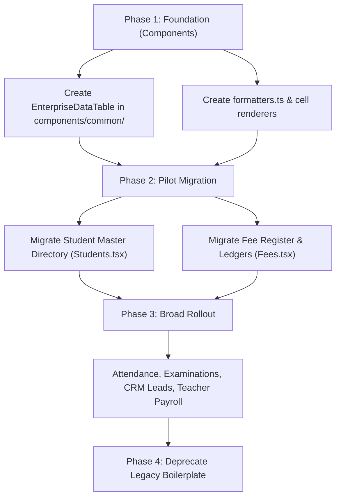

# Enterprise DataTables & Field Architecture Forensic Audit & Engineering Recommendation

**Product:** PrathamOne EduOS (Coaching Institute Edition)  
**Baseline Version:** 1.0.0  
**Architect:** Jawahar R Mallah  
**Organization:** Smritisys & AITDL Networks  
**Date:** 2026-11-23  
**Status:** Approved Architectural Directive  

---

## 1. EXECUTIVE SUMMARY & RESEARCH OBJECTIVE

A comprehensive, deep forensic audit was conducted across all user-facing interfaces, form components, data tables, and input fields in **PrathamOne EduOS**. The objective was to evaluate compliance with core governance rules:
- **SSOT Architecture (Rule 001 - Rule 008)**: Elimination of duplicated UI logic, table structures, and calculation paths.
- **View-First & Explicit Edit Mode (Rule 010)**: Strict enforcement of view-mode defaults and gated row mutations.
- **Sleek UI/UX Design System (Rule 014)**: Linear/Stripe-grade aesthetics, maximum 120px combined header height, 44px telemetry ribbons, 6px ultra-thin scrollbars, soft pastel tints, monospace numeric/timing chips, and minimal `—` empty state markers.
- **DPDP Act 2023 & Indian Institutional Normalization**: Aadhaar masking, INR (`₹`) currency notation, IST 12-hour/24-hour time boundaries (`06:00` to `22:00`), and standardized `DD MMM YYYY` date formatting.

---

## 2. CODEBASE INVENTORY & CURRENT STATE FORENSICS

### 2.1 Table Footprint Across Modules
The codebase currently contains **45+ tabular screens** representing hundreds of database entities:
| Module Workspace | File Path | Table Occurrences | Current Implementation Pattern |
| :--- | :--- | :--- | :--- |
| **Fees & Collections** | `frontend/src/pages/Fees.tsx` | 55 occurrences | Ad-hoc `<table>` + `useTableSort` + partial `ExcelReportGrid` |
| **Student Master** | `frontend/src/pages/Students.tsx` | 19 occurrences | Ad-hoc `<table>` + `useTableSort` + `SortableHeader` |
| **Examinations** | `frontend/src/pages/Examinations.tsx` | 19 occurrences | Custom HTML table with custom status tags |
| **Teacher Payroll** | `frontend/src/pages/TeacherPayroll.tsx` | 16 occurrences | Custom financial ledger table |
| **Teacher Management** | `frontend/src/pages/TeacherManagement.tsx` | 15 occurrences | Custom staff roster table |
| **Payments Ledger** | `frontend/src/pages/Payments.tsx` | 14 occurrences | Transaction ledger table |
| **CRM & Leads** | `frontend/src/pages/LeadManagement.tsx` | 13 occurrences | Pipeline status table |
| **Courses & Batches** | `frontend/src/pages/Courses.tsx` | 12 occurrences | Course catalog table |
| **Academic Workspace**| `frontend/src/pages/AcademicWorkspace.tsx`| 10 occurrences | Mixed HTML table & `ExcelReportGrid` |
| **Attendance Register**| `frontend/src/pages/Attendance.tsx` | 9 occurrences | Roster grid with custom status dropdowns |
| **Reports Centre** | `frontend/src/pages/Reports.tsx` | 28 occurrences | Canonical `ExcelReportGrid` with export engine |

### 2.2 Existing Table Primitives Analysis
1. **`useTableSort.ts`**: Universal hook supporting dot-notation paths, tri-state sorting (`asc` -> `desc` -> `null`), custom extractors, and ISO date regex. Excellent foundational logic.
2. **`SortableHeader.tsx`**: Accessible `<th>` component with keyboard navigation (`Enter`/`Space`), ARIA sorting attributes, and Lucide icons.
3. **`TableSortSelect.tsx`**: Compact dropdown selector for sort key and direction, used primarily on mobile viewports.
4. **`Pagination.tsx`**: Standard pagination bar with jump ellipsis (`...`) and count display, but lacking a responsive page size selector (`10`, `25`, `50`, `100`, `All`).
5. **`ExcelReportGrid.tsx`**: High-grade spreadsheet grid with column reordering, resizing, show/hide popover, global search, column filters, summary rows, and multi-format exports (Excel `.xlsx` via `write-excel-file`, CSV with UTF-8 BOM and formula injection protection, JSON).

---

## 3. IDENTIFIED GAPS & FORENSIC FINDINGS

### 3.1 Gap 1: Absence of a Canonical EnterpriseDataTable (SSOT Violation)
While `ExcelReportGrid.tsx` has enterprise features, it is confined to `Reports.tsx`. The remaining 40+ operational pages (`Students.tsx`, `Fees.tsx`, `Attendance.tsx`, etc.) implement raw HTML `<table>` blocks with manual pagination, manual empty states, manual loading spinners, and duplicated search bars. This violates **SSOT Rule 001** and **Rule 008 (Shared Frontend Components)**.

### 3.2 Gap 2: Inconsistent Column Customization & Freezing
- Operational tables lack column visibility toggles (users cannot hide non-essential columns like "City" or "Gender" to focus on "Admission No.", "Phone", and "Fee Status").
- On small or medium screens, horizontal scrolling scrolls away the primary identifier (Student Name / Admission No.) and the Actions column. Neither is pinned with `sticky left-0` or `sticky right-0`.

### 3.3 Gap 3: Missing Instant Table Exports in Operational Views
Staff viewing the Student Master or Attendance Register cannot immediately export the current table view to Excel or CSV without navigating away to the Reports module. Instant 1-click export should be a standard capability on all operational tables.

### 3.4 Gap 4: Form Field Fragmentation & Formatting Discrepancies
- **Currency (`₹`)**: In `Fees.tsx`, currency is formatted via `Intl.NumberFormat('en-IN')`, but elsewhere raw numbers or simple string prepends (`₹ {val}`) are used without Indian digit grouping (`1,50,000`).
- **Dates**: Three conflicting formats appear across screens: raw ISO `2026-11-23`, British `23 Nov 2026`, and US `11/23/2026`. The canonical standard must strictly be `DD MMM YYYY` (e.g. `23 Nov 2026`).
- **Empty State Markers**: Rule 014 mandates the minimalist `—` (em dash). Some tables still render `-`, `N/A`, `None`, or blank strings.
- **Monospace Encodings**: Identifiers (Admission No, Invoice Ref, Cheque No, IFSC, URN, Roll No) are inconsistently styled; some use `font-mono` while others use default sans-serif font.
- **DPDP Act 2023 Masking**: Aadhaar numbers in table listings are occasionally displayed in plaintext or partial masks instead of standard `XXXX-XXXX-1234`.

### 3.5 Gap 5: Rule 010 (View-First Governance) in Tabular Actions
Action columns show buttons (Edit, Delete, Withdraw, Concession). While some check `isEditMode`, there is no standardized visual affordance (such as a locked padlock icon `🔒` or tooltip) explaining to the user that Edit Mode must be activated to unlock actions. Furthermore, inline row editing is completely absent, forcing users into full modals for trivial updates (e.g. modifying roll number or section).

---

## 4. ARCHITECTURAL RECOMMENDATIONS

### 4.1 Architecture Component 1: `EnterpriseDataTable<T>` (Canonical SSOT)
Create a unified, production-grade `EnterpriseDataTable<T>` in `frontend/src/components/common/EnterpriseDataTable/` that combines the sorting intelligence of `useTableSort`, the accessibility of `SortableHeader`, and the spreadsheet powers of `ExcelReportGrid`:

```
frontend/src/components/common/EnterpriseDataTable/
├── EnterpriseDataTable.tsx       # Core orchestrator component
├── TableToolbar.tsx              # Search (debounced 250ms), Column Toggle, Page Size, Export Menu
├── TableHeader.tsx               # Sortable headers, column resize grips, sticky pinning
├── TableBody.tsx                 # Virtualized/paginated rows, hover states, inline edit triggers
├── TableFooter.tsx               # Monospace record metrics, page navigation, summary totals
├── TableExportMenu.tsx           # 1-click XLSX, CSV (UTF-8 BOM), PDF, Print triggers
├── types.ts                      # ColumnDef<T>, TableProps<T>, FilterConfig
└── index.ts                      # Clean barrel export
```

#### Key Capabilities:
1. **Sticky Header & Frozen Columns**: Pinned ID column on the left (`sticky left-0 shadow-xs`) and Pinned Action column on the right (`sticky right-0 shadow-xs`).
2. **Rule 014 Ultra-Thin Scrollbars**: Built-in `scrollbar-thin scrollbar-thumb-slate-300 hover:scrollbar-thumb-slate-400`.
3. **Column Visibility & Width Persistence**: User column preferences saved in `localStorage` keyed by `tableId`.
4. **Instant Multi-Format Export**: Built-in 1-click export to Excel (`.xlsx`), CSV (with UTF-8 BOM and formula sanitization), and Print.
5. **Rule 010 View-First Protection**: Action columns automatically render locked states when the scoped Edit Mode is inactive.
6. **Multi-Row Bulk Operations**: Optional selectable checkbox column (`enableRowSelection`) providing a floating batch action dock (e.g., Bulk Print Receipts, Bulk Send SMS, Bulk Allocate Batch).

### 4.2 Architecture Component 2: Unified Field Formatter Primitives
Establish a canonical set of field formatters and cell renderers:
```typescript
// frontend/src/utils/formatters.ts

/** Canonical Indian Currency Formatter */
export const formatINR = (val: number | string | null | undefined): string => {
  if (val === null || val === undefined || isNaN(Number(val))) return '₹0'
  return new Intl.NumberFormat('en-IN', {
    style: 'currency',
    currency: 'INR',
    maximumFractionDigits: 0,
  }).format(Number(val))
}

/** Canonical Indian Institutional Date Formatter (DD MMM YYYY) */
export const formatDateIST = (val: string | Date | null | undefined): string => {
  if (!val) return '—'
  const d = new Date(val)
  if (isNaN(d.getTime())) return '—'
  return d.toLocaleDateString('en-GB', { day: '2-digit', month: 'short', year: 'numeric' })
}

/** DPDP Act 2023 Masked Aadhaar Formatter */
export const formatMaskedAadhaar = (val: string | null | undefined): string => {
  if (!val) return '—'
  const clean = val.replace(/\D/g, '')
  if (clean.length !== 12) return val
  return `XXXX-XXXX-${clean.slice(8)}`
}

/** Monospace Identifier Chip Renderer */
export const renderMonoIdentifier = (val: string | null | undefined) => (
  <span className="font-mono text-primary-700 font-semibold tracking-tight">
    {val || '—'}
  </span>
)
```

### 4.3 Architecture Component 3: Standardized Form Fields (`FormFieldEngine`)
Standardize input controls across modals and settings panels:
1. **`FormInput`**: Text, email, phone with +91 prefix and validation.
2. **`CurrencyInput`**: Automatically inserts Indian commas as user types, stores clean integer/decimal.
3. **`DateInput`**: Native picker with IST validation and minimum/maximum institutional operational bounds.
4. **`SelectInput` / `CascadingSelect`**: Searchable dropdowns with keyboard arrow support.

---

## 5. IMPLEMENTATION ROADMAP & ROLLOUT STRATEGY



### Step-by-Step Rollout:
1. **Phase 1: Foundation**:
   - Construct `EnterpriseDataTable` and `formatters.ts` in `frontend/src/`.
   - Add unit tests verifying sorting, column toggling, pagination, and CSV sanitization.
2. **Phase 2: Pilot Migration**:
   - Refactor `Students.tsx` (Directory Tab) to utilize `EnterpriseDataTable`.
   - Validate performance, sticky columns, mobile responsiveness, and export fidelity.
3. **Phase 3: Module Migration**:
   - Roll out to `Fees.tsx` (Invoices & Installments), `Attendance.tsx`, and `Examinations.tsx`.
4. **Phase 4: Cleanup & Documentation**:
   - Deprecate ad-hoc `<table>` implementations.
   - Run release hygiene checks (`check_release_hygiene.py`) and header checks (`manage_headers.py`).

---

## 6. VERIFICATION & GOVERNANCE COMPLIANCE MATRIX

| Governance Directive | Compliance Mechanism in Proposed Standard | Verification Method |
| :--- | :--- | :--- |
| **Rule 001 — SSOT** | One universal `EnterpriseDataTable` used across all 40+ pages | Code grep confirms 0 redundant raw table wrappers |
| **Rule 010 — View-First** | Action column locks automatically when `isEditMode === false` | Unit test & manual UI lock verification |
| **Rule 014 — Sleek UI/UX** | 6px scrollbars, ≤120px header stack, soft pastel badges, `—` empty state | Visual screenshot audit at 1920x1080 |
| **DPDP Act 2023** | Auto-masking Aadhaar numbers to `XXXX-XXXX-1234` | Formatter unit test |
| **Security & Hygiene** | CSV formula injection mitigation (`sanitizeCsvValue`), UTF-8 BOM | Automated export test suite |

---

*Authored by Jawahar R Mallah, Product Architect, Smritisys & AITDL Networks.*  
*PrathamOne EduOS — Coaching Institute Edition.*
