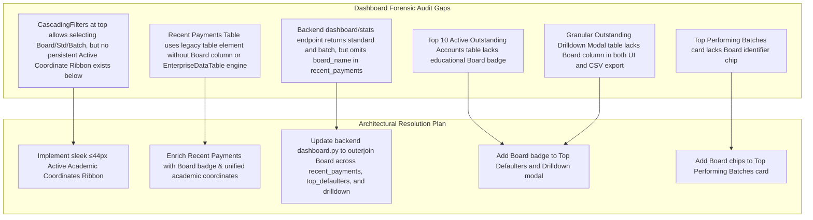
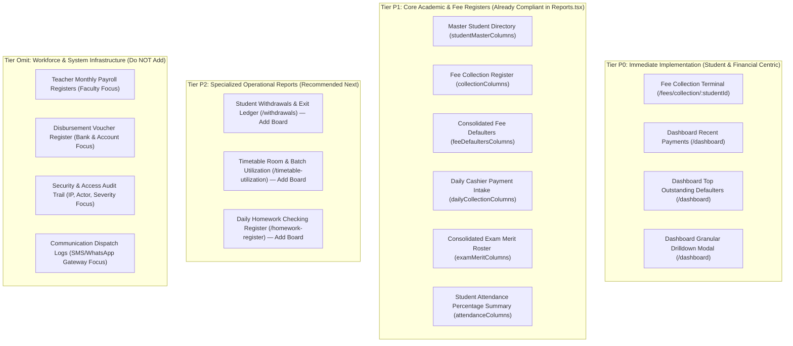

# Global Academic Coordinates Architecture: Dashboard Integration & Cross-Report Audit

**Product:** PrathamOne EduOS  
**Edition:** Coaching Institute Edition  
**Baseline Version:** 1.0.0  
**Product Architect:** Jawahar R Mallah  
**Organization:** Smritisys & AITDL Networks  
**Policy Status:** MANDATORY ARCHITECTURAL DIRECTIVE  

---

## 1. Executive Summary & Objective

In a coaching institute operating system, the **Academic Trinity**—composed of **Educational Board** (e.g. CBSE, ICSE, Maharashtra State Board), **Standard / Grade** (e.g. Class IX, Class X, 12th Science), and **Batch / Division** (e.g. Morning Batch A, Target 2027)—forms the fundamental coordinate system for every student record, fee receipt, attendance marker, and examination assessment.

Following the successful rollout of the **Global PrathamOne Enterprise DataTable Standard** and the resolution of column filtering across the Master Student Directory, this document establishes the authoritative standard for embedding academic coordinates into the **Executive Management Dashboard** and across all operational and analytical reports throughout PrathamOne EduOS.

---

## 2. Dashboard Forensic Audit & Gap Analysis

A comprehensive forensic audit of `frontend/src/pages/Dashboard.tsx` and `backend/app/api/v1/endpoints/dashboard.py` revealed the following specific gaps:

### Detailed Evaluation of Dashboard Components

| Dashboard Component | Current Coordinates | Missing Coordinates | Proposed Resolution & UX Pattern |
| :--- | :--- | :--- | :--- |
| **Top Cascading Filter Bar** | Academic Year, Board, Standard, Batch | Active Scope Feedback | Render a sleek, single-surface **Active Academic Coordinates Ribbon** (≤44px) below the filters summarizing the exact academic slice (e.g. `[Board: CBSE] · [Grade: Class X] · [Batch: Morning A] · [Status: Active]`) with 1-click reset. |
| **Recent Fee Payments Table** | Standard, Batch | **Board** | Update backend query to outerjoin `Board`, select `board_name`, and render a pastel Board badge (`CBSE`, `ICSE`, `HSC`) in the academic cell. |
| **Top 10 Outstanding Defaulters** | Standard, Batch | **Board** | Append educational Board badge next to Standard/Batch so recovery staff immediately know which syllabus syllabus/board curriculum the defaulter belongs to. |
| **Granular Outstanding Drilldown Modal** | Standard (`class_name`), Batch (`batch_name`) | **Board** | Add `Board` column to table and CSV export payload (`board_name`). |
| **Top Performing Batches Card** | Standard, Batch | **Board** | Display Board badge alongside batch utilization metrics. |

---

## 3. Global Cross-Report Audit & Recommendations

An application-wide audit across all 27+ reports and registers was conducted to classify where academic coordinates must be embedded, where they already exist, and where they should be omitted:

### Complete Cross-Report Inventory

| Report / Workspace | Standard / Grade | Batch / Division | Board | Status |
| :--- | :---: | :---: | :---: | :--- |
| **Master Student Directory** (`/students/directory`) | ✅ | ✅ | ✅ | Implemented & Verified |
| **Student Attendance Summary** (`/reports?id=student-attendance`) | ✅ | ✅ | ✅ | Implemented |
| **Daily Attendance Rollcall** (`/attendance`) | Scoped | Scoped | Scoped | Pre-filtered by selected batch |
| **Student Withdrawals & Exit Ledger** (`/reports?id=withdrawals`) | ✅ | ✅ | ⚠️ Recommended | Add Board column to exit snapshot |
| **Fee Collection Register** (`/reports?id=collection`) | ✅ | ✅ | ✅ | Implemented |
| **Outstanding Dues & Overdue Aging** (`/reports?id=outstanding`) | ✅ | ✅ | ✅ | Implemented |
| **Consolidated Fee Defaulters** (`/reports?id=fee-defaulters`) | ✅ | ✅ | ✅ | Implemented |
| **Daily Cashier Intake** (`/reports?id=daily-collection`) | ✅ | ✅ | ✅ | Implemented |
| **Student Fee Collection Terminal** (`/fees/collection/:id`) | ⚠️ Add | ⚠️ Add | ⚠️ Add | Add Student Academic Card |
| **Dashboard Recent Payments** (`/dashboard`) | ✅ | ✅ | ⚠️ Add | Add Board from backend |
| **Dashboard Outstanding Drilldown** (`/dashboard`) | ✅ | ✅ | ⚠️ Add | Add Board in UI & CSV |
| **Consolidated Exam Merit Roster** (`/reports?id=exam-merit`) | ✅ | ✅ | ✅ | Implemented |
| **Batch Capacity & Occupancy** (`/reports?id=batch-capacity`) | ✅ | ✅ | ✅ | Implemented |
| **Universal Student 360° Matrix** (`/reports?id=flexible-student-matrix`) | ✅ | ✅ | ✅ | Implemented |
| **Faculty Payroll & Tax Vouchers** (`/reports?category=workforce`) | ❌ N/A | ❌ N/A | ❌ N/A | Excluded by SSOT design |
| **Security Audit & Access Logs** (`/reports?id=audit-logs`) | ❌ N/A | ❌ N/A | ❌ N/A | Excluded by SSOT design |

---

## 4. UI/UX Sleek Implementation Standards (Rule 014 Compliance)

To satisfy **Rule 014 (Sleek UI/UX & Anti-Vertical-Bloat Governance)**:
1. **Vertical Efficiency**: The Active Academic Coordinates Ribbon must be rendered as a single-surface ribbon with maximum height of 44px (`py-2 px-3 sm:px-4`).
2. **Compact 2-Line & Pill Styling**:
   - Board: Soft pastel badge (`bg-indigo-50 text-indigo-700 border border-indigo-200/80 rounded-md px-1.5 py-0.5 text-[10px] font-bold`).
   - Standard: Monospace or bold slate chip (`text-slate-800 font-semibold text-xs`).
   - Batch: Subtle muted subtitle (`text-[10px] text-slate-500 font-medium`).
3. **Empty State Marker**: When a student is unassigned to a batch, render the minimalist `—` marker instead of verbose text.

---

## 5. Architectural Approval & Sign-Off

- **Architect:** Jawahar R Mallah
- **Organization:** Smritisys & AITDL Networks
- **Target Release:** PrathamOne EduOS 1.0.0
- **Status:** Approved for Direct Implementation
