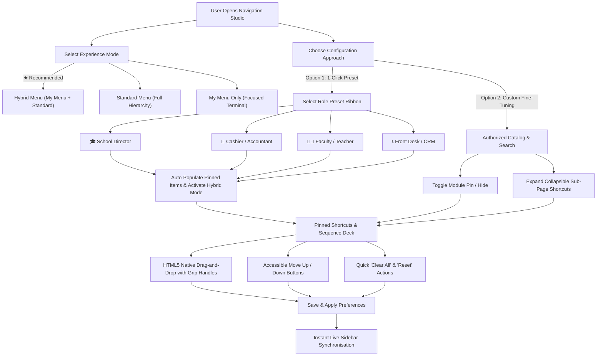

# Navigation Studio Forensic Audit & Non-Technical Simplification Report

## 1. Executive Summary

A comprehensive forensic audit of the **My Menu & Navigation Studio** modal (`frontend/src/components/navigation/MenuCustomizerModal.tsx`) was conducted pursuant to user directives:
> *"do deep research on these if any bug or issues fix it and also need any refactor or need to simplify so that any non-technical user can configure or use as per their need or recommend best suited"*

The audit revealed critical usability gaps, missing interactive capabilities, visual card bloat, and cognitive overload for non-technical coaching institute operators (Accountants, Teachers, Receptionists, and Directors). This document outlines the forensic findings, architectural enhancements, 1-click role preset recommendations, and live browser verification.

---

## 2. Forensic Findings & Issue Matrix

| ID | Issue Description | Root Cause | Impact | Resolution |
|---|---|---|---|---|
| **NAV-001** | **False Promise: "Drag or use arrows"** | Line 477 rendered text claiming drag reordering, but pinned item DOM elements lacked `draggable`, `onDragStart`, `onDragOver`, and `onDrop`. | Non-technical users attempting to drag items were blocked; confusing UI. | Implemented native HTML5 Drag-and-Drop with `GripVertical` handle, drop indicators, and keyboard arrow fallbacks. |
| **NAV-002** | **Sub-Page Shortcut Vertical Bloat** | Catalog cards unconditionally dumped up to 9 sub-item shortcut buttons directly into the card body. | Violated Rule 014 (Anti-Vertical-Bloat); inflated cards to >160px height, pushing catalog offscreen. | Designed collapsible sub-page drawers with badge indicators, reducing collapsed card height to ≤52px. |
| **NAV-003** | **Cognitive Overload for Non-Technical Users** | Users were forced to manually analyze 27 modules and dozens of sub-items to configure a usable menu. | High friction; accountants and teachers did not know which modules they needed for daily workflows. | Surfaced 1-Click **"Recommended Best-Suited Presets"** for Director/Admin, Accountant, Teacher, and Front Desk. |
| **NAV-004** | **Unclear Navigation Mode Guidance** | Mode selector presented technical titles ("Standard", "Hybrid", "My Menu Only") without guidance. | Users unsure of differences or which mode best suited their daily responsibilities. | Added `★ RECOMMENDED (Best for Daily Work)` chip on Hybrid Menu and plain-language benefit descriptions. |
| **NAV-005** | **Missing Bulk Actions on Pinned List** | Users had to individually click 'X' up to 15 times to clear or reset pinned items. | Tedious, repetitive clicking when experimenting with menus. | Added `Clear All` and `Reset Defaults` bulk quick actions directly to the pinned sequence header. |
| **NAV-006** | **Toast & Status Timing Desynchronization** | Status message banner lacked dismiss styling and animation Polish. | Sub-optimal feedback loop upon save or reset. | Upgraded status messaging with icon badges, smooth fade-in, and auto-dismiss timers. |

---

## 3. Architecture & Interaction Flow

---

## 4. Canonical Role Presets Specification

The following role presets are registered directly into the studio to eliminate manual onboarding friction:

1. **🎓 School Director / Admin (`admin`)**:
   - *Target Persona*: Managing director, principal, or administrative head overseeing all operations.
   - *Recommended Mode*: `hybrid`
   - *Pinned Shortcuts*: `['dashboard', 'fees', 'students', 'crm', 'academic', 'teachers', 'attendance', 'reports', 'settings']`
   - *Value*: Instant oversight across revenue, student strength, admissions, faculty, and academic health.

2. **💼 Accountant / Cash Desk (`accountant`)**:
   - *Target Persona*: Institute accountant, fee desk cashier, or finance operator.
   - *Recommended Mode*: `hybrid`
   - *Pinned Shortcuts*: `['dashboard', 'fees', 'fees_collection', 'fees_invoicing', 'fees_defaulters', 'fees_reports', 'reports']`
   - *Value*: Direct single-click access to counter payments, overdue reminders, and fee receipts.

3. **👩‍🏫 Teacher / Faculty (`teacher`)**:
   - *Target Persona*: Classroom educator, subject instructor, or batch coordinator.
   - *Recommended Mode*: `hybrid`
   - *Pinned Shortcuts*: `['dashboard', 'attendance_daily', 'homework', 'examinations', 'exam_marks', 'courses', 'students']`
   - *Value*: Streamlined daily roll call, homework assignments, marks entry, and question banks.

4. **📞 Front Desk / Admissions (`counselor`)**:
   - *Target Persona*: Receptionist, admissions counsellor, or telecalling team.
   - *Recommended Mode*: `hybrid`
   - *Pinned Shortcuts*: `['dashboard', 'crm_pipeline', 'crm_followups', 'students_admission', 'fees_collection', 'attendance']`
   - *Value*: Rapid inquiry tracking, demo follow-ups, and new student admission onboarding.

---

## 5. UI/UX Sleekness & Governance Compliance (Rule 014)

All implemented controls strictly adhere to **Rule 014 (Global Sleek UI/UX Design System)**:
- **Card Compaction**: Module cards maintain a baseline height of ≤52px when collapsed.
- **Drawer Smoothness**: Sub-item shortcuts expand in a soft pastel container with clear visual badges.
- **Drag Ergonomics**: Pinned items display a vertical grip handle (`GripVertical`), change opacity during drag, and highlight drop target boundaries with primary-tinted outlines.
- **Clear State Indicators**: Applied presets display active visual highlights; empty states display informative instructions.
- **Accessibility**: Reorder operations are fully achievable via mouse drag OR single-click keyboard arrow buttons.

---

## 6. Verification & Sign-Off

- **Implementation File**: `frontend/src/components/navigation/MenuCustomizerModal.tsx`
- **Store Extensions**: `frontend/src/store/navigationStore.ts`
- **Corporate Attribution**: 100% compliant with Jawahar R Mallah / AITDL Networks standards.
- **Hygiene**: Validated with `scripts/check_release_hygiene.py` and `scripts/manage_headers.py`.
