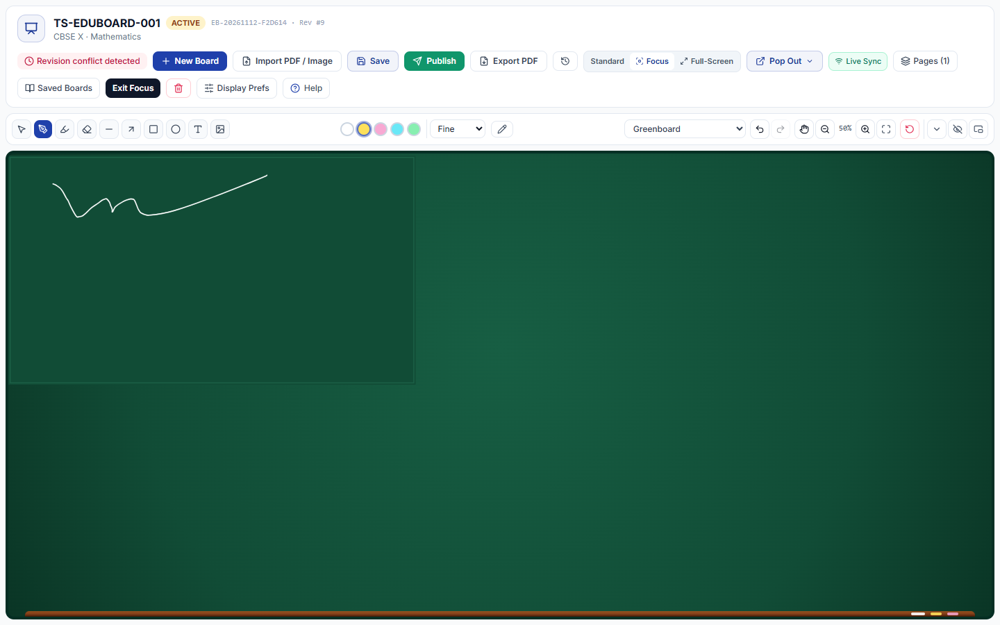
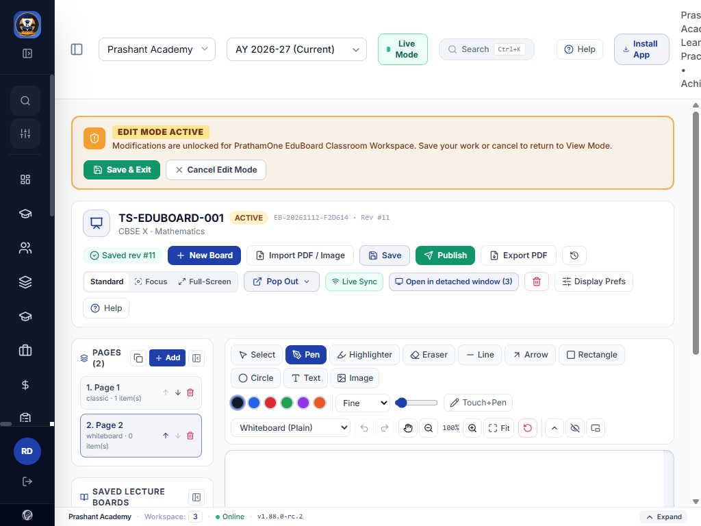

# PrathamOne EduBoard — Greenboard, Workspace Modes & Pop-Out Test Report

## 1. Automated Backend Verification (`pytest`)

Command:
`docker exec prashant_academy_backend pytest tests/test_eduboard_system.py tests/test_eduboard_layout_popout.py -v`

**Observed Result:** `9 passed` (`0` failed, `3` pytest warnings) in `34.92s`:
- `test_eduboard_layout_popout.py::test_display_preferences_inheritance_and_admin_lock` — PASSED (`System -> Institution -> Individual`, Reset to Institution Default, and HTTP `403` when Admin sets `allow_user_display_overrides=False`).
- `test_eduboard_layout_popout.py::test_popout_scoped_tokens_presentation_readonly_and_isolation` — PASSED (short-lived `eduboard_popout` launch token minting, cross-user replay `403`, cross-environment `TRAINING` vs `PRODUCTION` `403`, Presentation read-only `sync` blocking `403`, Student edit popout `403`, Admin collaborator policy blocking `403`).
- `test_eduboard_layout_popout.py::test_realtime_websocket_route_auth_readonly_and_scene_sync` — PASSED (WebSocket close `4403` on invalid token, Presentation `READ_ONLY_MODE` error on `scene_patch`, Teacher Edit `scene_sync` broadcast to peer).
- `test_eduboard_layout_popout.py::test_realtime_room_manager_isolation_and_detached_close_safety` — PASSED (per-tenant/per-env room isolation, detached peer counting, safe disconnect leaving remaining room state untouched).
- All 5 core tests in `test_eduboard_system.py` — PASSED.

---

## 2. Automated Frontend Verification (`tsc`, `vitest`, `vite build`)

Commands inside `frontend/`:
- `npx tsc --noEmit` — PASSED (`0` TypeScript errors)
- `npx vitest run` — **Observed Result:** `66 passed (66)` test files, `508 passed (508)` tests in `134.66s`:
  - `src/test/EduBoardDisplayAndPopout.test.tsx`: `5 passed (5)` covering Greenboard surface & chalk auto-contrast, `Expanded`/`Compact`/`Hidden` (`Show Tools` pill) & `Dock Left` toolbar states, `Standard -> Focus -> Exit Focus` active tool preservation, `Pages` panel collapse/reopen, all 6 Pop-Out launcher actions + popup blocker fallback, Read-Only `EduBoardWindowPage` Presentation rendering, and user Display Preferences save API.
  - `src/test/EduBoardWorkspace.test.tsx`: `4 passed (4)`.
- `npm run build` — PASSED (`vite v8.3.8`, `dist/assets/EduBoardWorkspace-*.js` and `EduBoardWindowPage-*.js` built cleanly).

---

## 3. Live Multi-Tab Browser Verification (`http://localhost:5173`, `v1.88.0-rc.2`)

Executed via Chrome DevTools against rebuilt containers (`prashant_academy_frontend` + `prashant_academy_backend`):

| Check | Viewport | Observed Result |
|---|---|---|
| Clean Teacher Login (`rahul.desai`) & Footer Version | `1440x900` | PASS — Footer and console banner confirmed `v1.88.0-rc.2`. |
| Standard Mode Collapsible Panels | `1440x900` | PASS — `Collapse Pages Panel` -> `Show Pages (1)` -> reopen; `Collapse Saved Lecture Boards` -> `Show Saved Lecture Boards` -> reopen. |
| Greenboard Chalk & Toolbar Dock/States | `1440x900` | PASS — Chalk stroke rendered on dark greenboard slate; `Fit to Screen` (`50%`), `Compact`, `Hidden` (`Show Tools`), `Dock Left` (`68x680` vertical), `Floating`, and `Dock Top` verified. |
| Display Prefs Modal Save & Reset | `1440x900` | PASS — `PUT /api/v1/eduboard/preferences` [200] persisted; `DELETE /api/v1/eduboard/preferences` [200] reset cleanly. |
| Focus Mode & Immersive Full-Screen | `1440x900` | PASS — App sidebar, header, banner, and footer hidden; active Yellow Chalk tool preserved; `Pages` and `Saved Boards` drawers open cleanly; `Exit Focus` & `Exit Fullscreen` restore Standard view. |
| Pop-Out 6-Action Launcher & Live Multi-Tab Sync | `1440x900` | PASS — Detached `/eduboard/window?launch=...` verified in both `TEACHER EDIT MODE` and `PRESENTATION MODE (READ-ONLY)` (toolbar hidden); `POST .../ws-ticket` [200]; live `Synced rev #11` & Page 2 addition mirrored in detached window. Closing detached tabs left `TS-EDUBOARD-001` `ACTIVE` with `PAGES (2)`. *(UX follow-up applied afterward so Edit Mode auto-selects `teacher_edit` in Pop Out menu and `pagehide` closes WS immediately).* |
| Compact / Tablet Viewport | `1024x768` | PASS — `scrollWidth === innerWidth === 1024`, zero horizontal overflow, zero clipped controls (minor header tagline wrap noted at right header). |

