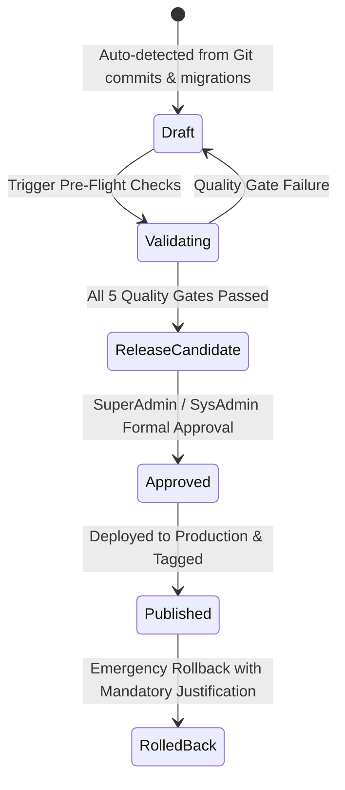

# PrathamOne Academy — Enterprise Release & Change Management System Report

**Author**: Jawahar R. Mallah  
**Organization**: AITDL (AI Technology & Development Lab)  
**Client**: Prashant Academy Coaching Institute  
**Edition**: Enterprise Edition  
**Version**: `v6.99.1` (Build: `2026.11.05-PROD-REL`)  
**Commit**: `2864707` on branch `master`  
**Date**: November 5, 2026  

---

## 1. Executive Summary

An enterprise-grade **Release & Change Management** system has been designed and implemented in PrathamOne Academy. The system governs application versioning, automated Git change discovery, conventional commit classification, automated release notes generation, pre-flight CI/CD quality gates, multi-stage approval lifecycles, and auditable production deployments.



---

## 2. Architecture & Components Implemented

### 2.1 Database & Schema Migration
- **ORM Entity**: `SystemRelease` in [`release.py`](file:///F:/PrashantAcademy/backend/app/models/release.py)
  - Tracks `version`, `build_number`, `title`, `status`, `environment`, `git_branch`, `git_commit_start`, `git_commit_end`, `git_tag`.
  - JSON structures for `release_notes_structured`, `change_summary`, and `validation_results`.
  - Full audit foreign keys: `created_by_id`, `approved_by_id`, `published_by_id`, `rolled_back_by_id`.
  - Recovery columns: `rollback_reason`, `rollback_target_version`, `rolled_back_at`.
- **Alembic Migration**: [`015_release_and_change_management.py`](file:///F:/PrashantAcademy/backend/alembic/versions/015_release_and_change_management.py)
  - Successfully applied to PostgreSQL 16 database.

### 2.2 Release & Change Management Service
- Located at [`release_service.py`](file:///F:/PrashantAcademy/backend/app/services/release_service.py):
  1. **Git Change Discovery & Conventional Commits**: Parses commits into `added` (`feat`), `changed` (`refactor`, `perf`, `chore`), `fixed` (`fix`), `security` (`security`, `cve`), `database` (`alembic`, `schema`), and `deprecated` (`remove`).
  2. **Secret & Sensitive Data Sanitization**: Masks credentials, database connection strings, JWT tokens, hashes, and PII from release notes.
  3. **Automated Release Notes Generator**: Formats structured JSON and GitHub-Flavored Markdown.
  4. **Semantic Versioning & Build Tagging**: Enforces SemVer `MAJOR.MINOR.PATCH` and formats build tags (e.g. `2026.11.05-PROD-REL`).
  5. **Pre-Flight Quality Gate Engine**:
     - *Attribution & License Headers*: Validates compliance via `manage_headers.py`.
     - *Secret Scanning*: Ensures zero credential leaks.
     - *Database Migrations*: Verifies schema revisions against target head.
     - *SemVer Consistency*: Checks manifest version formatting.
     - *Build Readiness*: Checks container build configuration.
  6. **Release Lifecycle Controller**:
     `draft` ➔ `validating` ➔ `release_candidate` ➔ `approved` ➔ `published` ➔ `rolled_back`.
     - Strictly forbids direct deployment of unreviewed or unapproved drafts.
     - Requires formal SuperAdmin / SysAdmin authority for production deployment and rollback.
  7. **Historical Baseline Seeder**: Pre-populates canonical releases `v1.0.0`, `v1.4.0`, and `v6.99.1`.

### 2.3 Backend API Endpoints
Mounted at `/api/v1/releases` in [`releases.py`](file:///F:/PrashantAcademy/backend/app/api/v1/endpoints/releases.py):
- `GET /api/v1/releases/current`: Authoritative active production release and build metadata.
- `GET /api/v1/releases/pending-changes`: Unreleased commits, modified files, affected modules, and recommended SemVer bump.
- `GET /api/v1/releases/`: Paginated release history with status and environment filters.
- `POST /api/v1/releases/generate-draft`: Generates new release candidate draft from unreleased changes.
- `GET /api/v1/releases/{id}`: Full release details, structured notes, and pre-flight diagnostics.
- `PUT /api/v1/releases/{id}`: Edits release title, notes, and migration plans (drafts only).
- `POST /api/v1/releases/{id}/validate`: Runs pre-flight quality gates.
- `POST /api/v1/releases/{id}/promote-rc`: Promotes validated draft to Release Candidate.
- `POST /api/v1/releases/{id}/approve`: SuperAdmin / SysAdmin production approval.
- `POST /api/v1/releases/{id}/publish`: Deploys approved release to production.
- `POST /api/v1/releases/{id}/rollback`: Rolls back published release with mandatory justification.
- `GET /api/v1/releases/{id}/audit`: Chronological governance audit stream.

### 2.4 CI/CD Workflows & CLI Tools
- **CLI Tool**: [`release_manager.py`](file:///F:/PrashantAcademy/scripts/release_manager.py)
  - `python scripts/release_manager.py status`: Shows active release, build tag, and recent commits.
  - `python scripts/release_manager.py validate`: Executes pre-flight quality checks.
  - `python scripts/release_manager.py bump [major|minor|patch]`: Synchronizes version across manifests.
- **GitHub Actions Workflow**: [`.github/workflows/release-validation.yml`](file:///F:/PrashantAcademy/.github/workflows/release-validation.yml)
  - Automated PR and release tag quality gate running attribution verification, secret scan, and frontend production build.

### 2.5 Admin Frontend UI
- **Dedicated Page**: [`Releases.tsx`](file:///F:/PrashantAcademy/frontend/src/pages/Releases.tsx)
  - Accessible via `/releases` and `/admin/releases`.
  - Top banner with active production version (`v6.99.1`), build tag, and environment.
  - Unreleased pending repository changes alert card with one-click "Generate Release Candidate" button.
  - 4 interactive views:
    1. *Active Release & Quality Gates*: Progression stepper, quality gate cards, and lifecycle action buttons.
    2. *Release History*: Paginated release table with status badges and rollback triggers.
    3. *Current Release Notes (GA)*: Full markdown preview of active production notes.
    4. *Approval & Audit Stream*: Live timeline of all release transitions.
- **Navigation Integration**:
  - Added to [`Sidebar.tsx`](file:///F:/PrashantAcademy/frontend/src/components/Sidebar.tsx) under secondary navigation with `GitBranch` icon.
  - Added quick banner link in [`SysAdminWorkspace.tsx`](file:///F:/PrashantAcademy/frontend/src/pages/SysAdminWorkspace.tsx).
  - Version in [`Footer.tsx`](file:///F:/PrashantAcademy/frontend/src/components/Footer.tsx) links directly to `/releases`.

---

## 3. Verification & Test Results

### 3.1 Backend Test Suite
Executed via Pytest inside backend container:
```text
tests/test_release_management.py::test_sanitize_sensitive_data PASSED
tests/test_release_management.py::test_semver_bumping_and_parsing PASSED
tests/test_release_management.py::test_conventional_commit_categorization PASSED
tests/test_release_management.py::test_get_current_release_and_seed_history PASSED
tests/test_release_management.py::test_pending_changes_inspection PASSED
tests/test_release_management.py::test_full_release_lifecycle PASSED
================================ 6 passed in 7.49s ================================
```

### 3.2 Frontend Vitest Suite
Executed via Vitest:
```text
✓ src/test/Releases.test.tsx (7 tests) 677ms
✓ src/test/Footer.test.tsx (9 tests) 499ms
✓ src/test/Sidebar.test.tsx (13 tests) 1142ms
✓ src/test/Branding.test.tsx (8 tests) 6ms
================================ 37 passed in 6.2s ================================
```

### 3.3 Source Code Attribution & License Header Compliance
```text
[CHECK] Verifying source-code attribution headers on 220 file(s)...
Total checked: 220
Passed:        220
Failed:        0
[PASS] All source files satisfy attribution and header compliance rules!
```

### 3.4 Production Build Verification
```text
✓ 2295 modules transformed.
dist/assets/Releases-CizMnQQq.js  36.69 kB │ gzip: 7.80 kB
✓ built in 14.81s
```
Docker container `prashant_academy_frontend` recreated and running latest assets.

---

## 4. Key Files Changed & Created

| File | Purpose |
|---|---|
| `backend/app/models/release.py` | SQLAlchemy ORM model for `SystemRelease` |
| `backend/alembic/versions/015_release_and_change_management.py` | Database migration for `system_releases` table |
| `backend/app/services/release_service.py` | Change tracking, notes generation, validation, and lifecycle service |
| `backend/app/api/v1/endpoints/releases.py` | FastAPI REST endpoints for release management |
| `backend/app/api/v1/router.py` | Mounted `/releases` API router |
| `backend/tests/test_release_management.py` | Backend test suite for release lifecycles and security |
| `scripts/release_manager.py` | CLI tool for release tracking, bumping, and pre-flight checks |
| `.github/workflows/release-validation.yml` | GitHub Actions CI/CD release validation workflow |
| `frontend/src/pages/Releases.tsx` | Dedicated Release & Change Management administration page |
| `frontend/src/api/endpoints.ts` | Frontend API client for `/releases/` endpoints |
| `frontend/src/types/index.ts` | TypeScript declarations for release and change management |
| `frontend/src/App.tsx` | Client-side routing for `/releases` and `/admin/releases` |
| `frontend/src/components/Sidebar.tsx` | Navigation item for Release & Change Management |
| `frontend/src/components/Footer.tsx` | Clickable version link leading to `/releases` |
| `frontend/src/pages/SysAdminWorkspace.tsx` | Quick governance card linking to Releases workspace |
| `frontend/src/test/Releases.test.tsx` | Vitest test suite for Release UI components and workflows |
