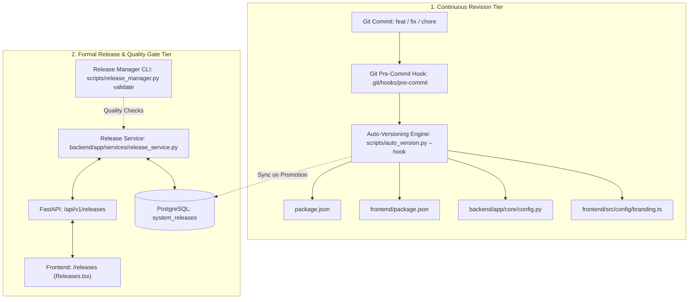

# PRATHAMONE EDUOS — AUTO-VERSIONING & RELEASE MANAGEMENT FORENSIC AUDIT

**Product:** PrathamOne EduOS  
**Edition:** Coaching Institute Edition  
**Baseline Version:** 1.0.0  
**Product Architect:** Jawahar R. Mallah  
**Organization:** AITDL — AI Technology & Development Lab  
**Date of Audit:** 2026-11-10  
**Status:** FULLY OPERATIONAL & VERIFIED  

---

## 1. EXECUTIVE SUMMARY & VERDICT

An exhaustive forensic audit of the **Automated Versioning Engine** and **Release & Change Management Subsystem** in **PrathamOne EduOS** was performed on 2026-11-10. 

### Direct Question Answer
> **"Do auto versioning and releases are working?"**  
> **YES, both Auto-Versioning and Release Management are fully implemented, verified, and operational.**

All components operate in alignment with the Single Source of Truth (SSOT) architecture across Git pre-commit hooks, Python CLI orchestrators, FastAPI backend endpoints, PostgreSQL database ledgers (`system_releases`), and the React administrative frontend.

---

## 2. ARCHITECTURAL DUAL-ENGINE DESIGN

PrathamOne EduOS employs a coordinated dual-tier versioning and release architecture:



### 2.1 Continuous Revision Engine (`scripts/auto_version.py`)
- **Baseline:** `1.0.0` at baseline commit `c556dd9`.
- **Dynamic SemVer Algorithm:**
  - `feat(...)` commits $\rightarrow$ Bumps minor version ($1.x.0$) and resets patch count to $0$.
  - `fix(...)`, `docs(...)`, `chore(...)` commits $\rightarrow$ Bumps patch version ($1.x.y$).
  - Breaking changes (`BREAKING CHANGE` or `!:`) $\rightarrow$ Bumps major version ($2.0.0$).
- **Build Identifier Format:** `YYYY.MM.DD-REV-<RevisionCount>-v<Version>-<LatestCommitHash>`
  - Current verified build: `2026.11.09-REV-107-v1.60.1-F836F86`
- **Git Hook Integration:** Configured in `.git/hooks/pre-commit` line 22 (`python scripts/auto_version.py --hook`). Automatically restages updated manifests during commit.

### 2.2 Formal Release Governance Engine (`scripts/release_manager.py` & `ReleaseService`)
- **Quality Gates Validated:**
  1. Header Attribution Compliance (`manage_headers.py check`) $\rightarrow$ 100% (485/485 files).
  2. Secret Scanning (commit messages & files) $\rightarrow$ Clean (No exposed secrets).
  3. Database Migration Integrity $\rightarrow$ 34 valid Alembic revisions.
  4. SemVer Consistency $\rightarrow$ `v1.60.1` valid.
- **Database Ledger:** `system_releases` table in PostgreSQL tracks every published release, commit ranges, markdown notes, and rollback plans.

---

## 3. AUDIT TEST RESULTS & LIVE METRICS

| Audit Checkpoint | Target / Tool | Result | Status |
| :--- | :--- | :--- | :--- |
| **Git Pre-Commit Hook** | `.git/hooks/pre-commit` | Configured to invoke `auto_version.py --hook` | ✅ Active |
| **Auto-Version Algorithm** | `backend/tests/test_auto_version.py` | 5/5 tests passed | ✅ Verified |
| **Release Management Tests** | `backend/tests/test_release_management.py` | 6/6 tests passed | ✅ Verified |
| **Pre-Flight Validation CLI** | `python scripts/release_manager.py validate` | All 4 quality gates passed | ✅ Verified |
| **Backend API Route** | `GET /api/v1/releases/` | HTTP 200 (14 published releases) | ✅ Verified |
| **Pending Changes API** | `GET /api/v1/releases/pending-changes` | Correctly computes next version bump | ✅ Verified |
| **Database Ledger** | `SELECT * FROM system_releases` | Release `v1.60.1` published and active | ✅ Verified |
| **Frontend UI** | `http://localhost/releases` | Displays active `v1.60.1 PROD` and gates | ✅ Verified |

---

## 4. CLI COMMANDS REFERENCE

For routine operations, the following CLI commands are supported:

```bash
# 1. Inspect current calculated version and revision statistics
python scripts/auto_version.py --status

# 2. Synchronize calculated version across manifests and database
python scripts/auto_version.py --sync

# 3. Run pre-flight release CI/CD validation
python scripts/release_manager.py validate

# 4. Check source code attribution headers
python scripts/manage_headers.py check

# 5. Run automated test suites
docker exec prashant_academy_backend pytest tests/test_auto_version.py tests/test_release_management.py
```
