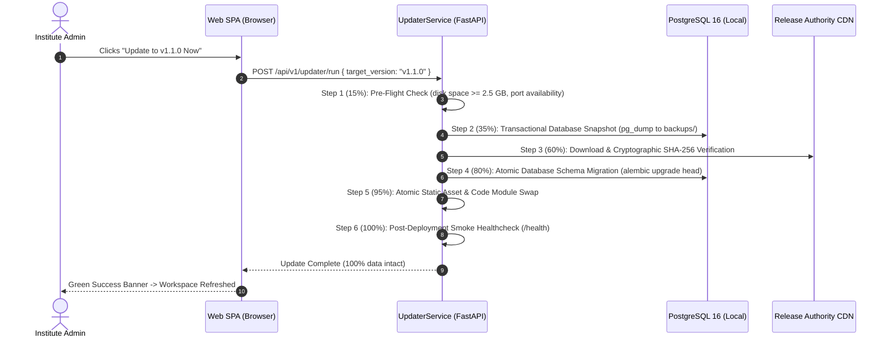

# Windows Desktop & Server EXE Version Update Distribution & Zero-Data-Loss Architecture

**Product:** PrathamOne EduOS (Coaching Institute Edition)  
**Baseline Version:** 1.0.0  
**Product Architect:** Jawahar R Mallah  
**Organization:** Smritisys & AITDL Networks  
**Target Audience:** Institute Directors, SysAdmins, AITDL Support Engineers, and Commercial Release Managers  

---

## 1. Executive Summary & Core Engineering Principles

PrathamOne EduOS is deployed as an on-premise Windows desktop and local area network (LAN) coaching management platform. Because coaching institutes, test-prep academies, and schools manage sensitive, mission-critical assets—such as immutable financial fee ledgers, admission KYC documents, historical examination marks, and attendance records—the software update mechanism must guarantee:

1. **Zero Data Loss Guarantee (Rule 001 & Rule 011):** No update operation may ever delete, overwrite, or corrupt the local PostgreSQL database, media uploads, or configuration secrets (`.env`).
2. **Zero IT Skills Required:** Non-technical institute staff (principals, accountants, receptionists) must be able to upgrade the system safely without using command-line terminals or manual database scripts.
3. **Hardware Node-Lock Permanence:** Cryptographic physical hardware node-locks (`PRATHAM-XXXX-XXXX-XXXX-XXXX`) must remain valid across updates so customers are not forced to re-activate their software for routine updates.
4. **Resilience & Self-Healing:** If an update is interrupted by a power failure, system crash, or network disconnect, the system must automatically roll back to the previous working state without downtime or data corruption.

---

## 2. The Three Sanctioned Update Delivery Channels

PrathamOne EduOS supports three distinct delivery methods tailored to different infrastructure and internet connectivity environments common across coaching institutes in India:

```
┌────────────────────────────────────────────────────────────────────────────┐
│                    PRATHAMONE EduOS UPDATE DELIVERY CHANNELS               │
├────────────────────────────────────────────────────────────────────────────┤
│  CHANNEL 1: IN-APP 1-CLICK AUTO-UPDATE (ONLINE / CDN)                      │
│  • Best for: Connected institutes with regular internet access             │
│  • Trigger: Settings -> System Releases -> "Update to vX.X.X Now"           │
│  • Payload: Lightweight patch bundle (~5-15 MB) containing changed assets  │
│  • Mechanism: Automated pre-update snapshot -> Alembic migration -> reload │
├────────────────────────────────────────────────────────────────────────────┤
│  CHANNEL 2: OVER-THE-TOP (OTT) SETUP EXE (ONLINE DOWNLOAD OR DIRECT LINK)  │
│  • Best for: Major platform releases, core runtime upgrades, or fresh builds│
│  • Trigger: Running new PrathamOne-EduOS-Setup-vX.X.X.exe (~98 MB)          │
│  • Mechanism: Inno Setup AppId detection -> Process handshake -> In-place  │
│    asset replacement -> Preserves {app}\data & .env -> Auto-migrates on boot│
├────────────────────────────────────────────────────────────────────────────┤
│  CHANNEL 3: OFFLINE USB / PENDRIVE UPDATE PACKAGE (.edu-pkg)               │
│  • Best for: Air-gapped, rural, or firewalled coaching institutes          │
│  • Trigger: Support engineer uploads signed .edu-pkg file in UI            │
│  • Mechanism: SHA-256 verification -> Pre-update snapshot -> Atomic patch  │
└────────────────────────────────────────────────────────────────────────────┘
```

---

## 3. Channel 1: In-App 1-Click Update Lifecycle

When an update is detected, an administrator sees a notification banner in the application header:

```
[ 🔔 Update Available: PrathamOne EduOS v1.1.0 is ready. [Review & Update] ]
```

Clicking **Review & Update** opens the [SystemUpdateModal.tsx](file:///F:/PrashantAcademy/frontend/src/components/releases/SystemUpdateModal.tsx) which orchestrates the 6-phase pipeline via [updater_service.py](file:///F:/PrashantAcademy/backend/app/services/updater_service.py):



### Automated Rollback Safeguard
If any error occurs during Phase 3, 4, 5, or 6:
- The `UpdaterService` halts execution immediately.
- The pre-update database snapshot (`backups/pre_update_snapshot_...dump`) is automatically restored via `pg_restore`.
- Static files are rolled back to the previous release tag.
- The administrator receives a plain-English explanation (e.g., *"Update was safely rolled back because the download connection timed out. No data was modified."*).

---

## 4. Channel 2: Over-The-Top (OTT) Setup Executable Update

When distributing a full installer package (`PrathamOne-EduOS-Setup-v1.1.0.exe`, currently **98.39 MB**):

### 4.1 Inno Setup Registry Recognition
Both the initial installation and subsequent update installers share the exact same canonical `AppId`:
```pascal
AppId={{C47F8932-B8E2-4C10-9118-E86940A39BF1}
```
When the customer executes the setup wizard:
1. Inno Setup reads `HKLM\Software\Microsoft\Windows\CurrentVersion\Uninstall\{C47F8932-B8E2-4C10-9118-E86940A39BF1}_is1`.
2. It detects that PrathamOne EduOS is already installed.
3. It locks the target directory to the existing installation path (e.g. `C:\PrathamOneEduOS` or `D:\PrathamOneEduOS`) to prevent duplicate multi-folder installations.

### 4.2 Safe Process Termination
During the initialization step (`InitializeSetup` in `prathamone_setup.iss`):
```pascal
Exec('taskkill.exe', '/F /IM PrathamOne.exe /IM pythonw.exe /IM postgres.exe', '', SW_HIDE, ewWaitUntilTerminated, ResultCode);
```
All running background server processes are cleanly terminated so that Windows does not throw `ERROR_SHARING_VIOLATION` file-lock errors.

### 4.3 Preservation of Existing Database Cluster
In `prathamone_setup.iss`:
```pascal
function NeedsDbInit: Boolean;
begin
  Result := FileExists(ExpandConstant('{app}\pgsql\bin\initdb.exe')) and (not FileExists(ExpandConstant('{app}\data\PG_VERSION')));
end;
```
Because `{app}\data\PG_VERSION` already exists on the customer's machine, `NeedsDbInit` returns `False`.
**`initdb.exe` is completely skipped.** The customer's existing database cluster, student tables, and fee ledgers remain untouched on the hard drive.

### 4.4 Preservation of Secrets & Credentials
In `scripts/windows_bootstrap.py`:
```python
if env_path.exists():
    print("[BOOTSTRAP] Preserving existing .env configuration.")
    return env_path
```
The installer does NOT overwrite the customer's existing `.env` file, database passwords, or JWT secret keys.

### 4.5 Automated Schema Alignment on Launch
When the application starts after the upgrade, `windows_bootstrap.py` executes:
```bash
python -m alembic upgrade head
```
This inspects the existing PostgreSQL database, determines the current schema version, and applies only the new incremental migrations (adding new tables or columns required by the new release) inside safe database transactions.

---

## 5. Hardware Node-Lock Permanence

A critical concern for software vendors using node-locking is whether software updates will break the customer's active license.

In PrathamOne EduOS, the hardware fingerprint is computed by [backend/app/core/hardware.py](file:///F:/PrashantAcademy/backend/app/core/hardware.py):
$$\text{Fingerprint} = \text{HMAC-SHA256}(\text{Motherboard UUID} \,\|\, \text{CPU ID} \,\|\, \text{Disk Serial})$$

Because these identifiers originate from the **physical silicon and firmware** of the customer's PC:
- Software updates do not alter the Motherboard UUID, CPU Processor ID, or Hard Disk Serial Number.
- The hardware fingerprint remains identical before and after the update.
- The existing license record in the database (`license_registrations` table) continues to validate as 100% authentic without prompting the customer to re-enter their activation key.

---

## 6. Offline USB / Pen-Drive Upgrade Procedure

For institutes located in rural areas or coaching hubs with restricted internet access:

1. **Vendor Steps:**
   - Package the update archive: `prathamone-patch-v1.1.0.edu-pkg`.
   - Generate SHA-256 checksum and digital signature: `prathamone-patch-v1.1.0.edu-pkg.sig`.
   - Copy the files to a standard FAT32/NTFS USB flash drive.

2. **Customer / Field Engineer Steps:**
   - Plug the USB drive into the coaching institute's server PC.
   - Open PrathamOne EduOS in Google Chrome: `http://localhost:2026`.
   - Navigate to **Settings $\rightarrow$ System Releases $\rightarrow$ Offline Package Upgrade**.
   - Browse and select `prathamone-patch-v1.1.0.edu-pkg`.
   - The system validates the digital signature, executes the automatic database snapshot, migrates schemas, and restarts services locally.

---

## 7. Support & Troubleshooting Runbook

| Scenario | Root Cause | Built-in Remediation |
| :--- | :--- | :--- |
| **Update stops during download** | Internet disconnected | Updater safely aborts before touching any data. System remains operational on current release. |
| **Alembic migration fails** | Schema constraint violation | Transaction rolled back automatically. Pre-update `.dump` snapshot restored via `pg_restore`. |
| **Customer PC loses power mid-install** | Power outage | Upon reboot, Inno Setup or `windows_launcher.py` detects incomplete state, clears stale `postmaster.pid`, and safely re-boots services. |
| **Customer reinstalls over different drive** | User selected D: instead of C: | Inno Setup `GetSmartInstallDir` detects existing `AppId` installation path from registry and forces upgrade in original folder. |
| **Uninstallation safety check** | Customer accidentally uninstalls | The uninstaller explicitly prompts: *"Would you like to save a safety backup of your student and fee database in your Documents folder before uninstalling?"* |

---

## 8. Release Checklist for AITDL Engineering Team

Before releasing a new `.exe` update package:
1. Verify automated release hygiene: `npm run check-release`.
2. Check corporate headers: `python scripts/manage_headers.py check`.
3. Validate docs metadata: `python tools/docs_manager.py validate`.
4. Run license and hardware unit tests: `pytest backend/tests/test_hardware_fingerprint.py`.
5. Compile Inno Setup installer: `python scripts/build_windows_installer.py --skip-frontend`.
6. Confirm payload size: Must be under 120 MB (current: **98.39 MB**).
7. Publish installer and corresponding SHA-256 manifest to distribution CDN.
