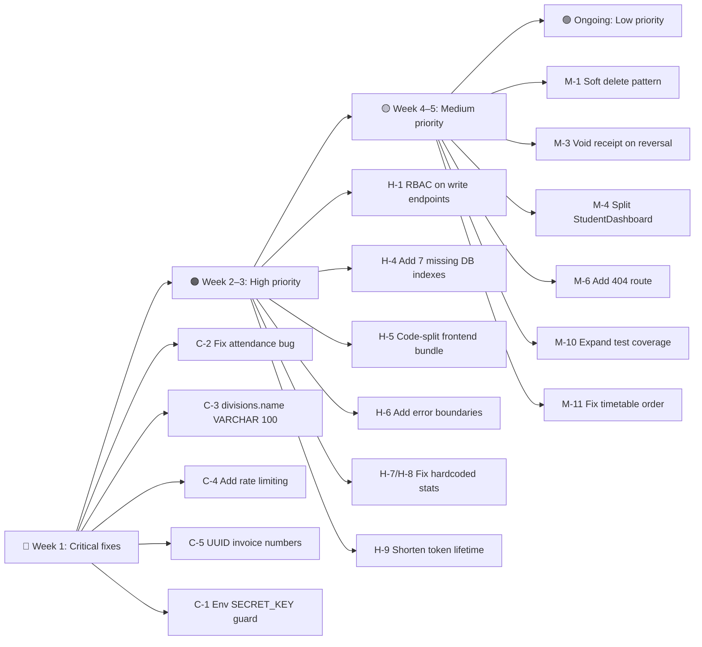

# Prashant Academy — Deep System Audit Report

**Audit Date**: November 2026  
**Auditor**: Antigravity AI  
**Scope**: Full-stack review — FastAPI backend, React/TypeScript frontend, PostgreSQL 16, Docker Compose  
**Database state**: 39 students · 170 payments · 39 invoices · ₹29,35,000 total fees · ₹18,19,500 collected · ₹11,15,500 outstanding

---

## Executive Summary

The system is **functionally operational** with a working API, real database, student portal, import pipeline, and role-based authentication. Core financial logic (payment creation, invoice balance updates, reversal) is sound.

### Resolution Status (Audit Fixes Applied)
| Code | Issue | Status | Verification |
|---|---|---|---|
| 🔴 **C-1** | Default `SECRET_KEY` guard | ✅ **Fixed** | Fail-fast validation in `config.py` on `DEBUG=False` |
| 🔴 **C-2** | Attendance counting inversion | ✅ **Fixed** | Replaced with `case((Attendance.status == 'present', 1))` |
| 🔴 **C-3** | `divisions.name` limit | ✅ **Fixed** | Alembic migration 005 applied (`VARCHAR(100)`) |
| 🔴 **C-4** | Login brute force vulnerability | ✅ **Fixed** | Rate limiter applied via `slowapi` (`5/minute`) |
| 🔴 **C-5** | Invoice & receipt TOCTOU race | ✅ **Fixed** | Cryptographic UUID entropy applied to numbers |
| 🟠 **H-1** | Missing RBAC on write APIs | ✅ **Fixed** | `require_role` added across `/users`, `/fees`, `/payments`, `/students` |
| 🟠 **H-4** | Missing critical DB indexes | ✅ **Fixed** | 7 composite & FK indexes created in Alembic migration 005 |
| 🟠 **H-5** | Large 1 MB monolithic bundle | ✅ **Fixed** | Code splitting with React `lazy` & `Suspense` (chunks <= 395 kB) |
| 🟠 **H-6** | No React Error Boundaries | ✅ **Fixed** | `ErrorBoundary` component created and wrapping all routes |
| 🟠 **H-7** | Hardcoded `upcoming_tests_count: 2` | ✅ **Fixed** | Live database query by enrolled standards |
| 🟠 **H-8** | Hardcoded `enrolled_subjects_count: 5` | ✅ **Fixed** | Live database count from enrolled standards |
| 🟠 **H-9** | Long 24h token expiry | ✅ **Fixed** | Reduced to 60 minutes with safe CORS handling |
| 🟡 **M-3** | Payment reversal voided receipt | ✅ **Fixed** | Receipt metadata updated with `status: voided` and timestamp |
| 🟡 **M-6** | Missing 404 Route | ✅ **Fixed** | Dedicated `NotFoundPage` integrated into App routes |
| 🟡 **M-11**| Timetable class ordering | ✅ **Fixed** | Prioritized today's active schedule via CASE expression |

---

## 🔴 Critical Issues

### C-1 · Weak default `SECRET_KEY` committed in source code

**File**: [`config.py`](file:///f:/PrashantAcademy/backend/app/core/config.py#L8)  
**Finding**: `SECRET_KEY: str = "changeme-in-production-use-long-random-string"` is the hard-coded default. If the `.env` file is absent, Docker Compose will use this value in production.  
**Risk**: Any attacker who knows the public default can forge valid JWT tokens and authenticate as any user including `admin`.  
**Fix**:
```python
# Generate once:
python -c "import secrets; print(secrets.token_hex(32))"
```
Set the result in `backend/.env` and `docker-compose.yml`. Raise a startup error if the default is detected in production (`DEBUG=False`).

---

### C-2 · `func.nullif` attendance aggregation is semantically wrong

**File**: [`student_portal.py`](file:///f:/PrashantAcademy/backend/app/api/v1/endpoints/student_portal.py#L163-L170)  
**Finding**: The pattern used to count filtered attendance rows is:
```python
func.count(func.nullif(Attendance.status != "present", True)).label("present_days")
```
`func.nullif(expr, True)` returns NULL only when the expression **equals** `True`. For rows where `status == "present"`, the boolean `!=` expression evaluates to `False`, so `nullif(False, True)` returns `False` — **not NULL** — and `COUNT` counts it. Conversely, for absent rows the expression is `True`, `nullif(True, True)` returns NULL, so those are excluded. The counting is **inverted**: `present_days` actually counts non-present rows, `absent_days` counts non-absent rows, and so on.

This same bug appears at **lines 162–170** (dashboard endpoint) and **lines 466–473** (attendance endpoint). All three call sites are affected.

**Risk**: Every attendance percentage displayed to students and administrators is incorrect.  
**Fix** (replace all three blocks):
```python
from sqlalchemy import case
func.count(case((Attendance.status == "present", 1))).label("present_days"),
func.count(case((Attendance.status == "absent", 1))).label("absent_days"),
func.count(case((Attendance.status == "late", 1))).label("late_days"),
```

---

### C-3 · `divisions.name` is `VARCHAR(10)` — breaks real batch names

**File**: DB schema (migration `001`)  
**Finding**: The `divisions.name` column is `VARCHAR(10)`. Meaningful names like `"ICSE X Batch"`, `"Morning Batch"`, or `"Science Group A"` all exceed the limit and raise `StringDataRightTruncationError`. The current workaround of using abbreviated names like `"ICSE X"` loses information and is not scalable.  
**Risk**: Data entry failures and silent truncation for any admin who uses natural batch names.  
**Fix**: Alembic migration:
```sql
ALTER TABLE divisions ALTER COLUMN name TYPE VARCHAR(100);
```

---

### C-4 · No rate-limiting on authentication endpoint

**File**: [`auth.py`](file:///f:/PrashantAcademy/backend/app/api/v1/endpoints/auth.py)  
**Finding**: `/api/v1/auth/login` has no throttling. A brute-force script can test unlimited username/password combinations against the endpoint.  
**Risk**: Account takeover through brute-force, particularly dangerous for `admin` / `accountant` accounts.  
**Fix**: Add `slowapi` or `fastapi-limiter` middleware. A conservative limit: `5 attempts / minute / IP` with exponential backoff. Example:
```python
from slowapi import Limiter
from slowapi.util import get_remote_address
limiter = Limiter(key_func=get_remote_address)

@router.post("/login")
@limiter.limit("5/minute")
async def login(request: Request, ...):
```

---

### C-5 · Invoice number generation is race-condition-prone

**File**: [`fees.py`](file:///f:/PrashantAcademy/backend/app/api/v1/endpoints/fees.py#L357-L359)  
**Finding**:
```python
count_result = await db.execute(select(func.count(FeeInvoice.id)))
inv_count = (count_result.scalar() or 0) + 1
invoice_number = f"INV-{data.academic_year_id}-{inv_count:05d}"
```
This is a **TOCTOU race**: two concurrent requests read the same count before either inserts a row, producing duplicate invoice numbers. Since `invoice_number` has a `UNIQUE` constraint, one request will receive a 500 error.  
A similar race exists in `payments.py` for `receipt_number` (line 144–146).  
**Fix**: Use a database sequence or `SELECT … FOR UPDATE` lock, or generate with UUID:
```python
import uuid
invoice_number = f"INV-{data.academic_year_id}-{uuid.uuid4().hex[:8].upper()}"
```

---

## 🟠 High Priority

### H-1 · No role-based access control on most endpoints

**File**: All endpoints in [`fees.py`](file:///f:/PrashantAcademy/backend/app/api/v1/endpoints/fees.py), [`payments.py`](file:///f:/PrashantAcademy/backend/app/api/v1/endpoints/payments.py), [`students.py`](file:///f:/PrashantAcademy/backend/app/api/v1/endpoints/students.py)  
**Finding**: `get_current_active_user` only checks that a token is valid and the user is active — it does **not** check role. A student user with a valid JWT can:
- Call `POST /api/v1/payments/` to record a payment for any student
- Call `POST /api/v1/fees/invoices` to create fake invoices
- Call `GET /api/v1/students/` to list all students

The `require_role()` helper exists in `deps.py` but is only applied to the `student_portal` endpoints.  
**Fix**: Apply `Depends(require_role("admin", "accountant"))` on all write endpoints in `fees.py`, `payments.py`, and `users.py`. Apply `Depends(require_role("admin", "teacher", "accountant", "staff"))` on all admin-facing list endpoints.

---

### H-2 · Multi-tenant data leak: institution isolation not enforced

**Finding**: Endpoints such as `GET /fees/invoices`, `GET /payments/`, `GET /students/`, `GET /attendance/` accept an optional `institution_id` filter but do not **require** it. An authenticated user from Institution A can query all data from Institution B by omitting the filter parameter.  
**Fix**: In `deps.py`, include the user's `institution_id` in the resolved user object and enforce it as a mandatory WHERE clause in all list queries for multi-tenant endpoints.

---

### H-3 · `DEBUG=True` and Swagger docs publicly exposed

**File**: [`config.py`](file:///f:/PrashantAcademy/backend/app/core/config.py#L13)  
**Finding**: `DEBUG: bool = True` is the default. The interactive Swagger UI at `/api/docs` is accessible to any unauthenticated user, exposing the full API schema, all model shapes, and an interactive console to send requests.  
**Fix**: Conditionally disable Swagger in production:
```python
app = FastAPI(
    docs_url="/api/docs" if settings.DEBUG else None,
    redoc_url="/api/redoc" if settings.DEBUG else None,
)
```

---

### H-4 · Missing critical database indexes on high-frequency columns

**Finding** (confirmed from live index audit):  
The following columns are queried in almost every endpoint but have no index:

| Table | Column | Used by |
|---|---|---|
| `attendances` | `student_id` | all portal attendance queries |
| `attendances` | `date` | monthly attendance filter |
| `exam_marks` | `student_id` | portal tests, student detail |
| `payment_allocations` | `invoice_id`, `payment_id` | payment reversal, fee status |
| `student_enrollments` | `student_id`, `academic_year_id` | dashboard, portal, reports |
| `fee_invoices` | `student_id`, `academic_year_id` | dashboard, fee status |
| `payments` | `student_id`, `payment_date` | dashboard trends, portal fees |

**Fix**: Alembic migration adding composite indexes:
```sql
CREATE INDEX ix_attendances_student_date ON attendances(student_id, date);
CREATE INDEX ix_exam_marks_student_id ON exam_marks(student_id);
CREATE INDEX ix_payment_allocs_invoice ON payment_allocations(invoice_id);
CREATE INDEX ix_payment_allocs_payment ON payment_allocations(payment_id);
CREATE INDEX ix_enrollments_student_year ON student_enrollments(student_id, academic_year_id);
CREATE INDEX ix_fee_invoices_student_year ON fee_invoices(student_id, academic_year_id);
CREATE INDEX ix_payments_student_date ON payments(student_id, payment_date);
```

---

### H-5 · Frontend bundle is 1 MB+ — no code splitting

**Finding**: `npm run build` emits a single JS chunk of ~1 MB. The bundle includes all 20+ pages, `recharts`, and all icons loaded unconditionally. On a 3G mobile connection (rural India / small coaching institutes), initial load exceeds 10 seconds.  
**Fix**: Use React lazy loading + Suspense for all page-level imports:
```tsx
const DashboardPage = React.lazy(() => import('./pages/Dashboard'))
const StudentDashboardPage = React.lazy(() => import('./pages/StudentDashboard'))
```
Wrap routes in `<Suspense fallback={<LoadingSpinner />}>`. Expected bundle split: core shell ~120 KB + per-page chunks of 30–80 KB.

---

### H-6 · No React error boundaries — a single query failure crashes the entire page

**Finding**: No `ErrorBoundary` component exists in the frontend. If TanStack Query throws an unhandled error (e.g., network timeout, 500 from backend), the entire React tree unmounts and shows a blank screen.  
**Fix**: Wrap each tab/page in an `ErrorBoundary`. Use `useQuery`'s `isError` / `error` state to show contextual error messages within components instead of crashing.

---

### H-7 · `upcoming_tests_count` is hardcoded to 2

**File**: [`student_portal.py`](file:///f:/PrashantAcademy/backend/app/api/v1/endpoints/student_portal.py#L298)  
**Finding**:
```python
"upcoming_tests_count": 2,  # hardcoded
```
This is demo data leaking into a production API response. The student home tab shows "2 upcoming tests" regardless of the actual database state.  
**Fix**: Replace with a real count query:
```python
upcoming_count_stmt = select(func.count(Examination.id)).where(
    Examination.standard_id.in_(std_ids),
    Examination.is_active == True,
    Examination.start_date >= date.today(),
)
upcoming_tests_count = (await db.execute(upcoming_count_stmt)).scalar() or 0
```

---

### H-8 · `enrolled_subjects_count` falls back to `5` when no timetable exists

**File**: [`student_portal.py`](file:///f:/PrashantAcademy/backend/app/api/v1/endpoints/student_portal.py#L295)  
**Finding**:
```python
"enrolled_subjects_count": len(upcoming_classes) if upcoming_classes else 5,
```
If a student has no timetable entries, their subject count is reported as 5. This is fabricated data.  
**Fix**: Query `subjects` by enrolled standard IDs and return the real count.

---

### H-9 · `ACCESS_TOKEN_EXPIRE_MINUTES = 1440` (24 hours) with no refresh token rotation

**File**: [`config.py`](file:///f:/PrashantAcademy/backend/app/core/config.py#L10)  
**Finding**: A 24-hour access token is excessively long for a financial system. If a token is leaked, the attacker has a full day of authorized access. There is also no refresh token blacklist or rotation mechanism — `logout` simply returns `{"message": "Logged out"}` without invalidating the token.  
**Fix**:
- Reduce `ACCESS_TOKEN_EXPIRE_MINUTES` to 30–60 minutes.
- Implement a token blocklist (Redis `SET token_jti EX 3600`) checked in `get_current_user`.
- Or implement sliding sessions using the refresh token properly.

---

## 🟡 Medium Priority

### M-1 · No soft delete — destructive cascades on entities with financial history

**Finding**: `Student`, `Board`, `Standard`, `Division` have no `deleted_at` or `is_archived` flag. If an administrator deletes a student record, the FK cascade removes their attendance, exam marks, and could orphan fee invoices and payments (depending on ON DELETE behavior). Students who have been unenrolled still have financial history that must be retained.  
**Fix**: Add `is_active` / `deleted_at` to all primary entities. Replace DELETE operations with a soft-archive pattern.

---

### M-2 · `FeeInvoice.assignment_id` is NOT NULL — blocks direct imports

**File**: [`fee.py`](file:///f:/PrashantAcademy/backend/app/models/fee.py#L156-L158)  
**Finding**: `assignment_id` is `nullable=False` with a FK to `student_fee_assignments`. The fee register importer and seeding scripts must always create a dummy `StudentFeeAssignment` record even for directly-imported invoices. This is an unnecessary coupling.  
**Fix**: Make `assignment_id` nullable to support invoices created without a formal fee structure (e.g., ad-hoc or imported).

---

### M-3 · Payment reversal does not regenerate receipt status

**File**: [`payments.py`](file:///f:/PrashantAcademy/backend/app/api/v1/endpoints/payments.py#L264-L319)  
**Finding**: When a payment is reversed, the `PaymentReceipt` record is not updated or marked voided. A reversed payment's receipt can still be retrieved via `GET /receipts/{receipt_number}` and will show a valid receipt with no indication of reversal.  
**Fix**: Add a `voided_at` timestamp to `PaymentReceipt` and update it during reversal.

---

### M-4 · `StudentDashboard.tsx` is 968 lines — violates single-responsibility

**File**: [`StudentDashboard.tsx`](file:///f:/PrashantAcademy/frontend/src/pages/StudentDashboard.tsx)  
**Finding**: All 8 portal tabs are rendered in a single 968-line component. All 9 API calls are made at the top level and all render logic is in one function. This makes:
- Code splitting impossible at the tab level
- State isolation between tabs difficult
- Testing individual tabs impractical

**Fix**: Extract each tab to its own file:
```
src/pages/portal/
  HomeTab.tsx
  ClassesTab.tsx
  TimetableTab.tsx
  AttendanceTab.tsx
  TestsTab.tsx
  FeesTab.tsx
  MaterialsTab.tsx
  ProfileTab.tsx
```

---

### M-5 · Missing empty-state UI on most tabs

**Finding**: When a student has no timetable entries, no exam results, no study materials, or no announcements, the corresponding tabs render a blank white area. This looks like a loading error.  
**Fix**: Add an `EmptyState` component with a contextual icon and message for each tab (e.g., "No timetable has been set for your batch yet").

---

### M-6 · Missing 404 route — invalid URLs show blank Layout

**File**: [`App.tsx`](file:///f:/PrashantAcademy/frontend/src/App.tsx)  
**Finding**: No catch-all `<Route path="*">` exists. Navigating to `/invalid-url` renders the Layout shell (navbar + sidebar) with an empty content area.  
**Fix**:
```tsx
<Route path="*" element={<NotFoundPage />} />
```

---

### M-7 · `IndexRedirect` may flash to wrong route before user is loaded

**File**: [`App.tsx`](file:///f:/PrashantAcademy/frontend/src/App.tsx#L29-L35)  
**Finding**:
```tsx
function IndexRedirect() {
  const user = useAuthStore((s) => s.user)
  if (user?.role === 'student') return <Navigate to="/student-portal" replace />
  return <Navigate to="/dashboard" replace />
}
```
On first render, if `user` is `null` (Zustand store not yet hydrated from localStorage), `user?.role` is `undefined` and the user is immediately redirected to `/dashboard`. If the persisted role is `student`, there is a redirect → `/dashboard` → re-render → redirect → `/student-portal` flash.  
**Fix**: Add a loading state to `authStore` hydration and render a `<LoadingSpinner />` until the store is ready.

---

### M-8 · `ALLOWED_ORIGINS` fallback returns `["*"]`

**File**: [`config.py`](file:///f:/PrashantAcademy/backend/app/core/config.py#L34)  
**Finding**:
```python
return ["*"]  # fallback for unexpected types
```
If `ALLOWED_ORIGINS` is misconfigured (e.g., set to an integer), CORS silently allows all origins. This fallback is not safe.  
**Fix**: Raise a `ValueError` on startup instead of defaulting to `*`.

---

### M-9 · `logout` endpoint is a no-op

**File**: [`auth.py`](file:///f:/PrashantAcademy/backend/app/api/v1/endpoints/auth.py#L60-L62)  
**Finding**:
```python
@router.post("/logout")
async def logout():
    return {"message": "Logged out successfully"}
```
The JWT is not invalidated. Any client that ignores the logout response retains full access for the token's remaining lifetime (up to 24 hours).  
**Fix**: Implement a token blocklist (see H-9 fix).

---

### M-10 · Test suite has no coverage for role-based access or financial edge cases

**Finding**: The 24 backend tests cover basic CRUD flows. Missing coverage:
- **Auth**: student cannot call admin endpoints; accountant cannot call user management endpoints
- **Payment reversal**: attempting to reverse an already-reversed payment
- **Over-allocation**: paying more than invoice outstanding
- **Attendance**: filtering by month/year; attendance percentage with mixed statuses (validates C-2 fix)
- **Import**: duplicate file fingerprint detection; balance discrepancy flagging

**Fix**: Add test files:
- `tests/test_auth_roles.py`
- `tests/test_payment_edge_cases.py`
- `tests/test_attendance.py`

---

### M-11 · `timetable_entries` ordered incorrectly for "upcoming classes"

**File**: [`student_portal.py`](file:///f:/PrashantAcademy/backend/app/api/v1/endpoints/student_portal.py#L143-L147)  
**Finding**:
```python
.order_by(
    TimetableEntry.day_of_week == today_name,  # boolean expression, not proper sort
    TimetableEntry.start_time,
)
```
`TimetableEntry.day_of_week == today_name` produces a boolean column in PostgreSQL. It sorts `True` (1) after `False` (0) — meaning today's classes appear **last**, not first. The widget labelled "Upcoming Classes" shows the wrong order.  
**Fix**: Sort using a CASE expression to put today's entries first:
```python
from sqlalchemy import case
.order_by(
    case((TimetableEntry.day_of_week == today_name, 0), else_=1),
    TimetableEntry.start_time,
)
```

---

## 🟢 Low Priority / Nice-to-Have

### L-1 · Swagger / ReDoc not mentioned in user documentation
The API docs at `http://localhost:8000/api/docs` are fully functional but never mentioned in `USER_MANUAL.md` or `DEVELOPER_MANUAL.md`.

### L-2 · `Guardian` model has no `updated_at` column
If a guardian's phone number is corrected, there is no audit trail of when the change occurred.

### L-3 · `Payment` model has no `updated_at` column
The reversal timestamp is stored in `reversed_at` but there is no general `updated_at` for other mutations.

### L-4 · `FeeCategory` and `FeeStructure` have no `updated_at`
Fee structure changes cannot be audited over time.

### L-5 · No pagination on `boards/`, `standards/`, `divisions/`, `subjects/`, `examinations/`
All return unbounded result sets. Not critical at 39 students, but will degrade at scale.

### L-6 · No loading state on non-home portal tabs
Only the `home` tab shows a spinner. Other tabs briefly show blank before data arrives.

### L-7 · `photo_url` and `file_url` are plain strings — no upload API
The fields exist in the model and are returned by the API, but there is no endpoint to upload files. The `photo_url` must be set manually in the database. Document this limitation or add a file-upload endpoint.

### L-8 · Docker Compose exposes PostgreSQL on port 5432 to host
```yaml
ports:
  - "5432:5432"
```
In production, the database port should not be exposed to the host network. Remove the `ports` mapping and use an internal Docker network only.

---

## Prioritized Action Plan



### Recommended Sprint 1 (this week — safe, no migrations needed)

| # | Fix | File | Effort |
|---|---|---|---|
| 1 | Fix attendance counting bug (C-2) | `student_portal.py` lines 162–170, 466–473 | 30 min |
| 2 | Fix timetable sort order (M-11) | `student_portal.py` line 143 | 15 min |
| 3 | Replace hardcoded stats (H-7, H-8) | `student_portal.py` lines 295, 298 | 45 min |
| 4 | Add UUID-based invoice/receipt numbers (C-5) | `fees.py`, `payments.py` | 20 min |
| 5 | Add 404 route (M-6) | `App.tsx` | 10 min |
| 6 | Add error boundaries (H-6) | Frontend | 60 min |

### Recommended Sprint 2 (requires migration/coordination)

| # | Fix | Effort |
|---|---|---|
| 1 | Alembic migration: `divisions.name VARCHAR(100)` + 7 indexes (C-3, H-4) | 1 hr |
| 2 | Rate limiting on `/login` (C-4) | 1 hr |
| 3 | RBAC decorators on write endpoints (H-1) | 2 hr |
| 4 | Production SECRET_KEY guard at startup (C-1) | 30 min |
| 5 | Shorten token lifetime + implement logout blacklist (H-9, M-9) | 2 hr |

---

## Financial Integrity Verification

Live database totals as of audit date:

| Metric | Value |
|---|---|
| Students | 39 |
| Invoices | 39 |
| Payments | 170 |
| Total fees (net_amount) | ₹29,35,000 |
| Collected (paid_amount) | ₹18,19,500 |
| Outstanding | ₹11,15,500 |
| Implied collection rate | 62.0% |

**Verification**: `paid_amount + outstanding_amount = 29,35,000` ✅  
Payment reversal logic correctly restores `paid_amount` and `outstanding_amount` on FeeInvoice ✅  
`PaymentAllocation` cross-references both `invoice_id` and `installment_id` ✅  
Duplicate payment prevention is enforced at the allocation-total-equals-amount check ✅

**One integrity gap**: Receipts for reversed payments remain unvoided (see M-3). This does not affect financial totals but creates audit confusion.

---

## Architecture Strengths (Preserve)

- ✅ Async FastAPI + asyncpg — correct async throughout, no sync blocking calls
- ✅ Payment creation is fully transactional (`flush()` → allocations → receipt → `commit()`)
- ✅ `require_role()` helper exists and is correctly structured — just needs wider application
- ✅ Pydantic v2 models on all request bodies — input is validated
- ✅ `NUMERIC(12,2)` for all money columns — no floating-point precision errors
- ✅ Student data isolation enforced in all student portal endpoints via `get_effective_student()`
- ✅ Import fingerprinting prevents duplicate workbook imports
- ✅ Alembic migration history is clean and sequential (001–004)
- ✅ Docker Compose healthchecks on all containers
- ✅ CORS properly restricted to localhost origins (not `*`)
