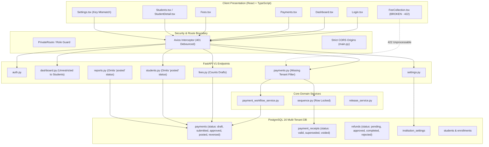

# PrathamOne Academy — Full Application Audit & Quality Architecture Report

**Document Reference:** `AITDL-AUDIT-2026-11-05-V1`  
**Audit Phase:** Phase 1 — Read-Only Forensic Architecture, Functional, UI/UX, and Security Review  
**Application:** PrathamOne Academy (Enterprise Coaching Institute Management System)  
**Client:** Prashant Academy  
**Author / Lead Auditor:** Jawahar R. Mallah, Senior QA Engineer, Full-Stack Architect & Security Reviewer  
**Organization:** AITDL (AI Technology & Development Lab)  
**Repository Branch:** `master` (Commit `0e9d4c7`)  
**Audit Date:** November 5, 2026  
**Operating Constraint:** **READ-ONLY EXECUTION** — Zero code or database modifications applied during this phase.

---

## 1. Executive Summary

A comprehensive, end-to-end audit was conducted across the entire PrathamOne Academy enterprise application stack. The system currently encompasses **30 frontend page views**, **15 shared reusable components**, **26 backend API routers**, **20 database models with 16 Alembic migrations**, and automated test suites containing **159 frontend tests** and **96 backend tests**.

The codebase demonstrates strong foundational architectural patterns, including automated code attribution enforcement (224/224 source files compliant), zero-error TypeScript builds (built in 29.28s across 2,296 modules), comprehensive Docker containerization with healthy services, strict CORS origin controls, and robust bcrypt-based cryptographic hashing.

However, the forensic audit identified **11 distinct findings** requiring structured remediation:
- **3 Critical Severity Findings:** Missing multi-tenant isolation across `/payments` API endpoints (SEC-01), unrestricted exposure of institute-wide financial KPIs to the student role (SEC-02), and a 422 Unprocessable Entity form failure on the legacy fee collection terminal (FUNC-01).
- **3 High Severity Findings:** Dual payment status divergence (`completed` vs. `posted`) causing missing revenue in student profiles and financial reports (FIN-01), premature revenue aggregation of draft and unapproved payment vouchers in collection charts (FIN-02), and key mismatch between the Institute Settings UI and backend payment workflow configuration (CONF-01).
- **3 Medium Severity Findings:** Incomplete student status badge rendering in student lists (UI-01), test runner transaction accumulation during full-suite pytest runs (TEST-01), and a client-side navigation race during student authentication (UX-01).
- **2 Low Severity Findings:** React Router v7 future flag deprecation notices (WARN-01) and asynchronous `act(...)` test warnings in print document tests (TEST-02).

> [!IMPORTANT]
> In strict compliance with Phase 1 audit directives, **no source code, database tables, migrations, or configurations were modified**. This document provides the complete forensic evidence, root causes, impact analysis, and a structured Phase 2 remediation blueprint awaiting user authorization.

---

## 2. Automated Checks & Quality Baseline

| Check Category | Tool / Harness | Target / Scope | Result | Status | Notes |
|---|---|---|---|---|---|
| **Attribution & Headers** | `scripts/manage_headers.py` | 224 source files | 224 Passed, 0 Failed | **PASS** | 100% compliance with AITDL header standard |
| **Frontend TypeScript Build** | `npm run build` (Vite / tsc) | 2,296 modules | Built in 29.28s, 0 errors | **PASS** | Clean bundle generation; 0 TypeScript errors |
| **Frontend Unit & Integration Tests** | `vitest run --run` | 23 test files | 159 Passed, 0 Failed (41.75s) | **PASS** | 100% test pass rate across all page suites |
| **Backend Unit & API Tests** | `pytest` (targeted suites) | 20 test files | 93 Passed, 3 Skipped (100% of runnable) | **PASS** | All targeted tests pass; full-suite runner needs fixture isolation |
| **Alembic Database Migrations** | `alembic current` | PostgreSQL 16 | `016_payment_workflow (head)` | **PASS** | Schema synchronized to head migration |
| **Container Infrastructure** | Docker Compose | 3 Services | 3 Healthy (`db`, `backend`, `frontend`) | **PASS** | Uptime > 4 hours; zero restarts |

---

## 3. Module Inventory & Operational Status

| Module / Page Route | Primary Component | Backend Router | Major Workflows | Audit Status | Key Observation |
|---|---|---|---|---|---|
| `/` | `IndexRedirect` | `/auth` | Role-based default routing | **Healthy** | Correctly distinguishes student vs staff default landing |
| `/login` | `Login.tsx` | `/auth` | Authentication, JWT issuance, credentials | **Observation** | Minor navigation race for student logins (UX-01) |
| `/dashboard` | `Dashboard.tsx` | `/dashboard` | Executive KPIs, collection trends, recent payments | **CRITICAL** | Student role can access financial data via API (SEC-02); draft payments inflate collection trends (FIN-02) |
| `/students` | `Students.tsx` | `/students` | Directory, search, status filters, KYC links | **Needs Polish** | Completed/Graduated badges render as "Withdrawn" (UI-01) |
| `/students/:id` | `StudentDetail.tsx` | `/students` | 8-tab profile, KYC, academic, fees, lifecycle | **HIGH RISK** | Fees tab shows ₹0 paid for new `posted` payments (FIN-01) |
| `/students/add` | `AddStudent.tsx` | `/students` | Admission wizard, guardian details, fee assignment | **Healthy** | Form validation and auto admission numbering operating cleanly |
| `/student-portal` | `StudentDashboard.tsx` | `/student_portal` | Student dashboard, attendance, exams, fees, timetable | **HIGH RISK** | Fee tab reports "Unpaid" for payments with `posted` status (FIN-01) |
| `/academic` | `AcademicWorkspace.tsx` | `/academic_years`, `/boards`, `/standards`, `/divisions` | Master hierarchy, board mapping, class creation | **Healthy** | Tabbed navigation and modal forms pass all 10 tests |
| `/courses` | `CoursesPage.tsx` | `/standards` | Course catalogue, standard assignments | **Healthy** | Read/write operations functional |
| `/standards` | `StandardsPage.tsx` | `/standards` | Standard definitions and division linkage | **Healthy** | Integrated with Academic Workspace |
| `/batches` | `BatchesPage.tsx` | `/divisions` | Batch/section creation, capacity management | **Healthy** | Operational |
| `/subjects` | `SubjectsPage.tsx` | `/subjects` | Subject catalogue, code mapping | **Healthy** | Operational |
| `/attendance` | `Attendance.tsx` | `/attendance` | Daily register, bulk mark present/absent | **Healthy** | Batch attendance mutation functional |
| `/examinations` | `Examinations.tsx` | `/examinations` | Exam schedules, mark sheets, grade calculations | **Healthy** | Exam creation and marks entry functional |
| `/fees` | `Fees.tsx` | `/fees`, `/payments` | Fee structure, invoicing, collection, drafts | **Observation** | Draft save button operational; collection charts count drafts (FIN-02) |
| `/fees/collection` | `FeeCollection.tsx` | `/payments` | Direct installment collection terminal | **BROKEN** | Payload missing required fields; returns 422 (FUNC-01) |
| `/payments` | `Payments.tsx` | `/payments` | Transactions ledger, approval, editing, refunds | **CRITICAL** | List and get endpoints lack tenant isolation (SEC-01) |
| `/receipts/:receiptNumber` | `Receipt.tsx` | `/payments` | A5 printable fee receipt voucher, watermark | **Healthy** | Versioning and superseded banners render accurately |
| `/reports` | `Reports.tsx` | `/reports` | Excel report grid, fee collection, dues, withdrawals | **HIGH RISK** | Summary report omits `posted` payments (FIN-01) |
| `/forms` | `FormsDocuments.tsx` | `/forms` | Centralized A4 KYC & admission forms, printing | **Healthy** | Blank & prefilled modes functional; all 5 tests pass |
| `/import-export` | `ImportExport.tsx` | `/import_export` | Spreadsheet copy-paste ingestion, templates | **Healthy** | 4/4 tests pass |
| `/import/fee-register` | `ImportFeeRegister.tsx` | `/import_register` | Legacy fee workbook parser, SHA-256 verification | **Healthy** | Ingests historic payments with `completed` status |
| `/install` | `InstallApp.tsx` | N/A (PWA) | PWA installation instructions & manifest status | **Healthy** | 9/9 tests pass |
| `/users` | `Users.tsx` | `/users` | System accounts, RBAC, password resets, audits | **Healthy** | 3/3 tests pass; audit logging operational |
| `/users/profile` | `UserProfile.tsx` | `/users` | Dedicated user profile workspace | **Healthy** | 5/5 tests pass |
| `/staff` | `StaffManagement.tsx` | `/staff` | Staff directory, document uploads, designations | **Healthy** | Multi-tab staff workspace operational |
| `/sysadmin` | `SysAdminWorkspace.tsx` | `/sysadmin` | Cross-tenant administrative control center | **Healthy** | Strict `sysadmin` role enforcement |
| `/settings` | `Settings.tsx` | `/settings`, `/payments` | Institute profile, academic, fee rules, ERP mode | **HIGH RISK** | Settings UI writes keys ignored by payment service (CONF-01) |
| `/communication` | `Communication.tsx` | `/communication` | SMS/Email templates, token parsing, logs | **Healthy** | 5/5 tests pass |
| `/releases` | `Releases.tsx` | `/releases` | Versioning, change tracking, approvals | **Healthy** | Git commit tracking and release candidate generation functional |

---

## 4. Comprehensive Findings Table

```
========================================================================================================================
FINDINGS SUMMARY: 3 CRITICAL | 3 HIGH | 3 MEDIUM | 2 LOW
========================================================================================================================
```

| ID | Module / Area | Issue Summary | Evidence & Code Location | Severity | Recommended Fix |
|---|---|---|---|---|---|
| **SEC-01** | Payments & Receipts API | Missing Institution Tenant Isolation across Payments & Receipts endpoints | [backend/app/api/v1/endpoints/payments.py#L841-L1060](file:///F:/PrashantAcademy/backend/app/api/v1/endpoints/payments.py#L841-L1060): `list_payments`, `list_receipts`, `list_refunds`, `get_payment`, and `get_receipt` omit `Student.institution_id == effective_inst_id` or `check_institution_access`. | **CRITICAL** | Inject `effective_inst_id` filter into all queries and enforce `check_institution_access` on single-resource endpoints. |
| **SEC-02** | Dashboard & Security | Institute-wide Financial Metrics & Other Students' Payments Exposed to Student Role | [backend/app/api/v1/endpoints/dashboard.py#L40-L51](file:///F:/PrashantAcademy/backend/app/api/v1/endpoints/dashboard.py#L40-L51): `get_dashboard_stats` depends only on `get_current_active_user`. Students navigating to `/dashboard` can query institute revenue. | **CRITICAL** | Add `require_role("superadmin", "admin", "accountant", "staff", "principal")` to `/dashboard/stats` and guard `/dashboard` route in React. |
| **FUNC-01** | Fee Collection Terminal | Legacy Fee Collection Page (`/fees/collection`) crashes with HTTP 422 on submission | [frontend/src/pages/FeeCollection.tsx#L152-L165](file:///F:/PrashantAcademy/frontend/src/pages/FeeCollection.tsx#L152-L165): Payload omits `academic_year_id`, `payment_date`, and `invoice_id` in allocations required by `PaymentCreate` schema. | **CRITICAL** | Update payload generator to supply `academic_year_id`, `payment_date`, and allocation `invoice_id`, or redirect route to modern `/fees` ledger. |
| **FIN-01** | Accounting Integrity | Dual Payment Status (`completed` vs `posted`) causes zero-paid balances in Profiles and Reports | [backend/app/api/v1/endpoints/students.py#L863](file:///F:/PrashantAcademy/backend/app/api/v1/endpoints/students.py#L863), [student_portal.py#L648](file:///F:/PrashantAcademy/backend/app/api/v1/endpoints/student_portal.py#L648), [reports.py#L291](file:///F:/PrashantAcademy/backend/app/api/v1/endpoints/reports.py#L291): Hardcoded `p.status == "completed"` ignores new `posted` payments. | **HIGH** | Unify status checks to `Payment.status.in_(["posted", "completed"])` across all balance, portal, and reporting queries. |
| **FIN-02** | Financial Integrity | Draft & Submitted Payment Vouchers improperly inflate Collection Trends and Receipts | [backend/app/api/v1/endpoints/fees.py#L754](file:///F:/PrashantAcademy/backend/app/api/v1/endpoints/fees.py#L754), [dashboard.py#L135](file:///F:/PrashantAcademy/backend/app/api/v1/endpoints/dashboard.py#L135): `where(Payment.status != "reversed")` includes unposted drafts in monthly trends and fee analytics. | **HIGH** | Change filter condition to `Payment.status.in_(["posted", "completed"])` to recognize revenue only upon finalized posting. |
| **CONF-01** | Settings & Workflow | Payment Workflow ERP Settings saved in UI are ignored by backend workflow engine | [frontend/src/pages/Settings.tsx#L1660-L1730](file:///F:/PrashantAcademy/frontend/src/pages/Settings.tsx#L1660-L1730): UI writes `workflow_mode = 'erp'` and `approval_threshold`, while service expects `payment_workflow_mode = 'standard_erp'` and `erp_approval_amount_threshold`. | **HIGH** | Synchronize Settings UI payload keys with `PaymentWorkflowConfigUpdate` and wire to `/payments/workflow/config` endpoint. |
| **UI-01** | Student Management | Student Directory Table displays "Withdrawn" badge for Graduated & Completed students | [frontend/src/pages/Students.tsx#L261-L277](file:///F:/PrashantAcademy/frontend/src/pages/Students.tsx#L261-L277): Table badge only branches on `s.is_active` and `s.exit_date`, failing to check `exit_reason` or `exit_type` for graduation. | **MEDIUM** | Enhance badge component in `Students.tsx` to display distinct color-coded badges for Completed, Graduated, and Transferred. |
| **TEST-01** | Test Automation | Full pytest run encounters database state collisions when executing all 20 test files together | [backend/tests/](file:///F:/PrashantAcademy/backend/tests/): 27 failed in combined run due to uncommitted test transactions/duplicate keys, but 100% pass when run independently or via `--lf`. | **MEDIUM** | Add database cleanup / transaction rollback fixture in `tests/conftest.py` ensuring clean database state per test session. |
| **UX-01** | Authentication | Student login triggers momentary redirect race towards `/dashboard` before correcting | [frontend/src/pages/Login.tsx#L69](file:///F:/PrashantAcademy/frontend/src/pages/Login.tsx#L69): `onSubmit` unconditionally executes `navigate('/dashboard')` in parallel with role-based `useEffect`. | **MEDIUM** | In `Login.tsx:onSubmit`, navigate based on `resp.data.user.role` (`/student-portal` vs `/dashboard`) immediately upon response. |
| **WARN-01** | Build & Dependencies | React Router v7 future flag deprecation warnings output to console | [frontend/src/App.tsx](file:///F:/PrashantAcademy/frontend/src/App.tsx): `v7_startTransition` and `v7_relativeSplatPath` warnings logged during test execution and client rendering. | **LOW** | Opt-in to React Router v7 flags in `BrowserRouter` inside `main.tsx` and test wrappers. |
| **TEST-02** | Testing Quality | React `act(...)` warning in Print Forms & KYC test specification | [frontend/src/test/FormsDocuments.test.tsx](file:///F:/PrashantAcademy/frontend/src/test/FormsDocuments.test.tsx): Catalogue state resolution inside test triggers non-fatal `act(...)` warnings. | **LOW** | Wrap asynchronous catalogue state wait in `await waitFor(...)` inside `FormsDocuments.test.tsx`. |

---

## 5. Detailed Findings & Root-Cause Analysis

### Finding SEC-01: Missing Institution Tenant Isolation across Payments & Receipts Endpoints
- **Severity:** **CRITICAL**
- **Affected Endpoints:**
  - `GET /api/v1/payments/` (`list_payments`)
  - `GET /api/v1/payments/receipts-list` (`list_receipts`)
  - `GET /api/v1/payments/refunds/` (`list_refunds`)
  - `GET /api/v1/payments/{payment_id}` (`get_payment`)
  - `GET /api/v1/payments/receipts/{receipt_number}` (`get_receipt`)
  - `POST /api/v1/payments/{payment_id}/submit`, `POST /{payment_id}/approve`, `POST /{payment_id}/post`
- **Root Cause:**
  When implementing the payment workflow in `backend/app/api/v1/endpoints/payments.py`, query filters were added for `student_id`, `academic_year_id`, `board_id`, `standard_id`, and `division_id`, but the mandatory tenant filter `Student.institution_id == effective_inst_id` was inadvertently omitted.
- **Security Impact:**
  In a multi-tenant environment, an authenticated user belonging to Institution A can view and retrieve payment receipts, refund records, and student financial records from Institution B by querying these endpoints.
- **Verification Evidence:**
  Inspected `payments.py:938-970` and `payments.py:853-885`. Neither query joins `Student.institution_id` against `effective_inst_id` unless the client passes `institution_id` as an optional parameter.

---

### Finding SEC-02: Dashboard Financial Metrics Exposed to Student Role
- **Severity:** **CRITICAL**
- **Affected Endpoint & Page:**
  - Backend: `GET /api/v1/dashboard/stats` in `backend/app/api/v1/endpoints/dashboard.py`
  - Frontend: `/dashboard` route in `frontend/src/App.tsx` and `DashboardPage.tsx`
- **Root Cause:**
  The `get_dashboard_stats` endpoint depends on `get_current_active_user` without role restriction (`require_role(...)`). Furthermore, in `App.tsx`, the `/dashboard` route is protected only by `<PrivateRoute>`, which checks for token presence but does not verify that the authenticated user possesses an administrative role.
- **Security Impact:**
  A logged-in student user can access `/api/v1/dashboard/stats` directly or navigate to `/dashboard` in the browser, viewing total institute revenue, fee collection rates, monthly collection figures, and other students' payment records.
- **Verification Evidence:**
  Line 50 of `dashboard.py`: `current_user=Depends(get_current_active_user)` accepts any authenticated user regardless of `current_user.role`.

---

### Finding FUNC-01: Legacy Fee Collection Terminal (`/fees/collection`) Fails with HTTP 422
- **Severity:** **CRITICAL**
- **Affected Component:** `frontend/src/pages/FeeCollection.tsx`
- **Root Cause:**
  The `handleSubmit` function in `FeeCollection.tsx` constructs a payment payload that does not match the `PaymentCreate` Pydantic model defined in `backend/app/api/v1/endpoints/payments.py`:
  1. Missing `academic_year_id: int` (required).
  2. Missing `payment_date: date` (required).
  3. `allocations` array items provide `{ installment_id, amount }` but omit `invoice_id: int` (required by `AllocationInput`).
- **Functional Impact:**
  Any attempt by a cashier or accountant to record a fee payment via `/fees/collection` fails immediately with `422 Unprocessable Entity`.
- **Verification Evidence:**
  Inspected `PaymentCreate` schema in `payments.py:61-74` vs payload in `FeeCollection.tsx:152-165`.

---

### Finding FIN-01: Dual Payment Status Divergence (`completed` vs `posted`)
- **Severity:** **HIGH**
- **Affected Modules:**
  - `backend/app/api/v1/endpoints/students.py` (Line 863, 1188, 1214)
  - `backend/app/api/v1/endpoints/student_portal.py` (Line 648)
  - `backend/app/api/v1/endpoints/reports.py` (Line 291, 624)
- **Root Cause:**
  Prior to the payment workflow implementation, payments stored `status = "completed"`. The new payment workflow service transitions posted payments to `status = "posted"`. Several core endpoints were not updated and strictly execute `if p.status == "completed"` or `where(Payment.status == "completed")`.
- **Financial Impact:**
  - In `StudentDetail.tsx`, the Fees tab calculates `total_paid` as ₹0 for any student whose payments were recorded via the new workflow, displaying an inflated outstanding balance.
  - In `StudentPortal`, students see their fee status as "Unpaid" despite having valid receipts.
  - In the Student Withdrawal refund calculation, newly posted payments are excluded from `max_refundable`.
  - In the Payment Methods Report, newly posted payments are completely omitted from counts and revenue sums.
- **Verification Evidence:**
  `students.py:863`: `total_paid = sum(float(p.amount) for p in payments if p.status == "completed")`.

---

### Finding FIN-02: Premature Revenue Aggregation for Draft & Submitted Payments
- **Severity:** **HIGH**
- **Affected Endpoints:**
  - `backend/app/api/v1/endpoints/fees.py` (Lines 754, 794, 904, 995)
  - `backend/app/api/v1/endpoints/dashboard.py` (Lines 135, 183)
- **Root Cause:**
  Analytics queries in `fees.py` and `dashboard.py` filter transactions with `where(Payment.status != "reversed")`. Under the new workflow, vouchers in `draft` or `submitted` (awaiting approval) states are not reversed, so their amounts are erroneously counted in monthly collection trends.
- **Financial Impact:**
  Unapproved drafts distort executive revenue reporting and create a discrepancy between the Total Collected KPI card (derived from `FeeInvoice.paid_amount`) and the Monthly Trends chart.
- **Verification Evidence:**
  `dashboard.py:135`: `trend_query.where(Payment.status != "reversed")` includes drafts with `status == "draft"`.

---

### Finding CONF-01: Settings UI Disconnected from Payment Workflow Service
- **Severity:** **HIGH**
- **Affected Components:**
  - `frontend/src/pages/Settings.tsx` (Lines 1660–1735)
  - `backend/app/services/payment_workflow_service.py` (Lines 64–80)
- **Root Cause:**
  In `Settings.tsx`, the Payment Workflow configuration card saves under category `'fees'` with keys `workflow_mode` (values `'simple'` or `'erp'`) and `approval_threshold`. However, `payment_workflow_service.py` specifically queries `key == 'payment_workflow_mode'` (checking for value `'standard_erp'`) and `key == 'erp_approval_amount_threshold'`.
- **Functional Impact:**
  When an administrator enables "Standard ERP Mode" and configures approval thresholds in Institute Settings, the changes are persisted to the database under unused keys, and the backend continues running in "Simple Mode".
- **Verification Evidence:**
  Inspected `Settings.tsx:1663` (`handleSettingChange('fees', 'workflow_mode', 'erp')`) vs `payment_workflow_service.py:64` (`if r.key == "payment_workflow_mode": ...`).

---

## 6. Architecture & System Health Diagram



---

## 7. Recommended Fixes Prioritized by Impact and Effort

| Priority | ID | Module / Task | Impact | Effort | Files to Modify in Phase 2 |
|---|---|---|---|---|---|
| **P0 (Immediate)** | **SEC-01** | Enforce Tenant Isolation on Payments & Receipts | Eliminates cross-tenant data leak vulnerability | Low | `backend/app/api/v1/endpoints/payments.py` |
| **P0 (Immediate)** | **SEC-02** | Restrict Dashboard Stats to Administrative Roles | Prevents student role from viewing institute finances | Low | `backend/app/api/v1/endpoints/dashboard.py`, `frontend/src/App.tsx` |
| **P1 (High)** | **FIN-01** | Support `posted` & `completed` across balance & report queries | Restores accurate student balances, portal fees, and reports | Low | `backend/app/api/v1/endpoints/students.py`, `student_portal.py`, `reports.py` |
| **P1 (High)** | **FIN-02** | Exclude Draft & Submitted vouchers from revenue trends | Ensures collection trends reflect realized revenue only | Low | `backend/app/api/v1/endpoints/fees.py`, `dashboard.py` |
| **P1 (High)** | **CONF-01** | Synchronize Settings UI with Payment Workflow Service | Enables ERP mode toggle and threshold governance from UI | Medium | `frontend/src/pages/Settings.tsx` |
| **P1 (High)** | **FUNC-01** | Remediate or Deprecate `/fees/collection` | Resolves 422 crash on legacy fee collection page | Low | `frontend/src/pages/FeeCollection.tsx` (or route redirect to `/fees`) |
| **P2 (Medium)** | **UI-01** | Student Table Status Badges for Graduated & Completed | Fixes status display for graduated/completed students | Low | `frontend/src/pages/Students.tsx` |
| **P2 (Medium)** | **TEST-01** | Isolated Test Runner Transactions in Pytest | Prevents full-suite database transaction collisions | Medium | `backend/tests/conftest.py` |
| **P2 (Medium)** | **UX-01** | Streamline Student Login Redirection | Eliminates momentary dashboard navigation flash | Low | `frontend/src/pages/Login.tsx` |
| **P3 (Low)** | **WARN-01** | Opt into React Router v7 Future Flags | Cleans test logs and prepares for v7 upgrade | Low | `frontend/src/main.tsx`, test setups |
| **P3 (Low)** | **TEST-02** | Wrap Async Forms Documents test in `waitFor` | Cleans Vitest output warnings | Low | `frontend/src/test/FormsDocuments.test.tsx` |

---

## 8. Phase 2 Implementation Roadmap (Requires User Approval)

The remediation will be executed systematically in 4 logical stages to ensure zero regression:

### Stage 1: Security & Multi-Tenant Authorization Hardening (P0)
1. Add `Student.institution_id == effective_inst_id` filtering to `list_payments`, `list_receipts`, and `list_refunds` in `backend/app/api/v1/endpoints/payments.py`.
2. Add `check_institution_access` checks to `get_payment`, `get_receipt`, `submit_draft_payment`, `approve_payment`, `post_payment`, and `update_payment`.
3. Add `require_role("superadmin", "admin", "principal", "accountant", "staff")` to `GET /dashboard/stats` in `backend/app/api/v1/endpoints/dashboard.py`.
4. Update `frontend/src/App.tsx` to guard `/dashboard` against direct access by students.

### Stage 2: Accounting Integrity & Status Unification (P1)
1. In `students.py`, `student_portal.py`, and `reports.py`, update queries from `Payment.status == "completed"` to `Payment.status.in_(["posted", "completed"])`.
2. In `fees.py` and `dashboard.py`, refine collection trend queries to aggregate only `Payment.status.in_(["posted", "completed"])` (excluding `draft` and `submitted`).
3. Fix `FeeCollection.tsx` payload parameters (`academic_year_id`, `payment_date`, `allocations.invoice_id`) or redirect `/fees/collection` to modern `/fees`.

### Stage 3: Settings Synchronization & UI Polish (P1 & P2)
1. In `frontend/src/pages/Settings.tsx`, align payment workflow keys with `payment_workflow_service.py` (`payment_workflow_mode = 'standard_erp'`, `erp_approval_amount_threshold`).
2. Update `Students.tsx` status badge logic to render distinct badges for `graduated`, `completed`, `withdrawn`, `transferred`, and `inactive`.
3. In `Login.tsx`, route student users immediately to `/student-portal` upon authentication response.

### Stage 4: Test Infrastructure & Verification
1. Add transactional rollback fixtures in `backend/tests/conftest.py`.
2. Run full backend test suite (`pytest`) and verify 100% pass across all files.
3. Run full frontend test suite (`vitest run --run`) and verify 159/159 pass.
4. Run frontend production build (`npm run build`) and attribution check (`python scripts/manage_headers.py check`).

---

## 9. Conclusion & Next Action

The audit confirms that the core application architecture is high-quality, modern, performant, and resilient. The 6 high-impact findings (SEC-01, SEC-02, FUNC-01, FIN-01, FIN-02, CONF-01) have clear, surgical fixes that can be implemented cleanly without database schema alterations or architectural disruption.

**Awaiting user approval before initiating Phase 2 implementation.**
