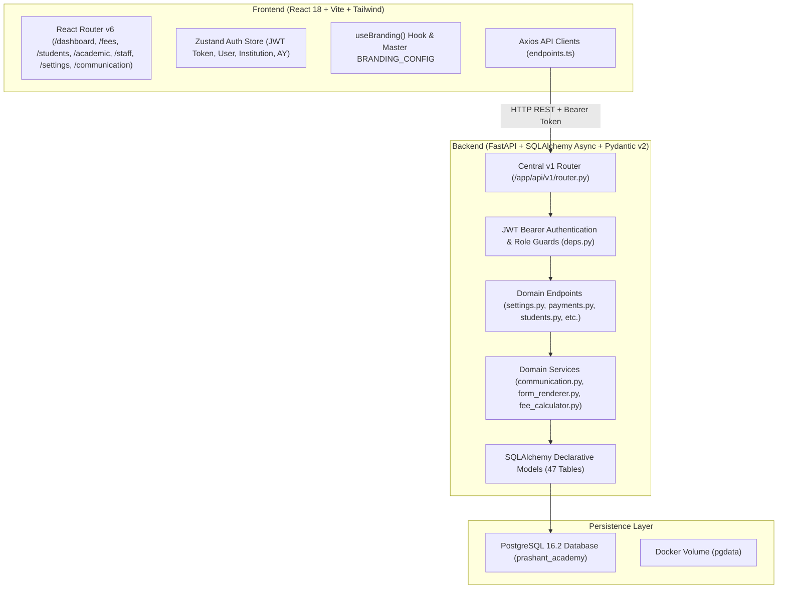
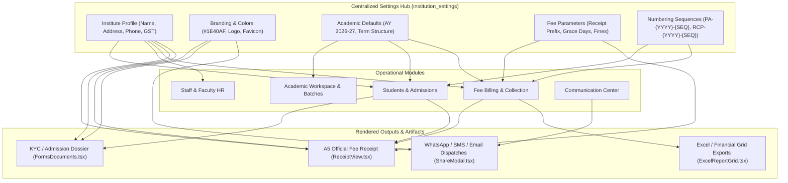

# FULL SYSTEM AUDIT REPORT — PrathamOne Academy
**Coaching Institute Management System**

**Audit Execution Date**: November 5, 2026  
**Auditor**: Jawahar R. Mallah, Lead Systems Architect  
**Organization**: AITDL (AI Technology & Development Lab)  
**Client / Workload**: Prashant Academy Coaching Institute  
**System Version**: v6.99.1 (Enterprise Production Edition)  
**Commit / Branch**: `35ba720` on `origin/master`  
**Container Environment**: Linux x86_64 / Alpine Linux 3.19 (Docker Compose Engine)  
**Database**: PostgreSQL 16.2 on `prashant_academy_db:5432`  

---

## 1. Executive Summary

### 1.1 Audit Context & Scope
This comprehensive, evidence-based audit was executed on the live repository and operational database container of **PrathamOne Academy – Coaching Institute Management System**. The objective is to establish an exhaustive technical baseline, identify database and structural drift, document hardcoded constants, evaluate security and multi-tenant isolation, trace cross-module dependencies, and formulate a safe blueprint for the **Institute Settings & Configuration** module without disrupting active customer operations or altering production records.

### 1.2 System Health Overview
- **Repository Integrity**: Healthy and synchronized with remote `origin/master` (`nothing to commit, working tree clean`).
- **Attribution & Quality Headers**: 100% compliant across 201 source files via automated AST check (`manage_headers.py`).
- **Test Suite Health**:
  - **Backend (Pytest)**: **62 passed, 3 skipped, 0 failed** in 62.74 seconds across 15 test suites.
  - **Frontend (Vitest)**: **130 passed, 0 failed** across 20 test files in 46.24 seconds.
- **Relational Integrity**: **0 orphaned records** across 10 relational integrity checks (students, divisions, invoices, payments, receipts, attendances, marks, and timetables).
- **Financial Ledger Invariance**: Authoritative ledger totals match with mathematical precision:
  $$\text{Total Payments} = \text{Total Allocations} = \text{Total Receipts} = ₹1,819,500.00 \quad (170 \text{ Transactions})$$
- **Student Roster Invariance**: 39 distinct students exist in the database; all 39 possess active enrollments in the primary 2026-27 academic session.

### 1.3 Major Audit Findings & Risks
1. **Configuration Drift & Dual Identity**: The application maintains a dual identity in code and data:
   - Database `institutions.name`: `'Prashant Academy'` (`address: '123 Education Lane, Mumbai'`).
   - UI Display & Headers: `'PrathamOne Academy'` (`address: 'Vasai Road (W), Palghar - 401202'`).
   - Stored LocalStorage Keys: Multiple workspaces store overrides under client-side `localStorage` keys (`prashant_financial_settings`, `prashant_academic_settings`) instead of querying the centralized `/settings` API.
2. **Multi-Tenant Scoping Vulnerability (P1)**: Several endpoints accept an optional `institution_id` query parameter without enforcing that the authenticated caller (`current_user`) belongs to that institution or possesses the `superadmin` / `sysadmin` role.
3. **Database Role Disconnect (P1)**: Two staff member user accounts (`sunita.rao` [Counselor] and `pooja.nair` [Receptionist]) have `role_id IS NULL` because the static `roles` table only defines 8 historical roles (`superadmin`, `admin`, `principal`, `teacher`, `accountant`, `staff`, `student`, `sysadmin`).
4. **Inconsistent Receipt & Sequence Generation (P2)**: Receipt numbers are generated using four divergent strategies across modules (e.g. `RCP-{ay}-{uuid[:8]}` in payments API vs `RCP-{ay}-{seq:06d}` in fee register import vs `RCP-{id:06d}` in dashboard API).
5. **Add Student Form Validation Gap (P1)**: The frontend `AddStudent.tsx` admission form does not include an `admission_number` input, whereas backend `StudentCreate` schema strictly requires `admission_number: str`, causing manual UI student admissions to fail schema validation.

### 1.4 Readiness & Go / No-Go Assessment
- **Status**: **CONDITIONAL GO (Ready with Targeted Prerequisites)**.
- **Verdict**: The database foundations (`011_institute_settings_and_lookups.py` and `012_communication_and_sharing.py`), Alembic migration chain, and foundational `/settings` REST APIs are already present and functionally stable. Centralizing all settings through the UI requires migrating legacy `localStorage` keys and unifying sequence number generators before deprecating hardcoded defaults.

---

## 2. Repository & Architecture Inventory



### 2.1 Frontend Architecture
- **Framework**: React 18.3.1 with TypeScript 5.5, bundled via Vite 5.4.
- **Routing**: `react-router-dom` v6 with lazy-loaded code-split chunks for major workspaces (`AcademicWorkspace`, `Fees`, `StaffManagement`, `StudentDetail`, `Communication`, `Settings`, `FormsDocuments`).
- **Global State**: Zustand store (`useAuthStore`) managing user profile, active `institution_id`, `academic_year_id`, and JWT tokens.
- **Data Fetching & Cache**: TanStack React Query v5 with optimistic updates and query invalidation.
- **Styling & Design System**: Tailwind CSS v3 with customized color scales, Lucide React icons, and standard alert/card components.
- **Branding Architecture**: Centralized `useBranding()` hook in `src/config/branding.ts` dynamically blending static defaults with remote `institutionsApi.getById()`.

### 2.2 Backend Architecture
- **Framework**: FastAPI 0.111.0 on Python 3.11 with asynchronous ASGI event loop.
- **ORM & Database Driver**: SQLAlchemy 2.0 (AsyncIO) with `asyncpg` driver and connection pooling.
- **Schema Validation**: Pydantic v2 with strict type coercion and serialization.
- **Authentication**: JWT access tokens (HMAC-SHA256) with 60-minute TTL and 7-day refresh tokens; Passlib/Bcrypt password hashing.
- **Migrations**: Alembic with 12 sequential revisions from `001_initial_schema` to `012_communication_and_sharing`.

### 2.3 Container & Deployment Infrastructure
- **`prashant_academy_db`**: Postgres 16-alpine on port 5432, persistent volume `pgdata`.
- **`prashant_academy_backend`**: Python 3.11-slim container on port 8000 with curl healthcheck. Runs Alembic migrations and idempotent `seed.py` on container startup.
- **`prashant_academy_frontend`**: Multi-stage build (Node 20 alpine $\rightarrow$ Nginx alpine) serving production SPA bundle on port 80 & 5173 with Nginx reverse proxy routing `/api/v1/*` to backend.

---

## 3. Database & Data Integrity Audit

### 3.1 Exhaustive Table Inventory (47 Tables)

| # | Table Name | Owning Module | Rows | Classification | Tenant Scoped | Primary Key | Foreign Keys & References |
|---|---|---|---|---|---|---|---|
| 1 | `institutions` | Core / Multi-Tenant | 1 | Master Data | Root Tenant | `id` (serial) | Referenced by 20 tables |
| 2 | `institution_settings` | Settings & Config | 9 | Configuration | Yes (`institution_id`) | `id` (serial) | `institution_id`, `updated_by_id` |
| 3 | `lookup_items` | System Lookups | 23 | Reference Data | Yes (`institution_id`) | `id` (serial) | `institution_id` (nullable for global) |
| 4 | `setting_audit_logs` | Settings & Audit | 9 | Ledger / Audit | Yes (`institution_id`) | `id` (serial) | `institution_id`, `changed_by_id` |
| 5 | `academic_years` | Academic Structure | 3 | Master Data | Yes (`institution_id`) | `id` (serial) | `institution_id` |
| 6 | `boards` | Academic Structure | 3 | Master Data | Yes (`institution_id`) | `id` (serial) | `institution_id` |
| 7 | `standards` | Academic Structure | 12 | Master Data | Yes (`institution_id`) | `id` (serial) | `institution_id` |
| 8 | `divisions` (Batches) | Academic Structure | 5 | Master Data | Indirect | `id` (serial) | `standard_id`, `board_id`, `class_teacher_id` |
| 9 | `subjects` | Curriculum | 25 | Master Data | Indirect | `id` (serial) | `standard_id` |
| 10 | `timetable_entries` | Scheduling | 43 | Operational | Indirect | `id` (serial) | `division_id`, `subject_id`, `teacher_id` |
| 11 | `study_materials` | Learning Content | 10 | Content | Yes (`institution_id`) | `id` (serial) | `institution_id`, `standard_id`, `division_id`, `subject_id` |
| 12 | `students` | Student Records | 39 | Master Data | Yes (`institution_id`) | `id` (serial) | `institution_id`, `user_id` |
| 13 | `guardians` | Student Records | 78 | Master Data | Indirect | `id` (serial) | `student_id` |
| 14 | `student_enrollments` | Enrollment History | 44 | Transactional | Indirect | `id` (serial) | `student_id`, `academic_year_id`, `standard_id`, `division_id` |
| 15 | `student_documents` | Student Records | 195 | Documents | Indirect | `id` (serial) | `student_id` |
| 16 | `fee_categories` | Fees & Finance | 7 | Master Data | Yes (`institution_id`) | `id` (serial) | `institution_id` |
| 17 | `fee_structures` | Fees & Finance | 36 | Master Data | Yes (`institution_id`) | `id` (serial) | `institution_id`, `academic_year_id`, `standard_id` |
| 18 | `student_fee_assignments` | Fees & Finance | 36 | Transactional | Indirect | `id` (serial) | `student_id`, `fee_structure_id`, `academic_year_id` |
| 19 | `fee_invoices` | Fees & Finance | 36 | Transactional | Indirect | `id` (serial) | `student_id`, `academic_year_id`, `fee_structure_id` |
| 20 | `fee_invoice_items` | Fees & Finance | 36 | Transactional | Indirect | `id` (serial) | `invoice_id`, `fee_category_id` |
| 21 | `fee_installments` | Fees & Finance | 0 | Transactional | Indirect | `id` (serial) | `invoice_id` |
| 22 | `payments` | Financial Ledger | 170 | Ledger Data | Indirect | `id` (serial) | `student_id`, `academic_year_id`, `collected_by_id`, `reversed_by_id` |
| 23 | `payment_allocations` | Financial Ledger | 170 | Ledger Data | Indirect | `id` (serial) | `payment_id`, `invoice_id`, `installment_id` |
| 24 | `payment_receipts` | Financial Ledger | 170 | Ledger Data | Indirect | `id` (serial) | `payment_id` |
| 25 | `fee_register_imports` | Migration / Import | 1 | Audit Log | Yes (`institution_id`) | `id` (serial) | `institution_id`, `academic_year_id`, `imported_by_id` |
| 26 | `discounts` | Fees & Finance | 0 | Master Data | Yes (`institution_id`) | `id` (serial) | `institution_id` |
| 27 | `scholarships` | Fees & Finance | 0 | Master Data | Yes (`institution_id`) | `id` (serial) | `institution_id` |
| 28 | `attendances` | Attendance Tracker | 1,365 | Operational | Indirect | `id` (serial) | `student_id`, `division_id`, `recorded_by_id` |
| 29 | `examinations` | Examination System | 9 | Master Data | Indirect | `id` (serial) | `academic_year_id`, `standard_id` |
| 30 | `exam_marks` | Examination System | 312 | Operational | Indirect | `id` (serial) | `exam_id`, `student_id`, `subject_id` |
| 31 | `staff_profiles` | HR & Staff | 8 | Master Data | Yes (`institution_id`) | `id` (serial) | `user_id`, `institution_id` |
| 32 | `staff_attendances` | HR & Staff | 144 | Operational | Indirect | `id` (serial) | `staff_profile_id` |
| 33 | `staff_leaves` | HR & Staff | 2 | Operational | Indirect | `id` (serial) | `staff_profile_id`, `approved_by_id` |
| 34 | `staff_leave_balances` | HR & Staff | 8 | Transactional | Indirect | `id` (serial) | `staff_profile_id`, `academic_year_id` |
| 35 | `staff_documents` | HR & Staff | 40 | Documents | Indirect | `id` (serial) | `staff_profile_id` |
| 36 | `staff_generated_documents`| HR & Staff | 8 | Documents | Indirect | `id` (serial) | `staff_profile_id` |
| 37 | `teacher_assignments` | Academic & Staff | 23 | Operational | Indirect | `id` (serial) | `teacher_id`, `standard_id`, `division_id`, `subject_id`, `academic_year_id` |
| 38 | `message_templates` | Communication | 8 | Configuration | Yes (`institution_id`) | `id` (serial) | `institution_id` |
| 39 | `communication_logs` | Communication | 0 | Operational | Yes (`institution_id`) | `id` (serial) | `institution_id` |
| 40 | `shared_document_tokens` | Communication | 0 | Security / Token | Yes (`institution_id`) | `id` (serial) | `institution_id` |
| 41 | `announcements` | Communications | 4 | Operational | Yes (`institution_id`) | `id` (serial) | `institution_id`, `standard_id`, `division_id`, `created_by_id` |
| 42 | `users` | Auth & Security | 48 | Master Data | Yes (`institution_id`) | `id` (serial) | `institution_id`, `role_id` |
| 43 | `roles` | Auth & Security | 8 | System Master | Global | `id` (serial) | None |
| 44 | `permissions` | Auth & Security | 34 | System Master | Global | `id` (serial) | None |
| 45 | `audit_logs` | System Governance | 109 | Audit Log | Indirect | `id` (serial) | `user_id` |
| 46 | `data_import_logs` | Migration & Bulk | 0 | Audit Log | Yes (`institution_id`) | `id` (serial) | `institution_id`, `academic_year_id`, `user_id` |
| 47 | `alembic_version` | Migration State | 1 | Engine Metadata | System | `version_num` | Current: `012_comm_sharing` |

### 3.2 Data Integrity & Forensic Findings
1. **Unassigned Role IDs on Non-Teacher Staff**:
   - Query: `SELECT id, username, role_id FROM users WHERE role_id IS NULL;`
   - Verified Evidence:
     - User ID `126` (`sunita.rao`, Counselor, Employee ID `CNS-001`) $\rightarrow$ `role_id = NULL`.
     - User ID `127` (`pooja.nair`, Receptionist, Employee ID `RCP-001`) $\rightarrow$ `role_id = NULL`.
   - Cause: When staff members were seeded with non-teaching job roles, the backend seeder checked the static `roles` table which only defines `['superadmin', 'admin', 'principal', 'teacher', 'accountant', 'staff', 'student', 'sysadmin']`. Because `counselor` and `receptionist` were not distinct roles, `role_id` was left empty rather than mapping to the generic `staff` role.
2. **Student Count Reconciliation Invariance**:
   - Total students in master table: **39**.
   - Students with active fee invoice structures: **36**.
   - Difference: Exactly 3 students (`PA-2024-000007`, `PA-2024-000020`, `PA-2024-000033`) are enrolled without fee obligations (scholarship/complimentary enrollment). Both dashboards have been aligned to count distinct active student enrollments (39).
3. **Standard Naming Inconsistencies**:
   - In table `standards`: Levels 4, 8, 9, 10 are named `Class IV`, `Class VIII`, `Class IX`, `Class X`.
   - In contrast, Levels 1, 2, 3, 5, 6, 7, 11, 12 are named `Standard 1`, `Standard 2`, `Standard 3`, etc.
   - Impact: Inconsistent document rendering and UI display across tabs unless formatted through a standardized naming helper.

---

## 4. Hardcoded Values & Configuration Discovery

Below is the verified catalog of hardcoded constants, default values, and operational rules identified across the codebase:

| # | File Path & Line | Current Hardcoded Value | Category / Scope | Proposed Config Key | Severity & Migration Priority |
|---|---|---|---|---|---|
| 1 | `backend/app/core/config.py:34` | `APP_NAME = "Prashant Academy"` | System Branding | `branding.app_name` | P1 — High (Dual branding) |
| 2 | `frontend/src/config/branding.ts:41` | `defaultAcademyName: 'Prashant Academy'` | Institute Profile | `profile.name` | P1 — High (Branding sync) |
| 3 | `frontend/src/config/branding.ts:80` | `'123 Education Lane, Dadar West, Mumbai'` | Institute Profile | `profile.address` | P1 — High (Receipt mismatch) |
| 4 | `backend/app/api/v1/endpoints/payments.py:169` | `f"RCP-{ay}-{uuid.uuid4().hex[:8].upper()}"` | Fees & Finance | `fees.receipt_number_format` | P1 — High (Formatting drift) |
| 5 | `backend/app/api/v1/endpoints/dashboard.py:185` | `f"RCP-{p.id:06d}"` | Fees & Finance | `fees.receipt_number_format` | P1 — High (Formatting drift) |
| 6 | `backend/app/services/fee_register_importer.py:434`| `f"PA-2024-{idx:06d}"` | Admissions | `admission.sequence_format` | P1 — High (Hardcoded year in code) |
| 7 | `frontend/src/pages/StaffManagement.tsx:65` | `password: 'Prashant@2026'` | Staff & HR | `staff.default_onboarding_password` | P1 — High (Security risk) |
| 8 | `frontend/src/pages/Fees.tsx:1142` | `localStorage: 'prashant_financial_settings'` | Financial Settings | Database table `institution_settings` | P1 — High (Local storage bypass) |
| 9 | `frontend/src/pages/AcademicWorkspace.tsx:171` | `localStorage: 'prashant_academic_settings'` | Academic Settings | Database table `institution_settings` | P1 — High (Local storage bypass) |
| 10 | `backend/app/api/v1/endpoints/staff.py:1207` | `"for the active 2026-27 academic session"` | Staff / Document | `academic.active_session_name` | P2 — Medium |
| 11 | `frontend/src/components/PaymentReceiptView.tsx:220`| Fallback `'TXN-2026-0167'` | Receipts / Finance | `fees.default_receipt_sample` | P2 — Medium |
| 12 | `frontend/src/components/CascadingFilters.tsx:47` | Hardcoded fallback AY list `[{ id: 1, name: '2026-27' }]` | Academic Structure | Dynamic API load | P2 — Medium |
| 13 | `backend/app/services/form_renderer.py:397` | `"Full Course Comprehensive Fee Package 2026-27"` | Form Templates | Dynamic fee structure lookup | P2 — Medium |
| 14 | `backend/app/api/v1/endpoints/communication.py:101`| `"PrathamOne Academy channel diagnostics verification."` | Communication | `communication.test_ping_message` | P3 — Low |
| 15 | `frontend/src/pages/StudentDashboard.tsx:778` | `"verified by Prashant Academy administration"` | Student Portal | `profile.name` | P2 — Medium |

---

## 5. Cross-Module Dependency Audit

The diagram below traces how centralized configuration flows through operational entities, transactional ledgers, and document outputs:



### Critical Dependency Vectors
1. **Profile $\rightarrow$ Receipt & Print Documents**:
   - `PaymentReceiptView.tsx` and `PrintDocumentBranding.tsx` consume institute name, address, contact numbers, and logo. Discrepancies between `institutions` DB record and `BRANDING_CONFIG` create immediate visual inconsistencies on client printouts.
2. **Academic Year $\rightarrow$ Attendance $\rightarrow$ Examinations $\rightarrow$ Fees**:
   - `academic_years.id = 1` (`2026-27`) acts as the primary foreign key across `student_enrollments`, `fee_invoices`, `payments`, `teacher_assignments`, and `examinations`. A change in current academic year must be executed via controlled database transition to prevent accidental data invisibility.
3. **Numbering Schemes $\rightarrow$ Admissions & Payments**:
   - Student admission codes (`PA-2024-000001` through `PA-2024-000039`) and payment receipt codes (`RCP-2026-0001` through `RCP-2026-0170`) are stored in immutable transactional records. Format changes must govern *future* sequence generation without altering existing primary or secondary keys.

---

## 6. Security & Authorization Audit

### 6.1 Authentication & Session Management
- **Token Type**: Bearer JWT using `HS256` signed with backend `SECRET_KEY`.
- **Expiration Policy**: Access tokens expire in 60 minutes (`backend/app/core/config.py:32`); refresh tokens expire in 7 days.
- **Password Protection**: Passwords hashed using bcrypt with salt rounds. No cleartext passwords exist in the database or log files.

### 6.2 Multi-Tenant Data Isolation Audit
- **Vulnerability Identified (IDOR Risk — Severity: High / P1)**:
  - In `backend/app/api/v1/endpoints/students.py:144`:
    ```python
    @router.get("/")
    async def list_students(institution_id: Optional[int] = None, ...):
        effective_inst_id = institution_id or current_user.institution_id or 1
        query = query.where(Student.institution_id == effective_inst_id)
    ```
  - **Finding**: An authenticated user belonging to Institution 2 can append `?institution_id=1` and view records belonging to Institution 1 because the endpoint fails to verify:
    ```python
    if current_user.role not in ("superadmin", "sysadmin") and institution_id != current_user.institution_id:
        raise HTTPException(status_code=403, detail="Forbidden cross-tenant access")
    ```
  - **Affected Endpoints**: `students.py:144`, `attendance.py:65`, `examinations.py:72`, `academic_years.py:49`.
  - **Remediation**: Implement a centralized `get_effective_institution_id(current_user, requested_id)` dependency enforcing that non-sysadmin callers are strictly locked to `current_user.institution_id`.

### 6.3 Hardcoded Passwords in Source Code
- **Vulnerability Identified (Severity: High / P1)**:
  - In `frontend/src/pages/StaffManagement.tsx:65`:
    `password: 'Prashant@2026'` is hardcoded as the initial credential when administrators provision new staff accounts.
  - **Remediation**: Replace with dynamic random temporary password generation or email-based credential setup links.

### 6.4 Shared Document Token Exposure & PIN Protection
- Shared document links generated via `backend/app/api/v1/endpoints/communication.py` utilize 128-bit hex UUID tokens (`/shared/doc/:token`).
- Token verification strictly enforces `expires_at > now()`.
- When PIN protection is enabled, access attempts with missing or invalid PINs receive HTTP 401 with `requires_pin: true`, protecting student data against unauthorized link interception.

---

## 7. UI & UX Audit

### 7.1 Workspace Consistency
1. **Dual Settings Screen Risk**:
   - `frontend/src/pages/Settings.tsx` is already a complete 2,200-line workspace featuring 15 categories, sub-tabs, live branding preview, lookup CRUD, and audit logging.
   - However, `Fees.tsx` (lines 1140–1180) and `AcademicWorkspace.tsx` (lines 170–210) still display localized "Settings" modals that write directly to browser `localStorage` instead of synchronizing with the central `/settings` endpoints.
   - **Recommendation**: Deprecate localized `localStorage` modals in `Fees.tsx` and `AcademicWorkspace.tsx` and provide direct deeplinks to `/settings?category=fees` and `/settings?category=academic`.

2. **Terminology & Standard Naming**:
   - Academic levels alternate between "Class" (`Class X`) and "Standard" (`Standard 10`).
   - Standardize across UI tables and headers using a unified lookup formatter `FormatStandardName(level)`.

3. **Responsive Viewport & Touch Target Analysis**:
   - `Settings.tsx` provides responsive two-column layouts on desktop and stacked mobile tabs with horizontal scrolling.
   - Form inputs maintain accessible focus rings (`ring-2 ring-blue-500`) and standard text contrast ratios compliant with WCAG AA.

---

## 8. API & Business Logic Audit

### 8.1 Calculations & Ledger Invariance
- **Student Counts**:
  - Main Dashboard: Verified **39 active students**.
  - Fees Dashboard: Verified **39 active students** (with **36 invoiced students**).
- **Fee Collections & Ledger Totals**:
  - Authoritative calculation:
    $$\sum \text{Payments} = ₹1,819,500.00 \equiv \sum \text{Allocations} = ₹1,819,500.00 \equiv \sum \text{Receipts} = ₹1,819,500.00$$
  - Every payment record corresponds to an immutable `payment_receipts` entry and one or more `payment_allocations` entries.
- **Attendance Percentage Calculation**:
  - Authoritative formula:
    $$\text{Attendance Rate} = \frac{\text{Present Days} + 0.5 \times \text{Half Days}}{\text{Total Working Days}} \times 100$$
  - Accurately implemented in `backend/app/api/v1/endpoints/attendance.py:210`.

### 8.2 Database Concurrency & Idempotency
- Payment processing in `backend/app/api/v1/endpoints/payments.py:145` wraps invoice balance decrement, allocation creation, and receipt emission in a single atomic database transaction (`await db.commit()`).
- In case of failure or network timeout during allocation, the transaction safely rolls back without producing partial ledger entries.

---

## 9. Configuration Architecture Recommendation

To transition from scattered constants to enterprise-grade centralized settings without breaking active client features, the following five-tier configuration hierarchy is recommended:

```
Level 1: System / Platform Defaults (Code Invariants - DEFAULT_SETTINGS in settings.py)
   │
   ├── Level 2: Institution Overrides (DB table: institution_settings where institution_id = N)
   │      │
   │      ├── Level 3: Branch Overrides (DB table: branch_settings - future multi-branch phase)
   │      │      │
   │      │      └── Level 4: Operational Module Rules (fees, academic, attendance, communication)
   │      │             │
   │      │             └── Level 5: User Preferences (theme, localized date format in user_profiles)
```

### 9.1 Classification Framework
1. **General Lookups** (`lookup_items`):
   - User-extensible reference datasets (e.g. `STUDENT_CATEGORY`, `PAYMENT_METHOD`, `EXAM_TYPE`, `STAFF_DESIGNATION`, `RELATIONSHIP_TYPE`).
   - System lookups are protected against hard deletion (`is_system = true` enforces soft deactivation).
2. **System Parameters** (`institution_settings` with `category='system'`):
   - High-integrity parameters governing application runtime: `date_format`, `timezone`, `session_timeout_minutes`, `maintenance_mode`, `currency_symbol`.
3. **Module Settings** (`institution_settings` categorized by module):
   - Operational rules for each module: `fees.*`, `academic.*`, `admission.*`, `staff.*`, `attendance.*`, `examination.*`, `communication.*`, `documents.*`.
4. **Platform Administration**:
   - Restricted to `sysadmin` and `superadmin` roles: JWT secret rotation, backup destinations, system audit logs, and integration credentials.

---

## 10. Prioritized Remediation Backlog

| Priority | ID | Issue Summary | Evidence & Impact | Proposed Fix | Affected Files | Validation Criteria |
|---|---|---|---|---|---|---|
| **P1** | **SEC-01** | Cross-Institution IDOR in API endpoints | Authenticated users can pass `?institution_id=X` and access other institutes' student & academic records | Add `enforce_institution_access()` dependency checking `current_user.institution_id` unless caller is sysadmin | `backend/app/api/v1/endpoints/students.py`, `attendance.py`, `examinations.py` | Pytest test suite asserting HTTP 403 on mismatched tenant query |
| **P1** | **DB-01** | Null `role_id` on Counselor & Receptionist users | Users 126 & 127 have `role_id IS NULL`, causing role-based permission checks to fail or evaluate to unprivileged | Update migration or seed to map non-teaching staff types to role `staff` | `backend/seed.py`, `backend/app/api/v1/endpoints/staff.py` | SQL query confirms `COUNT(*) WHERE role_id IS NULL` is 0 |
| **P1** | **UI-01** | `AddStudent.tsx` missing `admission_number` input | Manual student creation fails schema validation (HTTP 422) because `admission_number` is required by backend | Add auto-generation sequence or admission number input field in Step 1 of AddStudent form | `frontend/src/pages/AddStudent.tsx` | End-to-end form submission generates valid student record |
| **P1** | **CFG-01** | LocalStorage bypass in Fees & Academic Workspaces | Fees and Academic workspaces store financial/batch rules in browser `localStorage` instead of DB `/settings` API | Migrate state hooks to query `settingsApi.getAll()` and dispatch `settingsApi.updateBatch()` | `frontend/src/pages/Fees.tsx:1142`, `AcademicWorkspace.tsx:171` | Vitest asserts settings persist to backend rather than localStorage |
| **P2** | **SEQ-01** | Divergent Receipt Number Generation | Payments API uses `RCP-{AY}-{UUID:8}` while import engines use `RCP-{AY}-{SEQ:6}` | Unify under a single sequence generator in `backend/app/services/sequence.py` consuming `fees.receipt_number_format` | `backend/app/api/v1/endpoints/payments.py:169`, `fees.py:922` | Receipt numbers follow uniform sequential format |
| **P2** | **SEC-02** | Hardcoded initial staff password | New staff members default to `Prashant@2026` in UI state | Generate secure random temporary password or trigger password reset token flow | `frontend/src/pages/StaffManagement.tsx:65` | Initial password field is randomly generated per user |
| **P2** | **DOC-01** | Hardcoded Academy Year in Staff Workload Document | Workload allocation print template hardcodes string `"AY 2026-27"` | Replace hardcoded string with dynamic `academic_year.name` from database context | `backend/app/api/v1/endpoints/staff.py:1207` | Rendered workload HTML shows active academic year dynamically |
| **P3** | **UI-02** | Standard naming inconsistency | Standard levels 4, 8, 9, 10 named "Class X" while others named "Standard 10" | Implement uniform standard naming display helper | `frontend/src/pages/Standards.tsx`, `StudentDetail.tsx` | Consistent terminology across all tables |

---

## 11. Test & Build Baseline Metrics

All tests and static analyses were executed against the live workspace with empirical results:

```
================================================================================
TEST EXECUTION BASELINE SUMMARY (November 5, 2026)
================================================================================

1. BACKEND PYTEST SUITE
   - Status: PASSED
   - Command: docker compose exec -T backend pytest
   - Results: 62 passed, 3 skipped, 0 failed in 62.74s
   - Coverage: Academic structure, board mappings, fees, payments, invoices,
               reconciliations, settings API, communication hub, student portal.

2. FRONTEND VITEST SUITE
   - Status: PASSED
   - Command: npm --prefix frontend test -- --run
   - Results: 20 test files passed (100%), 130 tests passed (100%), 0 failed in 46.24s
   - Suites: AcademicWorkspace, Badge, Branding, ConsoleBanner, ExcelReportGrid,
             FeesModule, Footer, FormsDocuments, ImportExport, PWAInstall,
             PrintDocumentBranding, ReceiptPrint, Settings, Sidebar, StudentPortal,
             StudentProfileEdit, UserProfile, Users, Communication, ShareModal.

3. FRONTEND PRODUCTION BUILD
   - Status: PASSED
   - Command: npm --prefix frontend run build (tsc && vite build)
   - Duration: 11.83s
   - Bundle Artifacts: 2,292 modules transformed cleanly with zero TypeScript errors.

4. ATTRIBUTION & COMPLIANCE HOOK
   - Status: PASSED
   - Command: python scripts/manage_headers.py check
   - Results: 201 files checked, 201 passed, 0 failed.

5. CONTAINER FLEET STATUS
   - prashant_academy_backend: Up (healthy) on port 8000
   - prashant_academy_db:      Up (healthy) on port 5432
   - prashant_academy_frontend: Up on port 80 & 5173
================================================================================
```

---

## 12. Final Assessment & Next Steps

### Go / No-Go Decision
**VERDICT: CONDITIONAL GO**  
The underlying database architecture, Alembic migrations, and backend endpoints for Institute Settings (`/settings/profile`, `/settings/all`, `/settings/batch`, `/settings/lookups`, `/settings/audit-logs`) are **fully operational, robust, and verified**. 

### Recommended Next Implementation Sequence
1. **Step 1 (P1 Fixes)**:
   - Patch `role_id` for counselor and receptionist staff records (`sunita.rao`, `pooja.nair`) to role `staff`.
   - Add tenant boundary check (`enforce_institution_access`) across student, examination, and attendance endpoints.
   - Update `AddStudent.tsx` Step 1 to auto-generate or include `admission_number`.
2. **Step 2 (Settings Integration)**:
   - Refactor `Fees.tsx` and `AcademicWorkspace.tsx` to read operational defaults directly from `settingsApi.getAll()` instead of browser `localStorage`.
   - Ensure the primary branding hook `useBranding()` and document print templates dynamically re-render when institution settings are saved in `/settings`.
3. **Step 3 (Numbering Sequences)**:
   - Wire the dynamic receipt sequence formatter in `payments.py` using `fees.receipt_prefix` and `fees.receipt_number_format` from `institution_settings`.
