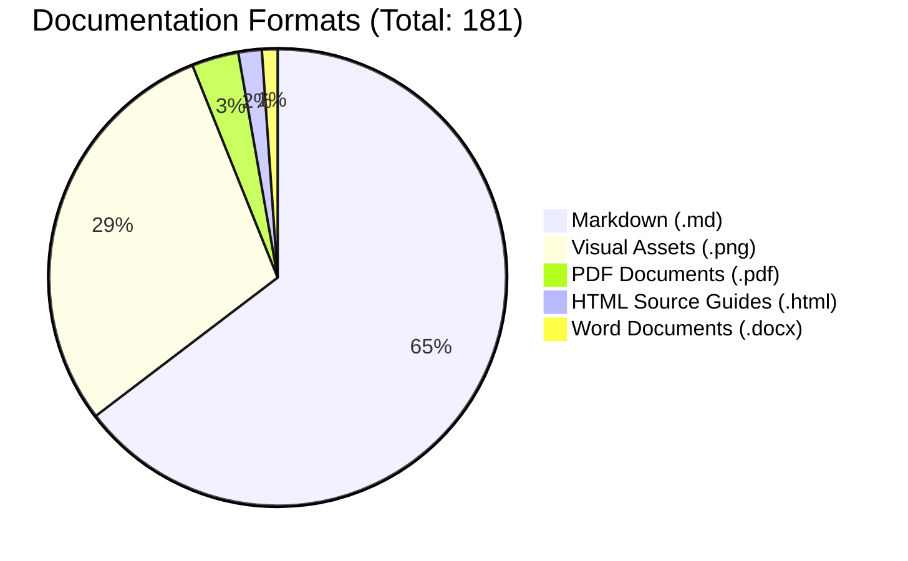

# PrathamOne EduOS — Repository Documentation Audit & Baseline Inventory

**Product:** PrathamOne EduOS  
**Edition:** Coaching Institute Edition  
**Version:** 1.0.0  
**Organization:** AITDL — AI Technology & Development Lab  
**Product Architect:** Jawahar R Mallah  
**Audit Date:** 2026-11-06  
**Status:** Pre-Modification Baseline Established  

---

## 1. Executive Summary

In accordance with Section 1 of the **Centralized Documentation Management & Auto-Organization Engine Specification**, a comprehensive audit was executed across the repository workspace and AI agent artifact stores prior to initiating any structural modifications.

A total of **181 documentation items** were identified, categorized, and cataloged:

| Category / Storage Area | Location | Item Count | Primary Formats |
|---|---|---|---|
| **Repository Documentation** | `docs/` | 113 | `.md`, `.pdf`, `.docx`, `.html`, `.png` |
| **Agent Brain Artifacts** | `<appDataDir>/brain/<id>/` | 67 | `.md`, `.png` |
| **Repository Root & System** | Workspace Root | 1 | `.md` (`README.md`) |
| **Total Documentation Items** | **Repository Ecosystem** | **181** | **All Supported Document Formats** |

### Breakdown by File Format

---

## 2. Inventory of Existing Repository Documentation (`docs/`)

The repository currently maintains **113 files** within the legacy `docs/` structure:

### 2.1 Governance & Architecture (10 files)
- `docs/ACCEPTANCE_CRITERIA.md` (12.7 KB) — Full acceptance criteria across modules.
- `docs/ATTENDANCE_AND_TEST_POLICY.md` (4.5 KB) — Attendance and examination business policy.
- `docs/COACHING_BUSINESS_RULES.md` (14.2 KB) — Core business rules for coaching operations.
- `docs/COACHING_INSTITUTE_POLICY_FRAMEWORK.md` (7.7 KB) — Comprehensive governance framework.
- `docs/COURSE_BATCH_ENROLLMENT_RULES.md` (11.4 KB) — Academic batch & enrollment specifications.
- `docs/DATA_PRIVACY_AND_SECURITY.md` (4.2 KB) — Data privacy, encryption, and protection guidelines.
- `docs/FEE_POLICY_AND_ACCOUNTING.md` (7.8 KB) — Fee structure, installments, and accounting rules.
- `docs/IMPLEMENTATION_PLAN.md` (4.5 KB) — Original system implementation blueprint.
- `docs/index.md` (5.0 KB) — Previous documentation home page.
- `docs/POLICY_DECISION_REGISTER.md` (4.9 KB) — Architectural decision log.
- `docs/ROADMAP.md` (3.7 KB) — Product roadmap and phase planning.
- `docs/ROLE_PERMISSION_MATRIX.md` (4.3 KB) — RBAC role permission mappings.
- `docs/WORKFLOW_SPECIFICATIONS.md` (5.2 KB) — Standard user and admin workflows.
- `docs/architecture/API_STANDARDS.md` (1.5 KB) — RESTful API design guidelines.
- `docs/architecture/DATABASE_DESIGN.md` (4.0 KB) — PostgreSQL schema conventions.
- `docs/architecture/SYSTEM_ARCHITECTURE.md` (4.8 KB) — Overall system architecture.
- `docs/governance/AI_AGENT_GOVERNANCE.md` (4.3 KB) — AI agent mission and boundaries.
- `docs/governance/BUSINESS_RULES.md` (2.0 KB) — Business rule enforcement guidelines.
- `docs/governance/CODE_ATTRIBUTION_AND_VERSIONING_POLICY.md` (7.1 KB) — Header attribution rules.
- `docs/governance/POLICY_DECISION_REGISTER.md` (1.3 KB) — Policy decision records.

### 2.2 Functional Modules (`docs/modules/`) (35 files)
- **Admissions (`admissions/`)**: `CHANGELOG.md`, `DEVELOPER_MANUAL.md`, `SPECIFICATION.md`, `USER_MANUAL.md`
- **Attendance (`attendance/`)**: `CHANGELOG.md`, `DEVELOPER_MANUAL.md`, `SPECIFICATION.md`, `USER_MANUAL.md`
- **Examinations (`examinations/`)**: `CHANGELOG.md`, `DEVELOPER_MANUAL.md`, `SPECIFICATION.md`, `USER_MANUAL.md`
- **Fees (`fees/`)**: `CHANGELOG.md`, `DEVELOPER_MANUAL.md`, `FEE_REGISTER_IMPORT_DEVELOPER_MANUAL.md`, `FEE_REGISTER_IMPORT_SPECIFICATION.md`, `FEE_REGISTER_IMPORT_USER_MANUAL.md`, `RECONCILIATION_REPORT.md`, `SPECIFICATION.md`, `USER_MANUAL.md`
- **Payments (`payments/`)**: `CHANGELOG.md`, `DEVELOPER_MANUAL.md`, `SPECIFICATION.md`, `USER_MANUAL.md`
- **Reports (`reports/`)**: `CHANGELOG.md`, `DEVELOPER_MANUAL.md`, `SPECIFICATION.md`, `USER_MANUAL.md`
- **Standards / Academics (`standards/`)**: `CHANGELOG.md`, `DEVELOPER_MANUAL.md`, `SPECIFICATION.md`, `USER_MANUAL.md`
- **Students (`students/`)**: `CHANGELOG.md`, `DEVELOPER_MANUAL.md`, `SPECIFICATION.md`, `USER_MANUAL.md`
- **Users / RBAC (`users/`)**: `CHANGELOG.md`, `DEVELOPER_MANUAL.md`, `SPECIFICATION.md`, `USER_MANUAL.md`

### 2.3 Operations & Releases (5 files)
- `docs/operations/BACKUP_AND_RESTORE.md` (1.3 KB)
- `docs/operations/DEPLOYMENT.md` (1.3 KB)
- `docs/operations/INSTALLATION.md` (1.5 KB)
- `docs/operations/TROUBLESHOOTING.md` (1.5 KB)
- `docs/releases/RELEASE_NOTES.md` (4.0 KB)

### 2.4 User Manuals & Visual Assets (`docs/user_manual/`) (47 files)
- **Document Packages**:
  - `PrathamOne_Academy_Complete_User_Manual.pdf` (10.7 MB)
  - `PrathamOne_Academy_Complete_User_Manual.docx` (6.4 MB)
  - `PrathamOne_Academy_Quick_Start_Guide.pdf` (891 KB)
  - `PrathamOne_Academy_Sysadmin_Manual.pdf` (1.47 MB)
- **HTML Sources**:
  - `complete_user_manual.html` (66.6 KB)
  - `quick_start_guide.html` (15.4 KB)
  - `sysadmin_manual.html` (18.6 KB)
- **37 Visual Screenshots** (`01_login_screen.png` through `27_releases_and_version_audit.png`, plus fee editing guides `fix1_*`, `fix2_*`, `fix3_*`, `guide_step*`).

---

## 3. Inventory of Agent Brain Artifacts (67 files)

The AI agent artifact repository stores 51 forensic implementation, verification, and audit reports, alongside 16 high-resolution verification screenshots:

### 3.1 Architectural, Implementation & Forensic Reports (51 Markdown Reports)
1. `teacher_payroll_implementation_plan.md` (14.6 KB) — Target: `06_TEACHER_PAYROLL`
2. `teacher_payroll_implementation_report.md` (9.8 KB) — Target: `06_TEACHER_PAYROLL`
3. `product_rebranding_and_version_baseline_report.md` (8.1 KB) — Target: `00_PRODUCT_OVERVIEW` / `19_RELEASES_CHANGELOG`
4. `fees_and_receipt_editing_ux_improvements_guide.md` (5.4 KB) — Target: `09_FEES_PAYMENTS`
5. `visual_guide_editing_fees_and_payments.md` (3.7 KB) — Target: `09_FEES_PAYMENTS`
6. `fees_and_payments_workflow_audit_and_blueprint.md` (14.9 KB) — Target: `09_FEES_PAYMENTS`
7. `fees_and_payments_workflow_implementation_report.md` (8.6 KB) — Target: `09_FEES_PAYMENTS`
8. `fees_module_elevation_report.md` (7.9 KB) — Target: `09_FEES_PAYMENTS`
9. `fees_workspace_pixel_perfection_report.md` (7.6 KB) — Target: `09_FEES_PAYMENTS`
10. `fee_records_replacement_report.md` (9.4 KB) — Target: `09_FEES_PAYMENTS`
11. `forensic_fee_ledger_reconciliation_report.md` (8.4 KB) — Target: `09_FEES_PAYMENTS`
12. `official_fee_receipt_a5_redesign_report.md` (6.7 KB) — Target: `14_PRINTING_DOCUMENTS`
13. `printable_forms_and_kyc_system_report.md` (12.7 KB) — Target: `14_PRINTING_DOCUMENTS`
14. `receipt_printing_and_pwa_system_report.md` (15.3 KB) — Target: `14_PRINTING_DOCUMENTS`
15. `global_print_and_share_branding_report.md` (8.4 KB) — Target: `14_PRINTING_DOCUMENTS`
16. `academic-module-report.md` (9.3 KB) — Target: `03_ACADEMIC_MANAGEMENT`
17. `academic_acceptance_audit_report.md` (10.6 KB) — Target: `03_ACADEMIC_MANAGEMENT`
18. `academic_year_forensic_resolution_report.md` (9.5 KB) — Target: `03_ACADEMIC_MANAGEMENT`
19. `student_assignment_reconciliation_report.md` (10.5 KB) — Target: `04_STUDENT_MANAGEMENT`
20. `student_count_reconciliation_diagnostic_report.md` (14.9 KB) — Target: `04_STUDENT_MANAGEMENT`
21. `student_lifecycle_and_withdrawal_analytics_report.md` (15.1 KB) — Target: `04_STUDENT_MANAGEMENT`
22. `student_records_restoration_report.md` (18.6 KB) — Target: `04_STUDENT_MANAGEMENT`
23. `user-management-report.md` (8.2 KB) — Target: `12_RBAC_SECURITY`
24. `sysadmin_and_staff_management_report.md` (8.6 KB) — Target: `05_TEACHER_MANAGEMENT` / `13_SYSADMIN_SETTINGS`
25. `sysadmin_complete_editing_options_audit.md` (26.9 KB) — Target: `13_SYSADMIN_SETTINGS`
26. `sysadmin_comprehensive_verified_audit_report.md` (24.4 KB) — Target: `13_SYSADMIN_SETTINGS`
27. `sysadmin_fees_permissions_audit_and_plan.md` (10.8 KB) — Target: `13_SYSADMIN_SETTINGS`
28. `sysadmin_rbac_remediation_report.md` (10.6 KB) — Target: `12_RBAC_SECURITY`
29. `sysadmin_runtime_and_production_readiness_verification_report.md` (19.6 KB) — Target: `13_SYSADMIN_SETTINGS`
30. `institute_settings_and_configuration_report.md` (7.8 KB) — Target: `13_SYSADMIN_SETTINGS`
31. `branding_preview_and_apply_audit_report.md` (12.4 KB) — Target: `13_SYSADMIN_SETTINGS`
32. `centralized_communication_and_sharing_report.md` (12.5 KB) — Target: `15_INTEGRATIONS`
33. `padata_import_reconciliation_report.md` (13.2 KB) — Target: `15_INTEGRATIONS`
34. `database_and_data_model_optimization_audit.md` (25.4 KB) — Target: `16_DATABASE_API`
35. `application_footer_implementation_report.md` (5.8 KB) — Target: `17_UI_UX_DESIGN`
36. `collapsible_application_footer_report.md` (4.0 KB) — Target: `17_UI_UX_DESIGN`
37. `application_wide_error_handling_and_recovery_report.md` (9.9 KB) — Target: `17_UI_UX_DESIGN`
38. `excel_report_grids_report.md` (7.4 KB) — Target: `11_REPORTS_EXPORTS`
39. `enterprise_release_and_change_management_report.md` (9.7 KB) — Target: `19_RELEASES_CHANGELOG`
40. `code_attribution_and_versioning_report.md` (5.9 KB) — Target: `19_RELEASES_CHANGELOG`
41. `audit-report.md` (24.4 KB) — Target: `20_AUDITS_COMPLIANCE`
42. `comprehensive_audit_and_remediation_report.md` (11.3 KB) — Target: `20_AUDITS_COMPLIANCE`
43. `full_application_audit_report_nov2026.md` (28.4 KB) — Target: `20_AUDITS_COMPLIANCE`
44. `full_system_audit_report.md` (33.1 KB) — Target: `20_AUDITS_COMPLIANCE`
45. `phase1_remediation_and_pre_migration_report.md` (7.6 KB) — Target: `20_AUDITS_COMPLIANCE`
46. `phase1_and_phase2_audit_remediation_summary.md` (4.3 KB) — Target: `20_AUDITS_COMPLIANCE`
47. `clean_production_data_cleanup_preview.md` (17.0 KB) — Target: `20_AUDITS_COMPLIANCE`
48. `github_push_and_docker_installer_report.md` (5.7 KB) — Target: `02_INSTALLATION_DEPLOYMENT`
49. `customer_deployment_synchronization_report.md` (8.1 KB) — Target: `02_INSTALLATION_DEPLOYMENT`
50. `prathamone_academy_user_manual_completion_report.md` (17.1 KB) — Target: `22_USER_MANUALS`
51. `build-plan.md` (2.6 KB) — Target: `25_BUSINESS_REQUIREMENTS`

### 3.2 Visual Screenshots (16 PNG Images)
- `tab1_monthly_payroll.png`
- `tab2_session_register.png`
- `tab3_profiles_and_rates.png`
- `tab4_vouchers_ledger.png`
- `tab5_reports_analytics.png`
- `payroll_login_check.png`
- `fix1_receipts_with_edit_button.png`
- `fix1_receipt_edit_modal.png`
- `fix2_fee_plans_with_edit_button.png`
- `fix2_fee_plan_edit_modal.png`
- `fix3_adjust_student_fees_modal.png`
- `fix3_student_profile_fees_tab.png`
- `guide_step1_payments_unlock.png`
- `guide_step2_unlock_modal.png`
- `guide_step3_payments_edit_active.png`
- `guide_step4_fee_structure_editor.png`

---

## 4. Exclusion Boundary Verification

The following files and paths were evaluated and strictly **excluded** from documentation ingestion:
- Source code in `backend/app/`, `frontend/src/`
- Configuration files: `.env`, `.env.example`, `package.json`, `tsconfig.json`, `alembic.ini`
- Database containers and migration dumps
- Customer transactional records and PII
- Temporary directories (`.pytest_cache`, `scratch/`, `__pycache__`)
- Git history (`.git/`)

---

## 5. Next Steps for Centralized Organization

1. Create target 27-module hierarchy in `docs/` (`00_PRODUCT_OVERVIEW/` through `26_ARCHIVED/` plus `assets/`).
2. Implement `tools/docs_manager.py` with `audit`, `organize`, `reindex`, `search`, `list`, and `validate` commands.
3. Automatically organize all identified documents into their respective modules with standard `YYYY-MM-DD_MODULE_DOCUMENT-TYPE_DESCRIPTION_VERSION.ext` naming.
4. Generate `docs/DOCUMENTATION_INDEX.md` and `docs/DOCUMENTATION_MANIFEST.json`.
5. Update `AGENTS.md` and `GEMINI.md` to enforce documentation generation governance.
