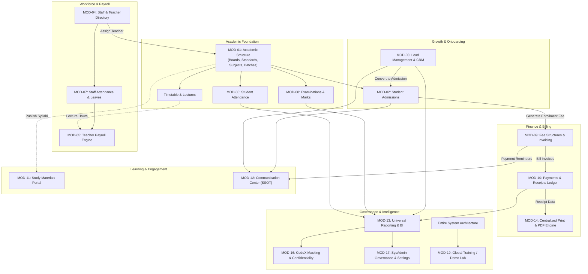

# PrathamOne EduOS — Global Cross-Module Dependency Map

**Product:** PrathamOne EduOS (Coaching Institute Edition)  
**Baseline Version:** 1.0.0  
**Product Architect:** Jawahar R. Mallah  
**Organization:** AITDL — AI Technology & Development Lab  

---

## 1. END-TO-END WORKFLOW INTEGRATION ARCHITECTURE

PrathamOne EduOS operates on a strictly governed, unidirectional Single Source of Truth (SSOT) dataflow:



---

## 2. CROSS-MODULE DEPENDENCY ANALYSIS

### 2.1 Lead Conversion to Student Admission (`CRM → Students`)
- **Producer:** `leads` table.
- **Consumer:** `students`, `guardians`, `student_enrollments`.
- **Integrity Status:** **VERIFIED & OPERATIONAL**.
- **Evidence:** Atomic endpoint `POST /leads/{id}/convert` creates new student record, assigns admission number (`ADM-YYYY-XXXX`), migrates contact details, creates guardian record, marks lead as `converted`, and retains historical communication logs without duplication.

### 2.2 Student Admission to Fee Invoicing (`Students → Fees`)
- **Producer:** `student_enrollments`.
- **Consumer:** `student_fee_assignments`, `fee_invoices`, `fee_invoice_items`.
- **Integrity Status:** **VERIFIED & OPERATIONAL**.
- **Evidence:** Enrollment triggers student fee assignment against standard fee structure; invoices generated with unique invoice numbers (`INV-YYYY-XXXX`).

### 2.3 Fee Invoicing to Payment Collection & Receipt (`Fees → Payments → Receipts`)
- **Producer:** `fee_invoices`.
- **Consumer:** `payments`, `payment_receipts`, `payment_allocations`.
- **Integrity Status:** **VERIFIED & OPERATIONAL**.
- **Evidence:** Payment collection decrements outstanding invoice balance, allocates across invoice line items, and generates immutable payment receipt (`REC-YYYY-XXXX`) compliant with the 2-row absolute bottom print footer standard.

### 2.4 Timetable & Teacher Attendance to Payroll (`Timetable + Attendance → Payroll`)
- **Producer:** `timetable_entries`, `staff_attendances`.
- **Consumer:** `teaching_sessions`, `teacher_payrolls`.
- **Integrity Status:** **PARTIAL / INTEGRATION PENDING**.
- **Gap Analysis:** Monthly base salaries and approved allowances calculate properly from `teacher_payment_profiles`. However, hourly lecture session completion logging from `timetable_entries` into `teaching_sessions` is currently pending automatic event hook implementation.

### 2.5 Academic Subjects to Study Materials (`Academic → LMS`)
- **Producer:** `subjects`, `standards`, `divisions`.
- **Consumer:** `study_materials`.
- **Integrity Status:** **DISCONNECTED / UI ONLY**.
- **Gap Analysis:** `study_materials` table exists and is queried by the student portal (`StudentDashboard.tsx`), but the administrative UI (`Courses.tsx`) renders static placeholder data disconnected from backend APIs.

---

## 3. RECOMMENDED IMPLEMENTATION & COMPLETION SEQUENCE

To resolve all identified gaps without disrupting running production services, follow this execution sequence:

```
[Phase 1: LMS Admin Integration] (P1)
  1. Build backend router `/api/v1/study-materials` with teacher/admin CRUD & file storage.
  2. Refactor `Courses.tsx` into active Study Materials Management workspace with View-First Edit Mode.

[Phase 2: Payroll Session Automation & Vouchers] (P2)
  3. Hook lecture check-in to auto-insert `teaching_sessions`.
  4. Generate printable payment vouchers (`teacher_payment_vouchers`) via `useUniversalPrint`.

[Phase 3: UI Alert Modernization & History Logging] (P3)
  5. Refactor 15 legacy `window.alert` calls to `react-hot-toast`.
  6. Add auto-insert to `staff_employment_histories` on designation/salary updates.
```
