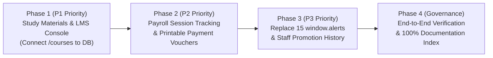

# PrathamOne EduOS — Global Module Completion Roadmap

**Product:** PrathamOne EduOS (Coaching Institute Edition)  
**Baseline Version:** 1.0.0  
**Product Architect:** Jawahar R. Mallah  
**Organization:** AITDL — AI Technology & Development Lab  

---

## 1. STRATEGIC ROADMAP OBJECTIVE

The forensic audit established that **19 out of 21 modules (90.5%) are already Completed and Verified** in production.
The objective of this roadmap is to systematically address the 2 remaining non-complete modules (`MOD-11` and `MOD-05`) alongside operational refinements (`P3` and `P4`) without touching live customer data or destabilizing working services.

---

## 2. PHASED COMPLETION ROADMAP

### Phase 1: Study Materials Management Console & Dynamic Course Integration (P1)
- **Target Module:** `MOD-11` Study Materials & Student Learning Portal
- **Scope of Work:**
  1. *Backend:* Expose administrative REST endpoints under `/api/v1/study-materials` for teachers and staff to upload, edit, tag by Standard/Subject, and archive study materials.
  2. *Frontend:* Refactor [`frontend/src/pages/Courses.tsx`](file:///f:/PrashantAcademy/frontend/src/pages/Courses.tsx) from a static placeholder into an active, database-backed Study Materials & Courses Management Console with View-First Edit Mode controls (`LockedButton`, `DeleteConfirmationModal`).
  3. *Integration:* Connect existing `study_materials` table (10 rows) with the admin UI and unify with the student dashboard.
- **Estimated Effort:** 2 Hours.
- **Testing:** Add `test_study_materials.py` and `StudyMaterials.test.tsx`.

---

### Phase 2: Teaching Session Auto-Logging & Teacher Payment Vouchers (P2)
- **Target Module:** `MOD-05` Teacher Payroll & Compensation
- **Scope of Work:**
  1. *Timetable Event Hook:* When teacher attendance is marked on a scheduled batch timetable entry, auto-insert an entry into `teaching_sessions` recording lecture duration and subject.
  2. *Printable Payment Vouchers:* Implement voucher issuance in `teacher_payroll_service.py` populating `teacher_payment_vouchers` with sequential voucher numbers (`VOU-YYYY-XXXX`).
  3. *Print Layout:* Connect voucher printing in `TeacherPayroll.tsx` using `useUniversalPrint` with canonical 2-row footer.
- **Estimated Effort:** 2.5 Hours.
- **Testing:** Extend `tests/test_teacher_payroll.py` with session and voucher assertions.

---

### Phase 3: Operational Refinements & Workforce History (P3)
- **Target Modules:** `MOD-04`, `MOD-07`, `MOD-17`
- **Scope of Work:**
  1. *Alert Modernization:* Replace 15 occurrences of `window.alert(...)` in `StaffManagement.tsx`, `SysAdminWorkspace.tsx`, `TeacherManagement.tsx`, and `Fees.tsx` with `react-hot-toast` (`toast.success` and `toast.error`).
  2. *Staff Promotion History:* Trigger automatic logging into `staff_employment_histories` whenever a staff member's designation, salary, or department is modified.
- **Estimated Effort:** 1 Hour.
- **Testing:** Verify toast popups across workforce modals.

---

### Phase 4: Final Verification & Re-Indexing (P4)
- **Scope of Work:**
  1. Execute full backend pytest suite across all modules.
  2. Execute full frontend vitest suite.
  3. Execute production Vite build and Nginx deployment.
  4. Run `manage_headers.py check` to verify 100% header compliance.
  5. Run `docs_manager.py reindex` and `validate`.
- **Estimated Effort:** 0.5 Hours.

---

## 3. RECOMMENDED NEXT IMMEDIATE STEP

**Action:** Begin with **Phase 1: Study Materials Management Console & Dynamic Course Integration (P1)**.
This directly resolves the only `UI ONLY` module in the software, replacing the hardcoded static `COURSES` array in `Courses.tsx` with dynamic, database-backed study material management.

