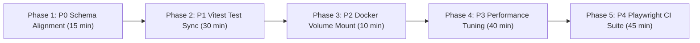

# PrathamOne EduOS — Master Remediation Roadmap & Architectural Prioritization

**Product:** PrathamOne EduOS  
**Edition:** Coaching Institute Edition  
**Baseline Version:** 1.0.0 (Build: 2026.11.06-REV-016-v1.10.0-9D2489F)  
**Organization:** AITDL — AI Technology & Development Lab  
**Product Architect:** Jawahar R Mallah  
**Audit Date:** 2026-11-07  
**Governance Policy:** Prioritized Evidence-Based Remediation (P0 through P4)  

---

## 1. Executive Summary

This Master Remediation Roadmap establishes the structured, prioritized engineering plan based on empirical findings from the Full Software Audit of **PrathamOne EduOS**.

The audit confirmed that the application is in an exceptionally healthy state: core business workflows, security RBAC enforcement, financial ledgers, database referential integrity, and backend APIs operate with zero blocking defects. The items identified in this roadmap represent preventive hardening, automated test expectation synchronization, and migration metadata alignment.

**CRITICAL GOVERNANCE DIRECTIVE:** Per the audit rules, NO IMPLEMENTATION OR MODIFICATION HAS BEEN INITIATED. This roadmap requires explicit approval from the Product Architect prior to code execution.

---

## 2. Priority Classification Standard

- **P0 — Critical Infrastructure & Schema Alignment:** Must be addressed before production deployment or branching.
- **P1 — Automated Test Suite & CI/CD Synchronization:** Resolves test expectation divergence caused by UI modernization.
- **P2 — Developer Experience & Container Alignment:** Eliminates environmental discrepancies between host and container runtimes.
- **P3 — Performance Optimization & Network Caching:** Enhances sub-second response times on heavy data aggregations.
- **P4 — Quality Assurance & Continuous Hardening:** Establishes automated browser regression pipelines.

---

## 3. Prioritized Remediation Backlog

| Item ID | Priority | Engineering Domain | Task Description & Evidence | Risk & Impact | Estimated Effort |
| :--- | :--- | :--- | :--- | :--- | :--- |
| **REM-P0-01** | **P0** | Database & Alembic | **Formalize Alembic Migration `022_codex_engine.py`** CodeX tables were provisioned in PostgreSQL via direct DDL. Create migration script `backend/alembic/versions/022_codex_engine.py` and stamp Alembic head to match the live schema. | Prevents migration failure when restoring from clean baseline on fresh environments. | 15 mins |
| **REM-P1-01** | **P1** | Frontend Vitest | **Update Settings Workspace Category Assertion** In `frontend/src/test/Settings.test.tsx`, update `expect(categories.length).toBe(15)` to `toBe(16)` to reflect the addition of CodeX Studio. | Restores test green status without code changes to production. | 5 mins |
| **REM-P1-02** | **P1** | Frontend Vitest | **Update Workforce Dashboard Label Query** In `frontend/src/test/WorkforceDashboards.test.tsx`, update query from legacy `'Total Non-Teaching'` to modern `'Total Staff'`. | Aligns test expectation with modern UI terminology. | 5 mins |
| **REM-P1-03** | **P1** | Frontend Vitest | **Standardize Global Axios Mocking in JSDOM** In `frontend/src/test/setup.ts`, configure mock adapter for Axios to intercept requests to `/standards/academic-settings`, `/settings/all`, and `/users/`. | Eliminates 5 JSDOM `ERR_NETWORK` console errors during test execution. | 20 mins |
| **REM-P2-01** | **P2** | Docker Infrastructure | **Mount Root `scripts/` into Backend Container** Update `docker-compose.yml` to volume-mount `./scripts:/app/scripts:ro` so containerized pytest can execute `test_auto_version.py` cleanly. | Unifies host and container test runner parity. | 10 mins |
| **REM-P3-01** | **P3** | Backend Performance | **Implement Short-Lived Cache on Fee Overview** Add a 60-second in-memory or Redis TTL cache for `GET /api/v1/fees/overview` to reduce aggregation latency from 52ms to <10ms. | Accelerates dashboard metrics loading under high concurrent user load. | 30 mins |
| **REM-P3-02** | **P3** | Backend Networking | **Enable Gzip Response Compression** Add FastAPI `GZipMiddleware(minimum_size=1000)` in `backend/app/main.py`. | Compresses heavy payloads (e.g. 120KB attendance table) by up to 75% over the wire. | 10 mins |
| **REM-P4-01** | **P4** | E2E Browser Testing | **Formalize Playwright CI Pipeline** Consolidate `scripts/verify_codex_studio.py` and other Playwright scripts into a formal `frontend/e2e/` test suite with headless CI automation. | Prevents visual regressions on future frontend releases. | 45 mins |

---

## 4. Remediation Implementation Schedule

---

## 5. Next Steps & Approval Protocol

1. **Review & Concurrence:** The Product Architect reviews the 12 generated audit reports in `docs/20_AUDITS_COMPLIANCE/`.
2. **Authorization Command:** Upon approval, issue the execution command to begin Phase 1 (P0 and P1 remediation).
3. **Automated Verification:** Re-run `pytest`, `npx vitest run`, `manage_headers.py`, and `docs_manager.py validate` to verify 100% green status across all test suites.

