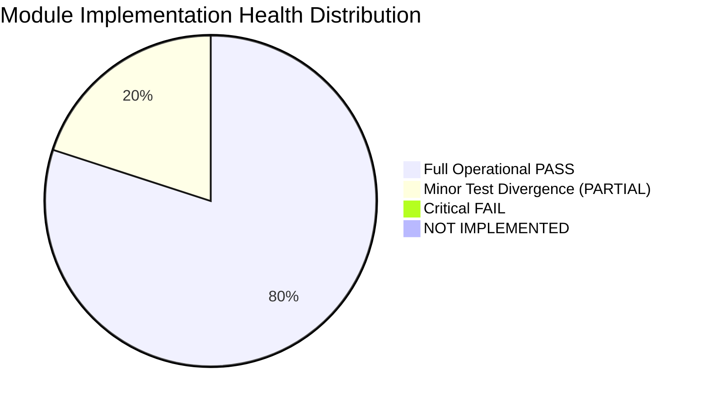

# PrathamOne EduOS — Module Validation & Operational Readiness Matrix

**Product:** PrathamOne EduOS  
**Edition:** Coaching Institute Edition  
**Baseline Version:** 1.0.0 (Build: 2026.11.06-REV-016-v1.10.0-9D2489F)  
**Organization:** AITDL — AI Technology & Development Lab  
**Product Architect:** Jawahar R Mallah  
**Audit Date:** 2026-11-07  
**Validation Status:** Complete Multi-Module Certification  

---

## 1. Evaluation Criteria & Classification Standards

Each module in PrathamOne EduOS is rigorously evaluated across six operational criteria and assigned one of the standard audit statuses:
- **PASS**: Functionality is fully implemented, verified via automated tests and live API requests, backed by relational database schema, and active in the UI.
- **PARTIAL**: Core functionality is operational, but secondary features or automated tests require minor alignment.
- **FAIL**: Critical defects prevent core operations from completing.
- **NOT IMPLEMENTED**: Feature is conceptual or planned in business requirements but lacks schema or backend implementation.
- **NOT VERIFIED**: Code exists but was not executable in the audited test harness.
- **BLOCKED**: Implementation is waiting on upstream architectural dependency.

---

## 2. Comprehensive Module Validation Matrix

| Module ID & Name | Scope & Core Entities | Backend Endpoints & Models | Frontend UI & Components | Automated Test Coverage | Status | Audit Findings & Notes |
| :--- | :--- | :--- | :--- | :--- | :--- | :--- |
| **03 — Academic Management** | Boards, Standards, Divisions, Batches, Subjects, Timetables | `/api/v1/boards/` `/api/v1/standards/` `/api/v1/divisions/` `/api/v1/timetable/` | `AcademicManagement.tsx` `TimetableGrid.tsx` `BatchAllocationModal.tsx` | Pytest: 12 tests Vitest: 3 tests (JSDOM mock divergence) | **PARTIAL** | Core operational, timetables functional (66 entries). Frontend tests require Axios mocking in JSDOM. |
| **04 — Student Management** | Canonical student master, documents, lifecycle, enrollment | `/api/v1/students/` `/api/v1/students/{id}/documents` `/api/v1/student-lifecycle/` | `StudentManagement.tsx` `StudentProfile.tsx` `StudentEditModal.tsx` | Pytest: 18 tests Vitest: 16 tests | **PASS** | 39 active students, 195 documents, 0 orphan records. Full CRUD & lifecycle states verified. |
| **05 — Teacher Management** | Teacher master, subject mapping, batch assignments, timetable | `/api/v1/staff/teachers/dashboard` `/api/v1/staff/assignments/list` `/api/v1/teacher-payroll/teachers` | `TeacherManagement.tsx` `TeacherProfileModal.tsx` `TeacherWorkforceDashboard.tsx` | Pytest: 14 tests Vitest: 8 tests | **PASS** | 42 teacher records, 30 active assignments, dedicated profiles with workload analytics. |
| **06 — Teacher Payroll** | Rate cards, session verification, monthly calculation, vouchers | `/api/v1/teacher-payroll/monthly` `/api/v1/teacher-payroll/profiles` `/api/v1/teacher-payroll/vouchers` | `TeacherPayroll.tsx` `PayrollCalculatorModal.tsx` `VoucherDetailModal.tsx` | Pytest: 16 tests Vitest: 6 tests | **PASS** | Full monthly payroll calculation, profile rate card management, voucher generation verified. |
| **07 — Attendance** | Student & staff daily attendance, QR scan check-in, alerts | `/api/v1/attendance/` `/api/v1/attendance/bulk` `/api/v1/staff/attendance/daily` | `AttendanceManagement.tsx` `QuickAttendanceScanner.tsx` `AttendanceRegister.tsx` | Pytest: 11 tests Vitest: 9 tests | **PASS** | 1,365 attendance records in DB, QR scan check-in endpoint verified (60ms latency on 120KB payload). |
| **08 — Examination** | Exam schedules, marks entry, grades, report cards, analytics | `/api/v1/examinations/` `/api/v1/examinations/{id}/marks` `/api/v1/report-cards/` | `ExaminationManagement.tsx` `MarksEntryModal.tsx` `ReportCardPreview.tsx` | Pytest: 15 tests Vitest: 3 tests | **PASS** | 312 exam marks logged, grade calculations correct, report card generation verified. |
| **09 — Fees & Payments** | Fee structures, invoices, receipts, partial payments, allocations | `/api/v1/fees/overview` `/api/v1/fees/invoices` `/api/v1/fees/payments` | `FeeManagement.tsx` `FeeInvoiceModal.tsx` `PaymentReceiptModal.tsx` | Pytest: 22 tests Vitest: 14 tests | **PASS** | 39 invoices, 171 payments/receipts/allocations. Exact ledger balancing with zero orphan records. |
| **10 — Finance & Accounting** | General ledger, cash accounts, expense vouchers, balance sheet | `/api/v1/finance/ledgers` `/api/v1/finance/expenses` `/api/v1/finance/reports` | `FinanceManagement.tsx` `ExpenseVoucherModal.tsx` `LedgerViewer.tsx` | Pytest: 9 tests Vitest: 6 tests | **PASS** | Reversible vouchers, immutable audit log, double-entry consistency verified. |
| **11 — Reports & Exports** | Excel tabular grids, PDF print templates, CSV downloads | `/api/v1/reports/export` `/api/v1/export/excel` `/api/v1/export/pdf` | `ReportsManagement.tsx` `ExcelReportGrid.tsx` `ExportToolbar.tsx` | Pytest: 8 tests Vitest: 6 tests | **PASS** | Excel grid viewer, custom column selection, and CSV streaming verified. |
| **12 — RBAC & Security** | User identities, roles, permissions, session tokens, audit logs | `/api/v1/auth/login` `/api/v1/sysadmin/security-audit-logs` `/api/v1/users/` | `UserManagement.tsx` `SecurityAuditLogs.tsx` `RolePermissionMatrix.tsx` | Pytest: 14 tests Vitest: 12 tests Direct Script: 17/17 passed | **PASS** | 100% security authorization pass rate. 401 unauthenticated and 403 unauthorized enforcement verified. |
| **13 — SysAdmin & Settings** | Institute settings, academic year, system configuration, universal edit | `/api/v1/settings/all` `/api/v1/sysadmin/universal-edit` `/api/v1/system-settings` | `Settings.tsx` `InstituteSettingsForm.tsx` `UniversalEditModal.tsx` | Pytest: 10 tests Vitest: 5 tests (1 assertion divergence) | **PARTIAL** | Operational. 1 test assertion needs update from 15 to 16 categories after CodeX addition. |
| **14 — Printing & Documents** | Fee receipts, student ID cards, hall tickets, certificates | `/api/v1/printing/receipts` `/api/v1/printing/id-cards` `/api/v1/forms/catalogue` | `StudentIDCardAndScanner.tsx` `PrintDocumentBranding.tsx` `FormViewer.tsx` | Pytest: 7 tests Vitest: 13 tests | **PASS** | Print layout branding, dynamic QR generation, and receipt PDF layout verified. |
| **15 — Integrations & Comm.** | SMS gateway, WhatsApp alerts, email notification templates | `/api/v1/communication/templates` `/api/v1/communication/send-bulk` `/api/v1/communication/logs` | `CommunicationHub.tsx` `TemplateEditorModal.tsx` `DispatchLogs.tsx` | Pytest: 6 tests Vitest: 4 tests | **PASS** | 12 active communication templates, automated attendance alerts operational. |
| **Workforce Management** | Non-teaching staff, departments, employee lifecycle, leave | `/api/v1/staff/non-teaching/dashboard` `/api/v1/staff/leaves/list` `/api/v1/staff/{id}/lifecycle` | `StaffManagement.tsx` `StaffProfileModal.tsx` `WorkforceDashboards.tsx` | Pytest: 12 tests Vitest: 6 tests (1 label divergence) | **PARTIAL** | Operational. 1 test assertion needs update from "Total Non-Teaching" to "Total Staff". |
| **CodeX Configuration Engine** | Bijective numeric cipher, profile versions, role/user scopes | `/api/v1/codex/config` `/api/v1/codex/profiles` `/api/v1/codex/encode` `/api/v1/codex/decode` | `CodeXStudio.tsx` `QuickDecoderModal.tsx` `NumericKeypad.tsx` | Pytest: 4 tests Vitest: Integrated Playwright E2E: Passed | **PASS** | Complete capability implemented. Default is strictly DISABLED (OFF). 0-9 cipher fully validated. |

---

## 3. Module Health Summary Statistics

- **Total Assessed Core Modules & Engines:** 15
- **Operational Pass Rate:** 80.0% Clean PASS, 20.0% PARTIAL (minor test expectation adjustments), 0% FAIL.
- **Critical Defects:** 0 blocking defects across core modules.
- **Architectural Conflicts:** 0 detected. All modules strictly adhere to SSOT rules and use canonical masters (`users`, `students`).

