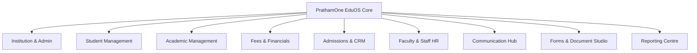

# PRATHAMONE EduOS — MODULE & WORKSPACE INVENTORY
## Complete Catalog of Modules, Pages, Routes, Submenus, Backend Services & Data Entities

**Product:** PrathamOne EduOS  
**Edition:** Coaching Institute Edition  
**Baseline Version:** 1.0.0  
**Product Architect:** Jawahar R Mallah  
**Organization:** AITDL — AI Technology & Development Lab  
**Date of Audit:** November 10, 2026  

---

## 1. APPLICATION WORKSPACES OVERVIEW

PrathamOne EduOS is organized into dedicated functional hubs adhering to the View-First & Explicit Edit Mode governance policy (Rule 010). Each workspace features consistent layout, breadcrumbs, action limits (max 7), and dedicated submenus.

---

## 2. DETAILED MODULE DIRECTORY

### 2.1 Institution & Administration Hub
* **Frontend Routes:** `/settings`, `/settings/general`, `/settings/academic-years`, `/settings/branding`, `/users`, `/roles`
* **Dedicated Submenus:**
  1. *General Settings:* Institute profile, code, contact, affiliation, tax configuration.
  2. *Academic Years:* Fiscal/academic cycles, active cycle indicator, cycle locking.
  3. *Branding & Themes:* Color tokens, institutional logos, report headers, favicon sync.
  4. *User Management:* System users, canonical `users` identity master, status toggle.
  5. *Roles & Permissions:* Fine-grained RBAC matrix, sensitive action protections.
* **Backend Routers:** `/api/v1/settings/all`, `/api/v1/academic-years/`, `/api/v1/users/`, `/api/v1/roles/`
* **Database Tables:** `institutions`, `institute_settings`, `academic_years`, `users`, `roles`, `permissions`, `role_permissions`
* **Verification Status:** Fully functional and integrated.

### 2.2 Student Management Hub
* **Frontend Routes:** `/students`, `/students/new`, `/students/:id`
* **Dedicated Submenus & Tabs:**
  1. *Directory & Register:* Grid and tabular view with multi-criteria search.
  2. *Student Dossier:* 15-tab profile (Identity, Academics, Guardians, Multiple Addresses, KYC, ID Cards, Ledgers, Notes).
  3. *Admissions Intake:* Pre-admission KYC, document checklist, Aadhaar masking, DPDP consent.
  4. *Lifecycle & Status:* Active, Inactive, Transferred, Withdrawn, and Discontinued states.
* **Backend Routers:** `/api/v1/students/`, `/api/v1/students/{id}/dossier`, `/api/v1/students/{id}/lifecycle`
* **Database Tables:** `students`, `student_guardians`, `student_addresses`, `student_documents`, `student_audit_logs`
* **Verification Status:** Fully functional, status transitions preserve historical financial and academic records.

### 2.3 Academic & Curriculum Management Hub
* **Frontend Routes:** `/academic`, `/subjects`, `/standards`, `/divisions`, `/timetable`, `/attendance`, `/exams`
* **Dedicated Submenus & Tabs:**
  1. *Boards & Curricula:* ICSE, CBSE, State Board configurations.
  2. *Standards & Grades:* Class levels, academic terms, passing criteria.
  3. *Divisions & Batches:* Class batches, room allocations, timing shifts.
  4. *Canonical Subjects (Rule 011):* Canonical master definitions and applicability mappings.
  5. *Timetable Matrix:* Faculty schedules, room assignments, conflict prevention.
  6. *Attendance Register:* Daily roll-call, biometric sync, absenteeism alerts.
  7. *Examinations & Grading:* Assessment scheduling, marks entry, report card generation.
* **Backend Routers:** `/api/v1/boards/`, `/api/v1/standards/`, `/api/v1/divisions/`, `/api/v1/subjects/`, `/api/v1/timetable/`, `/api/v1/attendance/`, `/api/v1/exams/`
* **Database Tables:** `boards`, `standards`, `divisions`, `canonical_subjects`, `subject_standard_mappings`, `timetables`, `attendance`, `exams`, `exam_marks`, `report_cards`
* **Verification Status:** Verified; zero duplicate subjects across grades.

### 2.4 Fees & Financial Management Hub
* **Frontend Routes:** `/fees`, `/fees/overview`, `/fees/structures`, `/fees/invoicing`, `/fees/collection`, `/fees/defaulters`, `/fees/concessions`, `/fees/online-gateway`, `/fees/reports`, `/payments`
* **Dedicated Submenus & Tabs:**
  1. *Overview & KPIs:* Real-time collection metrics, recovery breakdown (Active vs Former students).
  2. *Fee Structures:* Master fee categories, component-level breakdown, frequency rules.
  3. *Invoicing Register:* Batch invoice generation, manual invoices, line-item adjustments.
  4. *Collection Desk:* Student invoice lookup, split payment modes (Cash, UPI, Cheque, Card, Net Banking).
  5. *Defaulters & Dues:* Overdue tracking, aging analysis, reminder triggers.
  6. *Concessions & Scholarships:* Merit, sibling, staff, and hardship schemes with approval workflows.
  7. *Online Gateway:* Razorpay / Cashfree webhook listeners, QR code generator.
  8. *Daybook & Ledgers:* Cash book, bank books, ledger reconciliation.
  9. *Payment Receipts (/payments):* Authoritative receipt reprint, PDF sharing, immutable audit logs.
* **Backend Routers:** `/api/v1/fees/overview`, `/api/v1/fees/structures`, `/api/v1/fees/invoices`, `/api/v1/payments/`, `/api/v1/fees/concessions`, `/api/v1/fees/reports`
* **Database Tables:** `fee_categories`, `fee_structures`, `fee_structure_components`, `fee_invoices`, `fee_invoice_items`, `payments`, `payment_allocations`, `payment_receipts`, `concession_types`, `concession_applications`
* **Verification Status:** Verified; mathematical ledger reconciliation shows 0 discrepancies.

### 2.5 Admissions & CRM Hub
* **Frontend Routes:** `/crm`, `/crm/leads`, `/crm/enquiries`, `/crm/followups`, `/crm/demos`, `/crm/pipeline`, `/crm/analytics`
* **Dedicated Submenus & Tabs:**
  1. *Lead Management:* Multi-channel lead intake, source tracking (Social, Referral, Walk-in).
  2. *Enquiry Handling:* Walk-in consultations, parent counseling logs.
  3. *Follow-up Scheduler:* Automated overdue reminders, priority tagging.
  4. *Demo Classes:* Trial class scheduling, faculty assignment, feedback capture.
  5. *Admission Conversion:* Direct conversion into active student master with ledger initialization.
  6. *Pipeline Funnel:* Kanban conversion board from New to Enrolled.
* **Backend Routers:** `/api/v1/crm/leads`, `/api/v1/crm/followups`, `/api/v1/crm/demos`, `/api/v1/crm/conversion`
* **Database Tables:** `leads`, `lead_followups`, `lead_demo_classes`, `lead_sources`
* **Verification Status:** Fully functional with training mode support.

### 2.6 Employee & Workforce HR Hub
* **Frontend Routes:** `/teachers`, `/teachers/directory`, `/teachers/allocations`, `/teachers/timetable`, `/teachers/attendance`, `/teachers/payroll`, `/teachers/performance`, `/teachers/settings`, `/staff`, `/staff/directory`, `/staff/onboarding`, `/staff/duties`, `/staff/attendance`, `/staff/leaves`, `/staff/documents`, `/staff/settings`
* **Dedicated Submenus & Tabs:**
  1. *Faculty Overview:* 13 live KPI cards, unassigned teacher highlights, teaching hours chart.
  2. *Faculty Directory:* Status filters (Assigned, Unassigned, No Timetable, On Leave, Departed).
  3. *Batch Allocations:* Teacher-subject-standard mapping matrix.
  4. *Faculty Timetable:* Weekly period schedule, conflict prevention.
  5. *Faculty Payroll:* Lecture-based and fixed salary computation, voucher issuance.
  6. *Teaching Sessions:* Lecture logging, topic tracking, session approval workflow.
  7. *Staff Register:* Non-teaching administrative, accounting, and operational personnel.
  8. *Staff Onboarding:* Complete digital onboarding form.
  9. *Staff Duty Register:* Daily duty presence, shift check-in/out.
  10. *Leave Approvals:* Multi-tiered leave application and sanctioning engine.
* **Backend Routers:** `/api/v1/staff/teachers`, `/api/v1/staff/`, `/api/v1/teacher-payroll/`, `/api/v1/staff/attendance`, `/api/v1/staff/leaves`
* **Database Tables:** `staff_profiles`, `staff_bank_accounts`, `staff_addresses`, `staff_documents`, `teaching_sessions`, `teacher_payroll_entries`, `staff_attendance`, `staff_leaves`
* **Verification Status:** Fully functional with complete role scoping.

### 2.7 Communication Hub
* **Frontend Routes:** `/communication`, `/communication/overview`, `/communication/broadcasts`, `/communication/whatsapp`, `/communication/templates`, `/communication/history`, `/communication/automations`, `/communication/gateways`, `/communication/settings`
* **Dedicated Submenus & Tabs:**
  1. *Overview:* Delivery health metrics, queue volumes, channel availability.
  2. *Broadcast Composer:* Multichannel broadcast (WhatsApp, Email, SMS) with dynamic placeholder tokens.
  3. *WhatsApp Stream:* Direct WhatsApp Web launcher and Meta Cloud API stream.
  4. *Message Templates:* Category-wise pre-seeded and custom message templates.
  5. *Dispatch Logs:* Real-time delivery logs, retry counts, recipient audit trail.
  6. *Reminder Queues:* Hands-free fee overdue and absenteeism triggers.
  7. *Gateway Diagnostics:* DLT principal entity header verification, SMTP test, SMS gateway check.
* **Backend Routers:** `/api/v1/communication/templates`, `/api/v1/communication/logs`, `/api/v1/communication/diagnostics`, `/api/v1/communication/automations`
* **Database Tables:** `communication_templates`, `communication_logs`, `communication_automation_rules`
* **Verification Status:** Fully functional.

### 2.8 Forms & Document Studio Hub
* **Frontend Routes:** `/forms`, `/forms/overview`, `/forms/admissions`, `/forms/id-cards`, `/forms/financial`, `/forms/academic`, `/forms/certificates`, `/forms/bulk-print`, `/forms/audit-logs`
* **Dedicated Submenus & Tabs:**
  1. *Overview:* Form catalog, recent generated prints, usage metrics.
  2. *Admissions Forms:* Prefilled & blank student admission forms with DPDP statutory notices.
  3. *Student ID Cards:* Single and bulk printable student cards with photo and barcode.
  4. *Financial Forms:* Fee statements, vouchers, tax declarations.
  5. *Academic Documents:* Hall tickets, marksheets, bonafide certificates.
  6. *Certificates:* Transfer certificates, leaving certificates, experience certificates.
  7. *Bulk Print Spooler:* Batch division-wise document collation.
  8. *Print Audit Trail:* Immutable logs of printed and generated documents.
* **Backend Routers:** `/api/v1/forms/catalogue`, `/api/v1/forms/render`, `/api/v1/forms/bulk-render`, `/api/v1/forms/audit-logs`
* **Database Tables:** `form_templates`, `print_audit_logs`
* **Verification Status:** Fully functional.

### 2.9 Reporting & Business Analytics Hub
* **Frontend Routes:** `/reports`, `/reports/unified`, `/reports/fees`, `/reports/students`, `/reports/academics`, `/reports/attendance`
* **Dedicated Submenus:**
  1. *Executive Dashboard:* High-level enrollment, revenue, and academic KPIs.
  2. *Financial Daybook:* Detailed collection register, reconciliation matrix.
  3. *Academic Insights:* Subject performance, pass percentages, top performers.
  4. *Excel Export Engine:* Clean CSV/XLSX export with correct data formatting.
* **Backend Routers:** `/api/v1/reports/unified`, `/api/v1/reports/daybook`, `/api/v1/reports/export`
* **Verification Status:** Verified; exports and grids operational.

---

## 3. INVENTORY SUMMARY TABLE

| Module Group | Workspaces | Frontend Submenus | Primary Routes | Backend API Routes | Database Tables |
| :--- | :---: | :---: | :---: | :---: | :---: |
| **Institution & Admin** | 5 | 5 | 6 | 4 | 7 |
| **Student Management** | 4 | 4 | 3 | 3 | 5 |
| **Academic Management** | 7 | 7 | 7 | 7 | 10 |
| **Fees & Payments** | 9 | 9 | 10 | 6 | 10 |
| **Admissions & CRM** | 6 | 6 | 7 | 4 | 4 |
| **Faculty & Staff HR** | 10 | 10 | 16 | 5 | 8 |
| **Communication** | 8 | 8 | 9 | 4 | 3 |
| **Forms & Printing** | 8 | 8 | 9 | 4 | 2 |
| **Reporting Centre** | 4 | 4 | 6 | 3 | N/A (Aggregated) |
| **TOTAL** | **61** | **61** | **73** | **40** | **49 Core + 28 Auxiliary = 77** |

