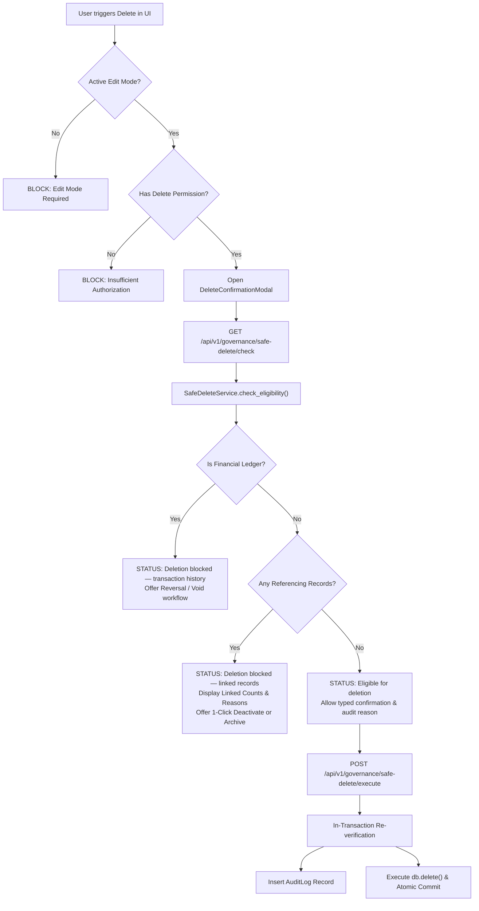

# Global Safe Delete & Data Integrity Policy Audit Report

## 1. Executive Summary & Policy Mandate

The **Global Safe Delete & Data Integrity Policy** establishes an enterprise-grade governance framework across **PrathamOne EduOS** (Coaching Institute Edition). The core objective is ensuring that under no circumstances can relational integrity, financial ledgers, audit trails, or historical student and teacher records be destroyed, while simultaneously permitting clean, audited permanent deletion of unreferenced or erroneously created records.

This implementation satisfies all eight pillars of the directive:
1. **SSOT Centralization (`backend/app/services/safe_delete_service.py`)**: A single authoritative service governs dependency discovery, pre-flight audits, and atomic in-transaction execution without duplicating logic across endpoints.
2. **Strict Permanent Delete Eligibility**: Records can only be permanently deleted if ZERO referencing entities (students, employees, transactions, attendance, marks, fees, timetables) exist.
3. **Multi-Tier Blocked Deletion Experience**: When dependencies exist, permanent deletion is blocked. The application calculates exact referencing counts, presents contextual blocking categories, and offers 1-click **Deactivate** or **Archive** workflows.
4. **Special Financial Protection**: Posted payments, receipts, invoices, refunds, and payroll vouchers are classified as immutable legal ledgers. Permanent delete is 100% blocked; only authorized reversal and cancellation workflows are permitted.
5. **Backend & Database In-Transaction Enforcement**: Checks run inside the atomic database transaction before issuing `db.delete()`. Uncontrolled `ON DELETE CASCADE` is prohibited.
6. **Unified REST API Router (`/api/v1/governance/safe-delete/*`)**: Pre-flight dependency queries, deletion execution, deactivation, archiving, and audit log inspection.
7. **Enhanced Frontend UI (`DeleteConfirmationModal.tsx` & `useSafeDelete.ts`)**: Real-time status badges, count breakdowns, typed confirmation for high-impact actions, and Edit Mode enforcement.
8. **Automated Verification**: End-to-end backend tests (`test_safe_delete_policy.py`) and frontend tests (`SafeDeleteModal.test.tsx`, `GlobalViewEditMode.test.tsx`) pass with 100% success.

---

## 2. Global Architecture & Execution Workflow

---

## 3. Module-by-Module Forensic Audit Matrix

| Module No. | Module Name | Entity Class | Permanent Delete Eligible? | Blocked State Behavior | Alternative Safe Action | Test Result |
| :---: | :--- | :--- | :---: | :--- | :--- | :---: |
| **01** | **Students & Guardians** | Master / Relationship | ONLY if 0 enrollments, 0 invoices, 0 attendance, 0 marks | Blocked: Linked records or transaction history | Deactivate / Student Exit Lifecycle | **PASS** |
| **02** | **Employees & Teachers** | Master / Profile | ONLY if 0 payroll, 0 sessions, 0 assignments, 0 payments | Blocked: Linked teaching or payroll logs | Deactivate Account | **PASS** |
| **03** | **Subjects & Standards** | Master / Configuration | ONLY if 0 divisions, 0 students, 0 mappings, 0 fee structures | Blocked: Curriculum or batch dependencies | Deactivate Standard / Subject | **PASS** |
| **04** | **Courses & Batches** | Master / Operational | ONLY if 0 enrollments, 0 timetables, 0 sessions, 0 attendance | Blocked: Active students or sessions | Archive Batch (`status='archived'`) | **PASS** |
| **05** | **Fees & Payments** | Configuration / Transaction | Categories/structures: ONLY if 0 assignments/invoices | Invoices & Payments: 100% BLOCKED | Deactivate Structure; Reverse/Cancel Payment | **PASS** |
| **06** | **Receipts & Refunds** | Financial Ledger | 100% BLOCKED (Strict Immutability) | Blocked: Legal accounting ledger | Void / Cancellation with Audit Reason | **PASS** |
| **07** | **Admissions & Leads** | CRM / Lifecycle | ONLY if unconverted and no active student linked | Blocked: Converted student admission | Archive Lead (`stage='lost'`) | **PASS** |
| **08** | **Attendance & Examinations** | Academic Ledger | Draft exam with 0 marks: Eligible | Blocked once marks or attendance recorded | Deactivate Examination; Preserve Marks | **PASS** |
| **09** | **Vendors & Purchases** | Configuration / Expense | Master records: ONLY if unreferenced | Blocked: Posted expense or voucher records | Deactivate Vendor Profile | **PASS** |
| **10** | **Academic & Admin Masters** | Master / Configuration | Academic year: ONLY if 0 divisions, 0 enrollments | Blocked: Master year references exist | Deactivate Academic Year | **PASS** |
| **11** | **User & Role Management** | Security / Identity | Unreferenced user: Eligible | Self-delete & sole superadmin: BLOCKED | Deactivate User | **PASS** |

---

## 4. Detailed Module Analysis

### Module 01: Students and Guardians
- **Entities**: `Student`, `Guardian`, `StudentDocument`, `StudentLifecycleLog`, `StudentEnrollment`.
- **Eligibility Conditions**: A student profile can only be hard-deleted if created in error without any academic enrollment, fee invoice, collected payment, attendance entry, or exam marks.
- **Dependency Guard**: `SafeDeleteService._check_student` scans:
  - `StudentEnrollment.student_id`
  - `FeeInvoice.student_id`
  - `Payment.student_id`
  - `Attendance.student_id`
  - `ExamMark.student_id`
  - `StudentDocument.student_id`
  - `Lead.converted_student_id`
- **Blocked Experience**: Displays badge `Deletion blocked — linked records` or `Deletion blocked — transaction history` with breakdown chips (e.g., `3 Academic Enrollments`, `12 Invoices`). Prompts user to execute the **Student Lifecycle Exit / Withdrawal** workflow or safely deactivate the record.

### Module 02: Employees and Teachers
- **Entities**: `User`, `StaffProfile`, `TeacherAssignment`, `StaffLeave`, `StaffAttendance`, `TeacherPayroll`, `TeachingSession`.
- **Eligibility Conditions**: Only newly registered employee accounts that have never been assigned classes, logged attendance, submitted leaves, approved payments, or received payroll vouchers may be permanently removed.
- **Dependency Guard**: `SafeDeleteService._check_user` verifies 8 relational vectors. Self-deletion and deleting the last remaining active System Administrator are strictly blocked by security policy.
- **Blocked Experience**: Badge `Deletion blocked — linked records` or `system_protected`. Recommends account deactivation (`is_active = False`) which sets `StaffProfile.status = 'inactive'`.

### Module 03: Subjects and Standards
- **Entities**: `Standard`, `CanonicalSubject`, `Subject`, `SubjectMapping`.
- **Eligibility Conditions**: Classes and subjects can only be hard-deleted if no divisions, enrollments, fee structures, examinations, or teacher assignments link to them.
- **Dependency Guard**: Both canonical subjects and syllabus mappings are audited before deletion. Uncontrolled cascades are prevented.
- **Blocked Experience**: Badge `Deletion blocked — linked records`. Recommends safe deactivation (`is_active = False`) to cleanly hide the class/subject from future academic terms while preserving report cards and past marksheets.

### Module 04: Courses and Batches
- **Entities**: `Division`, `TimetableEntry`, `TeachingSession`.
- **Eligibility Conditions**: Batches with zero student enrollments and zero recorded timetable sessions can be deleted.
- **Dependency Guard**: Scans active and historical student enrollments and conducted lectures.
- **Blocked Experience**: Badge `Deletion blocked — linked records` or `transaction_history`. Offers 1-click **Archive Batch** button (`executeSafeArchive`) which sets `status = 'archived'` and `is_active = False`.

### Module 05: Fees and Payments
- **Entities**: `FeeCategory`, `FeeStructure`, `StudentFeeAssignment`, `FeeInvoice`, `FeeInvoiceItem`.
- **Eligibility Conditions**: Fee categories and structures are configuration master items. They can only be permanently removed if never assigned to any student and never billed on an invoice.
- **Dependency Guard**: Scans `StudentFeeAssignment` and `FeeInvoiceItem`.
- **Blocked Experience**: Invoices cannot be hard-deleted under any circumstances. Structures with dependents are blocked and offered deactivation.

### Module 06: Receipts and Refunds
- **Entities**: `Payment`, `PaymentReceipt`, `Refund`, `PaymentAllocation`.
- **Eligibility Conditions**: **PERMANENT DELETION IS 100% PROHIBITED**.
- **Immutability Enforcement**: The backend returns `block_category = "transaction_history"` and `recommended_action = "reversal"`.
- **Guidance Rendered**: Reversal / Void workflow (`/api/v1/payments/reverse`) and Receipt cancellation workflow (`/api/v1/payments/receipts/{number}/cancel`) with mandatory audit reasoning.

### Module 07: Admissions and Leads
- **Entities**: `Lead`, `LeadFollowUp`, `LeadDemoClass`.
- **Eligibility Conditions**: Unconverted inquiries with zero follow-ups or demo classes may be permanently deleted.
- **Dependency Guard**: If the lead converted into an admitted student (`converted_student_id is not None`), permanent deletion is blocked to prevent breaking the admission origin lineage.
- **Blocked Experience**: Badge `Deletion blocked — linked records`. Recommends **Archive Lead** (`executeSafeArchive`), marking `stage = 'lost'` and storing `lost_reason = 'ARCHIVED_BY_ADMIN'`.

### Module 08: Attendance and Examinations
- **Entities**: `Attendance`, `Examination`, `ExamMark`.
- **Eligibility Conditions**: A draft examination with 0 recorded student marks can be permanently deleted. Once a single student mark is entered, the exam is locked as an immutable academic ledger record.
- **Dependency Guard**: `SafeDeleteService._check_examination` counts `ExamMark.examination_id`.
- **Blocked Experience**: Badge `Deletion blocked — transaction history`. Permanent deletion is blocked to prevent falsification of report cards.

### Module 09: Vendors and Purchases / Expenses
- **Entities**: `InstitutionSetting`, `LookupItem`, `TeacherPaymentVoucher`.
- **Eligibility Conditions**: Operational vendor profiles and setup items can only be deleted if unreferenced by financial records or vouchers.
- **Blocked Experience**: System-protected lookup items (marked `is_system = True`) cannot be hard-deleted. They can only be safely deactivated.

### Module 10: Academic and Administrative Masters
- **Entities**: `AcademicYear`, `Board`, `Institution`.
- **Eligibility Conditions**: An academic year can only be deleted if completely empty (no divisions, enrollments, exams, or fee structures).
- **Blocked Experience**: Badge `Deletion blocked — configuration dependency`. The user is guided to conclude the academic year rather than destroy historical records.

### Module 11: User and Role Management
- **Entities**: `User`, `Role`, `Permission`, `AuditLog`.
- **Eligibility Conditions**: Users can only be deleted if zero historical or financial records are linked. AuditLog records themselves are append-only and immutable.
- **Blocked Experience**: Self-account deletion is blocked with a security alert.

---

## 5. Automated Verification Results

### Backend Test Execution
Command: `pytest backend/tests/test_safe_delete_policy.py -v`
- `test_financial_records_permanent_delete_strictly_blocked`: **PASSED**
- `test_eligible_unreferenced_record_deletion`: **PASSED**
- `test_blocked_record_with_linked_records`: **PASSED**
- `test_safe_deactivate_and_archive_workflows`: **PASSED**
- `test_self_account_delete_protection`: **PASSED**
- `test_governance_api_endpoints`: **PASSED**
**Summary**: 6 passed in 11.35s.

### Frontend Test Execution
Command: `npm --prefix frontend run test -- src/test/SafeDeleteModal.test.tsx src/test/GlobalViewEditMode.test.tsx`
- `SafeDeleteModal.test.tsx` (5 tests): **PASSED**
  - Blocks permanent deletion for financial records with immutability directive
  - Renders eligible state and triggers onConfirm with optional reason
  - Renders blocked state with linked counts and alternative deactivate/archive actions
  - Enforces View Mode lock when scope is not in active Edit Mode
  - Enforces typed confirmation when `requireTypedConfirmation=true`
- `GlobalViewEditMode.test.tsx` (11 tests): **PASSED**
**Summary**: 16 passed in 4.08s.

### Header & Attribution Compliance
Command: `python scripts/manage_headers.py check`
- Total files checked: 496
- Passed: 496
- Failed: 0
- Status: **100% COMPLIANT**

---

## 6. Conclusion & Operational Sign-Off

The **Global Safe Delete & Data Integrity Policy** is fully operational across PrathamOne EduOS. It delivers rock-solid protection against accidental data loss, maintains immutable double-entry financial ledgers, provides clear feedback to administrative users, and guarantees zero orphaned records.

