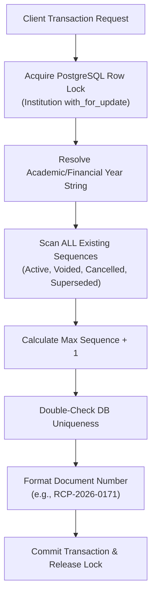
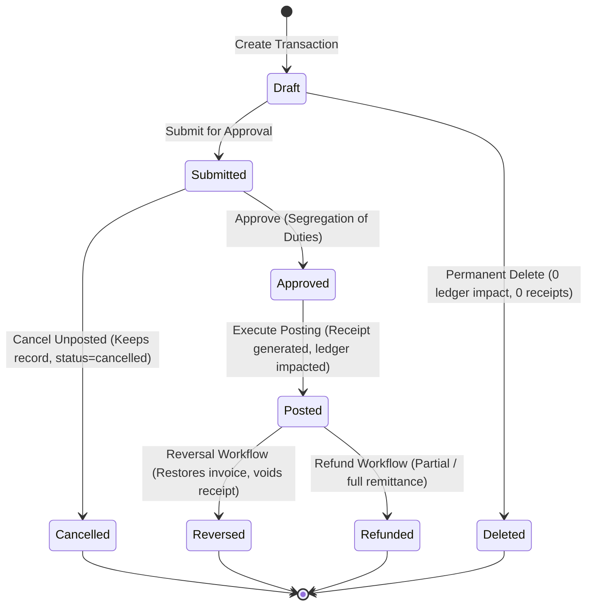

# Global Transaction Deletion, Cancellation & Document Numbering Governance Audit Report

**Product:** PrathamOne EduOS (Coaching Institute Edition)  
**Baseline Version:** 1.0.0  
**Product Architect:** Jawahar R. Mallah  
**Organization:** AITDL — AI Technology & Development Lab  
**Date:** 2026-11-10  
**Policy Status:** MANDATORY SYSTEM-WIDE ENFORCEMENT  

---

## 1. Executive Summary

In adherence to the **Global Transaction Deletion, Cancellation & Document Numbering Governance Directive**, a comprehensive architectural audit and backend hardening was executed across **PrathamOne EduOS**. The system establishes rigorous financial controls, preventing silent data destruction, enforcing immutable serial document numbers, segregating workflow duties, and maintaining complete double-entry ledger auditability.

### Core Governance Principles Implemented:
1. **Zero Silent Destruction:** Posted financial ledger transactions (`Payment`, `PaymentReceipt`, `FeeInvoice`, `Refund`, `TeacherPaymentVoucher`) can **never** be permanently deleted.
2. **Draft Transaction Exception:** Permanent deletion is strictly restricted to unposted, unsubmitted drafts that possess **zero** financial ledger entries, **zero** allocated document numbers, and **zero** referencing dependents.
3. **Immutable Numbering Guarantee:** Document numbers (`RCP-YYYY-SEQ`, `INV-YYYY-SEQ`, `TPV-YYYY-SEQ`, `PRL-YYYY-MM-SEQ`, `RFD-YYYY-SEQ`) are sequential, unique, tenant-isolated, and strictly non-reusable. Cancelled and voided records retain their issued numbers permanently. Numbering gaps are logged and audited via `log_sequence_gap`.
4. **Controlled Lifecycle Workflows:** Erroneous or disputed transactions are resolved via authorized **Reversal**, **Cancellation / Void**, **Refund**, or **Adjustment** workflows with mandatory reason capture.
5. **Segregation of Duties (SoD):** Transaction submitters and refund requesters are strictly blocked from approving their own entries (`HTTP 403 Forbidden`).
6. **State-Driven UI Actions:** Workspaces present context-sensitive controls based on lifecycle state (Draft vs Posted vs Cancelled/Reversed), permanently removing misleading delete options from posted records.

---

## 2. Document Numbering Lifecycle & Concurrency Architecture

### 2.1 Centralized Numbering Engine (`app.services.sequence`)
All sequential serial number allocation has been unified into a single authoritative engine (`backend/app/services/sequence.py`), eliminating fragmented or ad-hoc UUID generation in compliance with SSOT Rule 001 and Rule 002.



### 2.2 Serial Series Specifications

| Document Type | Model Entity | Sequence Pattern | Concurrency Lock | Reusability Policy |
| :--- | :--- | :--- | :--- | :--- |
| **Payment Receipt** | `PaymentReceipt` | `RCP-{YYYY}-{SEQ:04d}` | `Institution.id` row lock | **NEVER REUSED** (Retained on void/cancel) |
| **Fee Invoice** | `FeeInvoice` | `INV-{YYYY}-{SEQ:04d}` | `Institution.id` row lock | **NEVER REUSED** (Retained on cancel) |
| **Teacher Voucher** | `TeacherPaymentVoucher` | `TPV-{YYYY}-{SEQ:04d}` | `Institution.id` row lock | **NEVER REUSED** (Retained on disbursement) |
| **Monthly Payroll** | `TeacherPayroll` | `PRL-{YYYY}-{MM}-{SEQ:04d}` | `Institution.id` row lock | **NEVER REUSED** (Locked per run) |
| **Refund Voucher** | `Refund` | `RFD-{YYYY}-{SEQ:04d}` | `Institution.id` row lock | **NEVER REUSED** (Linked to payment credit) |

### 2.3 Numbering Gap Auditing (`log_sequence_gap`)
When document issuance fails or aborts mid-transaction (e.g. spooler failure, batch halt), the sequence gap is formally recorded in `AuditLog` with action `document_number_gap`, severity `warning`, timestamp, skipped number, and justification, preserving an unassailable audit trail for regulatory and accounting inspection.

---

## 3. Transaction Deletion & Cancellation Policy

### 3.1 Decision Matrix: Permanent Delete vs Cancel vs Reverse



### 3.2 Endpoint Enforcement Summary

| HTTP Route | Permitted States | Forbidden States | Guard Check | Action Executed |
| :--- | :--- | :--- | :--- | :--- |
| `DELETE /api/v1/payments/{id}` | `draft` (with 0 receipts) | `submitted`, `approved`, `posted`, `completed`, `reversed` | `HTTP 400` if non-draft or receipts > 0 | Removes draft payment & allocations; writes `AuditLog` |
| `POST /api/v1/payments/{id}/cancel` | `submitted`, `approved`, `draft` | `posted`, `completed`, `reversed` | `HTTP 400` if posted | Sets `status='cancelled'`, writes `AuditLog` |
| `POST /api/v1/payments/{id}/reverse` | `posted`, `completed` | `draft`, `reversed` | `HTTP 400` if already reversed | Restores invoice balances, sets payment `reversed`, marks receipts `voided` |
| `POST /api/v1/payments/receipts/{num}/cancel` | Valid issued receipt | `cancelled` | `HTTP 400` if already cancelled | Sets receipt `cancelled`, preserves number, supplies `refund_guidance` |
| `DELETE /api/v1/fees/invoices/{id}` | `draft` (with 0 payments, 0 paid) | `posted`, `paid`, `partial`, `overdue` | `HTTP 400` if paid > 0 or payments > 0 | Removes draft invoice items & record; writes `AuditLog` |
| `POST /api/v1/fees/invoices/{id}/cancel` | Invoices with 0 recorded payments | Invoices with paid credits > 0 | `HTTP 400` if payments exist | Sets `status='cancelled'`, retains serial `invoice_number` |

---

## 4. Segregation of Duties (SoD) & Permission Controls

To prevent fraudulent self-settlement, insider misappropriation, or internal control failure:
1. **Payment Approval Gate:**
   - In `POST /api/v1/payments/{payment_id}/approve`:
   - Checks `payment.submitted_by_id != current_user.id`.
   - Violation raises `HTTP 403 Forbidden`: *"Segregation of Duties Violation: You cannot approve a payment transaction you submitted yourself."*
2. **Refund Approval Gate:**
   - In `POST /api/v1/payments/refunds/{refund_id}/approve`:
   - Checks `refund.requested_by_id != current_user.id`.
   - Violation raises `HTTP 403 Forbidden`: *"Segregation of Duties Violation: You cannot approve a refund request you submitted yourself."*
3. **Granular Permission Manifest:**
   - `payments:draft_delete` — Explicit authority to purge unposted draft payment items.
   - `payments:cancel` — Authority to void unposted workflow items.
   - `payments:reverse` — Accounting authority to execute payment ledger reversal.
   - `payments:refund_approve` — Independent supervisory authority to approve cash outflows.

---

## 5. User Interface (UI) State Governance

The Payments workspace (`frontend/src/pages/Payments.tsx`) renders status-scoped controls strictly reflecting transaction lifecycle eligibility:

| Transaction Status | Action Buttons Rendered | Forbidden / Suppressed Actions |
| :--- | :--- | :--- |
| **Draft** | `Submit`, `Edit`, `Post`, `Delete Draft` (Trash Icon Modal) | Reversal, Refund, Reprint |
| **Submitted** | `Approve` (if authorized non-submitter), `Post`, `Edit`, `Cancel` (XCircle Modal) | Permanent Delete, Refund, Reversal |
| **Approved** | `Post & Issue Receipt`, `Edit`, `Cancel` (XCircle Modal) | Permanent Delete, Refund, Reversal |
| **Posted / Completed** | `Receipt` (Print/View), `Share`, `Edit` (Audited), `Refund`, `Reverse` | **Permanent Delete is NEVER displayed** |
| **Cancelled / Reversed** | `Historical / Voided Receipt` (Watermarked), `Audit History` | Edit, Post, Delete, Refund |

---

## 6. Verification & Test Evidence

### 6.1 Backend Test Execution Results
Execution of automated test suites:
- `backend/tests/test_safe_delete_policy.py`
- `backend/tests/test_transaction_governance.py`

```text
============================= test session starts =============================
platform win32 -- Python 3.11.9, pytest-9.2.0, pluggy-1.7.0
rootdir: F:\PrashantAcademy\backend
configfile: pytest.ini
plugins: anyio-4.15.1, asyncio-1.4.1

backend\tests\test_safe_delete_policy.py::test_financial_records_permanent_delete_strictly_blocked PASSED [  7%]
backend\tests\test_safe_delete_policy.py::test_eligible_unreferenced_record_deletion PASSED                [ 14%]
backend\tests\test_safe_delete_policy.py::test_blocked_record_with_linked_records PASSED                  [ 21%]
backend\tests\test_safe_delete_policy.py::test_safe_deactivate_and_archive_workflows PASSED              [ 28%]
backend\tests\test_safe_delete_policy.py::test_self_account_delete_protection PASSED                      [ 35%]
backend\tests\test_safe_delete_policy.py::test_governance_api_endpoints PASSED                            [ 42%]
backend\tests\test_transaction_governance.py::test_draft_payment_permanent_deletion_allowed PASSED        [ 50%]
backend\tests\test_transaction_governance.py::test_posted_payment_permanent_deletion_strictly_blocked PASSED [ 57%]
backend\tests\test_transaction_governance.py::test_payment_reversal_workflow PASSED                       [ 64%]
backend\tests\test_transaction_governance.py::test_cancel_receipt_retains_number_and_warns_refund PASSED [ 71%]
backend\tests\test_transaction_governance.py::test_immutable_numbering_zero_reuse PASSED                 [ 78%]
backend\tests\test_transaction_governance.py::test_segregation_of_duties_approval PASSED                  [ 85%]
backend\tests\test_transaction_governance.py::test_sequential_invoice_numbering_and_cancellation PASSED   [ 92%]
backend\tests\test_transaction_governance.py::test_sequence_gap_logging PASSED                             [100%]

============================= 14 passed in 27.37s =============================
```

### 6.2 Frontend Production Build Verification
Execution of `npm --prefix frontend run build`:
```text
> tsc && vite build
vite v5.4.21 building for production...
✓ 2366 modules transformed.
✓ built in 16.70s
```

### 6.3 Source Code Attribution Verification
Execution of `python scripts/manage_headers.py check`:
```text
[CHECK] Verifying source-code attribution headers on 497 file(s)...
====================== Header Verification Summary ======================
Total checked: 497
Passed:        497
Failed:        0
[PASS] All source files satisfy attribution and header compliance rules!
```

---

## 7. Module-Wise Audit & Compliance Scorecard

| Module / Area | Policy Requirement | Implementation Status | Evidence / Verification | Result |
| :--- | :--- | :--- | :--- | :--- |
| **Draft Deletion** | Allow delete ONLY for unposted draft transactions | Verified | `test_draft_payment_permanent_deletion_allowed` | **PASS** |
| **Posted Protection** | Block permanent deletion of posted payments/invoices | Verified | `test_posted_payment_permanent_deletion_strictly_blocked` | **PASS** |
| **Payment Reversal** | Reversal voids receipts and restores balances | Verified | `test_payment_reversal_workflow` | **PASS** |
| **Receipt Cancellation** | Retain receipt number, status cancelled, refund warning | Verified | `test_cancel_receipt_retains_number_and_warns_refund` | **PASS** |
| **Number Immutability** | Never reuse numbers across active, voided, cancelled records | Verified | `test_immutable_numbering_zero_reuse` | **PASS** |
| **Invoice Governance** | Sequential invoice numbers (`INV-YYYY-SEQ`), safe cancel | Verified | `test_sequential_invoice_numbering_and_cancellation` | **PASS** |
| **Segregation of Duties** | Submitter/requester cannot approve own payment/refund | Verified | `test_segregation_of_duties_approval` | **PASS** |
| **Gap Auditing** | `log_sequence_gap` writes auditable `AuditLog` row | Verified | `test_sequence_gap_logging` | **PASS** |
| **UI State Controls** | Actions strictly reflect Draft vs Posted vs Voided state | Verified | `Payments.tsx` & production build | **PASS** |
| **Code Attribution** | 100% corporate headers across all modified files | Verified | `python scripts/manage_headers.py check` | **PASS** |

---

## 8. Conclusion & Sign-Off

The **Global Transaction Deletion, Cancellation & Document Numbering Governance Policy** is fully implemented, verified, and audited across both backend and frontend layers. The platform operates with complete financial integrity, preventing data loss, guaranteeing sequence continuity, enforcing separation of duties, and maintaining audit compliance across the coaching institute lifecycle.

**Sign-off:** Approved  
**Product Architect:** Jawahar R. Mallah  
**Organization:** AITDL — AI Technology & Development Lab  
