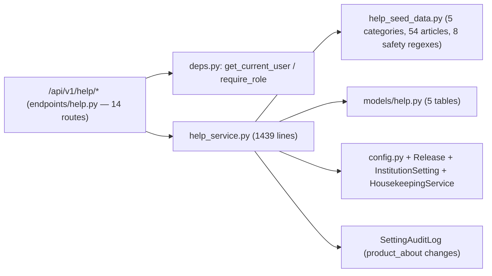

# PRATHAMONE EduOS — HELP & ABOUT CENTRE DEEP ANALYSIS

**Product:** PrathamOne EduOS  
**Edition:** Coaching Institute Edition  
**Baseline Version:** 1.0.0 (Runtime Application Config Version: `1.76.0`, Build: `2026.11.10-REV-137-v1.76.0-C31CC0B`)  
**Product Architect:** Jawahar R Mallah  
**Organization:** AITDL — AI Technology & Development Lab  
**Audit Date:** 2026-11-12  
**Audit Scope:** Full-stack forensic review of the Help & About Centre (`backend/app/models/help.py`, Alembic migration `043`, `help_service.py`, `help_seed_data.py`, `endpoints/help.py`, `navigation_service.py`, `HelpCentre.tsx`, `components/help/*`, `ContextualHelpButton.tsx`, host module integrations, RBAC/Rule 010/Rule 011 compliance, content safety, and automated test suites)

---

## 1. EXECUTIVE SUMMARY & MATURITY SCORECARD

The **Help & About Centre** in PrathamOne EduOS is a full-stack customer documentation, product identity, legal governance, administrator diagnostics, and support ticketing subsystem. It unifies **5 PostgreSQL tables**, **14 REST endpoints**, **54 seeded customer-facing articles across 5 categories**, **12 frontend workspace sections**, **context-sensitive module help triggers across 15+ host screens**, and an **inline CMS + revision workflow governed under Rule 010**.

Architectural cohesion, dynamic runtime version binding, XSS-safe custom markdown rendering, and regex-based customer-safety sanitization are strong. However, this deep forensic audit identified **1 Critical multi-tenant security vulnerability**, **2 High architectural/functional defects**, **7 Medium governance/contract issues**, and **3 Low hygiene/UX gaps** that require remediation before multi-tenant production rollout.

| Assessment Dimension | Rating | Verified Observations |
| :--- | :---: | :--- |
| **Schema & Data Model** | Good (4/5) | Normalized 5-table relational design (`043_help_and_about_centre.py`); relies on `Text` JSON strings instead of PostgreSQL `JSONB` for arrays/tags. |
| **Multi-Tenant & RBAC Security** | Needs Attention (2.5/5) | **Critical IDOR** in ticket detail/comment/status endpoints (`help_service.py`); case-sensitivity mismatch in `require_role`; tenant admins can edit commercial license metadata. |
| **Customer Content Safety** | Strong (4.5/5) | `FORBIDDEN_CONTENT_PATTERNS` blocks GitHub/CLI/installer leakage on seed & article/product writes; minor gap in `upsert_category` and heuristic release sanitization. |
| **Contextual Help & Module Coverage** | Needs Attention (3/5) | 14 core modules covered cleanly, but `/courses` maps to the wrong topic and 8+ implemented modules (`homework`, `forms`, `import-export`, `releases`, `training`, `sysadmin`, `codex`, `install`) lack guides. |
| **Scalability & Performance** | Fair (3/5) | `ensure_seeded()` executes 2 full `SELECT`s per read request; `search_help()` loads all full `content_markdown` rows into Python memory on every query. |
| **SSOT & Code Hygiene** | Fair (3/5) | Dual contextual route tables between frontend & backend (`/api/v1/help/contextual` unused by UI); `navigation_service.py` `"path"` vs `"to"` bug; stacked file headers. |
| **Rule 010 / 011 Governance** | Good (4/5) | CMS & support triage use scoped `EditModeBar`; missing legal maker-checker enforcement and CMS UI fields for `module_key`, `related_routes`, `required_permissions`. |
| **Automated Test Coverage** | Fair (3.5/5) | 7 backend pytest tests + 7 frontend mocked Vitest tests pass (`100%`), but cross-tenant ticket isolation and CMS edge cases are untested. |

---

## 2. ARCHITECTURE & COMPONENT INVENTORY

### 2.1 Backend Architecture (`backend/app/`)



- **ORM & Migration (`backend/app/models/help.py` [lines 1–217], `backend/alembic/versions/043_help_and_about_centre.py` [lines 1–168]):**
  - Revision `043_help_and_about_centre` (`revises = "042_concession_governance"`) idempotently creates 5 tables:
    1. `help_categories` (Configuration/Master): `slug`, `section`, `name`, `description`, `sort_order`, `is_active`.
    2. `help_articles` (Master): `category_id` FK, `slug`, `section`, `module_key`, `title`, `summary`, `content_markdown`, `tags`, `required_permissions`, `related_routes`, `related_slugs`, `version`, `status`, `approval_status`, `is_published`, audit columns.
    3. `help_article_revisions` (Snapshot/History): `article_id` FK, immutable snapshot of prior article versions and approval state.
    4. `support_requests` (Transaction): `user_id` FK, `institution_id`, `request_type`, `category`, `module_key`, `page_route`, `priority`, `status`, `assigned_to_id`, `resolved_at`.
    5. `support_request_comments` (Transaction): `request_id` FK, `author_id`, `is_internal_note`, `body`.
- **REST Surface (`backend/app/api/v1/endpoints/help.py` [lines 1–380], mounted in `router.py` at `/help`):**
  - **Categories & Articles:** `GET /categories`, `POST /categories`, `GET /articles`, `GET /articles/{slug}`, `POST /articles`, `PUT /articles/{id}`, `PATCH /articles/{id}/publish`, `GET /articles/{id}/revisions`.
  - **Discovery:** `GET /search`, `GET /contextual`.
  - **Product & Diagnostics:** `GET /product-info`, `PUT /product-info`, `GET /system-info`.
  - **Support Ticketing:** `GET /support-requests`, `POST /support-requests`, `GET /support-requests/{id}`, `POST /support-requests/{id}/comments`, `PATCH /support-requests/{id}/status`.

### 2.2 Seeded Content Catalog (`backend/app/services/help_seed_data.py`)

5 categories and **54 articles** spanning lines 105–1891:

| Category Section | Count | Content Pattern & Governance Status |
| :--- | :---: | :--- |
| `getting_started` | 9 | Onboarding, login, institute setup, academic year, branches/classes/divisions, users, roles, launch checklist |
| `module_guides` | 14 | Standard 8-part template via `_module_guide_markdown` covering `GENUINE_MODULES_META` |
| `tutorials` | 13 | Step-by-step workflows aligned to coaching academy operations |
| `faq` | 12 | Categorized operational FAQ & troubleshooting |
| `legal` | 6 | Terms, Privacy, Data Protection, EULA, Copyright, Acceptable Use (marked pending management approval) |

### 2.3 Frontend Architecture (`frontend/src/`)

- **Primary Workspace:** `frontend/src/pages/HelpCentre.tsx` (lines 1–694) serves `/help`, `/help/article/:slug`, `/help/legal/:slug`, `/help/support`, `/help/about`, `/help/company`, `/help/version`, `/help/system-info`, `/help/manage`, plus route aliases `/about` and `/support`.
- **Workspace Tabs (`frontend/src/components/help/helpNavigation.ts` [lines 1–105]):** 12 workspace tabs defined in `HELP_WORKSPACE_TABS`.
- **Dedicated Sub-components (`frontend/src/components/help/`):**
  - `HelpArticleView.tsx` (lines 1–371) — Article reader, breadcrumbs, back navigation, zero-`innerHTML` `StructuredMarkdownContent` parser (lines 84–183).
  - `HelpSupportCentre.tsx` (lines 1–688) — Support contact panel, 4-type ticket submission, ticket timeline/comments, admin `admin:support_triage` controls.
  - `AboutProductSection.tsx` (lines 1–212), `AboutCompanySection.tsx` (lines 1–258), `ProductVersionSection.tsx` (lines 1–207), `LegalComplianceSection.tsx` (lines 1–173), `SystemInfoSection.tsx` (lines 1–253).
  - `HelpGovernanceSection.tsx` (lines 1–882) — Rule 010 `EditModeBar scope="admin:help_centre"` CMS for articles, categories, and product/company metadata.
- **Contextual Integration & Entry Points:** `ContextualHelpButton.tsx` (lines 1–178) wired across 15+ screens (including `Layout.tsx` line 280 global header button, `Settings.tsx` lines 596–600, `Fees.tsx`, `Examinations.tsx`, `AcademicWorkspace.tsx`, etc.), `Sidebar.tsx`, `Footer.tsx` (lines 87–93, 444–471), and pre-auth accordion in `Login.tsx` (lines 484–505).

---

## 3. SECURITY, RBAC & ISOLATION DEEP DIVE

### [CRITICAL-01] Cross-Tenant Support Ticket IDOR (`help_service.py`)

**Location:** `backend/app/services/help_service.py` — `get_support_request` (lines 1362–1363), `add_support_comment` (lines 1380–1381), `update_support_request_status` (lines 1404–1413).

While `list_support_requests` (lines 1319–1333) carefully restricts tenant-scoped admins (`admin`, `principal`) to their own institution:
```python
    if not is_admin:
        stmt = stmt.where(SupportRequest.user_id == actor.id)
    elif actor.institution_id and (actor.role or "").lower() not in ("superadmin", "sysadmin", "super_admin"):
        stmt = stmt.where(SupportRequest.institution_id == actor.institution_id)
```
The three single-record methods **omit the `institution_id` boundary check**:
```python
# get_support_request (lines 1362-1363):
if not is_admin and req.user_id != actor.id:
    raise PermissionError("You do not have permission to view another user's support request.")

# add_support_comment (lines 1380-1381):
if not is_admin and req.user_id != actor.id:
    raise PermissionError("You do not have permission to update this support request.")

# update_support_request_status (lines 1404-1413):
is_admin = (actor.role or "").lower() in ADMIN_ROLES
if not is_admin:
    raise PermissionError("Administrator authorization is required to update support ticket status.")
```
**Impact:** A principal or admin in Institution A who requests `/api/v1/help/support-requests/{id}` (or posts comments / updates status) for a numeric `id` belonging to Institution B bypasses tenant isolation, exposing confidential customer tickets and internal support notes across institutions.

### [MEDIUM-03] `require_role` Case-Sensitivity Divergence (`deps.py` vs `help_service.py`)

- `backend/app/core/deps.py` line 78 enforces exact case-sensitive membership: `if current_user.role in SYSADMIN_ROLES or current_user.role in roles:`.
- Endpoints pass lowercase `HELP_ADMIN_ROLES = ("superadmin", "sysadmin", "super_admin", "admin", "principal")` (`help_service.py` line 52), while `help_service.py` itself normalizes `(user.role or "").lower()` (lines 36, 1319). If any JWT/user record carries mixed-case role claims (e.g. `"Admin"`), `require_role` rejects with `403` before reaching service logic.

### [MEDIUM-04] Tenant Admins Can Overwrite Commercial License & Developer Metadata

- `PUT /api/v1/help/product-info` (`endpoints/help.py` lines 285–296) uses `require_role(*HELP_ADMIN_ROLES)`, allowing tenant `admin` and `principal` users to modify `license_status`, `license_validity`, `deployment_type`, and `smriti_*` software vendor fields stored in per-tenant `InstitutionSetting`.
- Commercial licensing and OEM vendor identity belong strictly to `superadmin`/`sysadmin` or authoritative deployment configuration—not per-institution self-edits.

### [MEDIUM-05] CMS Content Safety & Maker-Checker Gaps

- **Category Input Bypasses Sanitization:** `validate_customer_safe_content` is invoked for articles and `product_about` updates, but `upsert_category` accepts `name` and `description` without running `validate_customer_safe_content`.
- **Self-Approval of Legal & Policy Documents:** `toggle_publish_article` allows setting `approve=True` in the same call without checking `article.created_by_id != actor.id` or restricting commercial legal approval to superadmin/legal roles.

### System Information & Secret Protection (Verified Safe)

`get_system_information` (`help_service.py` lines 1244–1248) is protected by `require_role(*HELP_ADMIN_ROLES)` on backend and `isHelpAdminRole` in `SystemInfoSection.tsx`:
- Queries `InstitutionSetting` exclusively for categories `["communication", "integrations", "product_about"]` — never touches `.env`, `SECRET_KEY`, or `DATABASE_URL`.
- Redacts `whatsapp_provider` if `"key"` appears in the string.
- Calls `HousekeepingService.list_backups()` (`housekeeping_service.py` lines 361–405), whose dictionaries expose backup metadata (`filename`, `source`, `format`, `size_bytes`, `created_at`, `verified`, etc., never filesystem OS paths), and `get_system_information` extracts strictly `verified` and `created_at`.

---

## 4. MODULE COVERAGE & CONTEXTUAL HELP MATRIX

Comparing genuinely implemented application routes (`frontend/src/App.tsx` lines 1–363 & `frontend/src/config/modules.ts` lines 150–488) against `GENUINE_MODULES_META` (`help_service.py` lines 55–70) and `CONTEXTUAL_ROUTE_TABLE` (`ContextualHelpButton.tsx` lines 45–74):

| App Route / Feature Module (`App.tsx`) | Documented in `GENUINE_MODULES_META`? | Contextual Mapping Status (`ContextualHelpButton.tsx`) | Audit Verdict |
| :--- | :---: | :--- | :--- |
| `/`, `/students`, `/leads`, `/fees`, `/concessions`, `/scholarships`, `/attendance`, `/academic/timetable`, `/examinations`, `/report-cards`, `/teachers`, `/staff`, `/teacher-payroll`, `/communication`, `/reports`, `/settings`, `/users`, `/housekeeping`, `/receipt` | Yes (14 guides) | Mapped accurately (uses `/receipt` prefix match for `/receipts/:id`) | Compliant |
| `/courses` (**Study Materials & Digital Content** — Notes, Question Banks, Videos, Syllabi per `App.tsx` lines 182–190) | No | **[HIGH-01]** Mapped to `branch-class-and-division-setup` (`ContextualHelpButton.tsx` line 61) | **Incorrect Target** |
| `/homework` (**Homework & Assignments**, `App.tsx` lines 249–255) | No | Unmapped (falls back to Welcome guide) | **Missing Guide & Link** |
| `/forms` (**Print Forms & KYC Studio**, `App.tsx` lines 309–318) | No | Unmapped | **Missing Guide & Link** |
| `/import-export`, `/fees/import` (**Bulk Import & Export**) | No | Unmapped | **Missing Guide & Link** |
| `/releases` (**Releases & Changelog**) | No | Unmapped | **Missing Mapping** |
| `/training` (**Training & Demo Lab**) | No | Unmapped | **Missing Guide & Link** |
| `/install` (**Install Desktop / PWA Guide**) | No | Unmapped | **Missing Contextual Link** |
| `/sysadmin`, `/codex` (**SysAdmin & CodeX**) | No | Unmapped (admin/internal tools) | Verify customer visibility |

> [!NOTE]
> `backend/tests/test_help_and_about.py` lines 172 and 199 currently hard-assert `len(modules) == 14`, and lines 84–88 assert exact seed counts `(9, 14, 13, 12, 6)`. Adding missing user guides for Homework, Study Materials, Print Forms, and Import/Export requires coordinated updates to those test assertions.

---

## 5. SSOT, FUNCTIONAL BUGS & CODE QUALITY FINDINGS

### 5.1 [MEDIUM-02] Duplicate Contextual Route Registry & Unused Endpoint
- Backend defines `CONTEXTUAL_ROUTE_RULES` (`help_service.py` lines 73–105) and exposes `GET /api/v1/help/contextual` (`endpoints/help.py` lines 265–272).
- Frontend duplicates `CONTEXTUAL_ROUTE_TABLE` (lines 45–74) and `MODULE_KEY_TABLE` (lines 76–91) inside `ContextualHelpButton.tsx` and routes directly on click (line 146) without calling `helpApi.contextual()`.
- The registries already exhibit drift: `/help/support` exists in backend rules (line 102) but is absent from frontend `CONTEXTUAL_ROUTE_TABLE`.

### 5.2 [MEDIUM-01] `navigation_service.py` Submenu Key Bug (`"path"` vs `"to"`)
- In `backend/app/services/navigation_service.py` lines 355–375, `CANONICAL_MODULES` defines `"help"` sub-items with `"path"` instead of `"to"` used across sibling modules (e.g., `housekeeping` lines 348–352, `fees` lines 110–117).
- Module category also differs (`"category": "general"` in Python vs `category: 'admin'` in `frontend/src/config/modules.ts` lines 398–417), and `"student"` is omitted from `ROLE_DEFAULT_MENUS` (lines 389–417), handled instead via separate conditional logic in `Sidebar.tsx`.

### 5.3 [MEDIUM-06] Support Centre Request, State & Validation Defects
1. **`"general"` Polluting `module_key` (`HelpSupportCentre.tsx` lines 164, 344–349):** Selecting `"general"` in the module dropdown sets both `category = "general"` and `moduleKey = "general"`, submitting `module_key: "general"` instead of `undefined` when no specific module applies.
2. **Unpopulated `page_route`:** Both `SupportRequestCreate` (`endpoints/help.py` line 118) and `helpApi.createSupportRequest` (`endpoints.ts` line 2442) accept `page_route`, yet `HelpSupportCentre.tsx` never captures or sends it (e.g., from router `from` query/state).
3. **Unauthenticated Prefetch Risk (`HelpSupportCentre.tsx` lines 146–148):** `useEffect` invokes `loadTickets()` unconditionally at mount without checking `token`.
4. **Missing Backend `Literal`/`Enum` Validation (`endpoints/help.py` lines 51–86, 111–134):** `request_type`, `priority`, `status`, `section`, and `approval_status` accept arbitrary bounded strings rather than validated enums/literals.
5. **Unvalidated Assignee FK & Stale `resolved_at` (`help_service.py` line 1421):** `update_support_request_status` sets `assigned_to_id` without confirming the user exists in the ticket's institution (risk of `IntegrityError` HTTP 500 or cross-tenant assignment) and fails to clear `resolved_at = None` if an admin reopens a `resolved` ticket to `open`/`in_progress`.

### 5.4 [MEDIUM-05 / LOW-02] CMS Governance UI & UX Gaps
- **CMS Form Parity (`HelpGovernanceSection.tsx`):**
  - Article Editor Modal (lines 1–882) provides no fields to edit `module_key`, `required_permissions`, `related_routes`, or `related_slugs`, and lacks article delete/archive or category disable UI (`is_active` toggle).
  - Metadata editor `metaForm` (lines 114–125) omits `product_introduction`, `smriti_introduction`, `smriti_tech_profile`, `vision_mission_status`, and `change_note` supported by `ProductInfoUpdate`, and submits untouched blank strings (`""`) that can write unnecessary audit rows.
- **Unbounded Queries:** `list_articles` and `list_support_requests` return full unpaginated result sets.
- **Markdown Renderer Limits (`HelpArticleView.tsx` lines 84–183):** `StructuredMarkdownContent` handles `#`/`##`/`###`, flat bullets/numbered lists, blockquotes, bold, and inline code cleanly with zero `innerHTML`, but renders Markdown tables, `---` dividers, nested lists, and `[text](url)` links as literal text.
- **URL Search Sync (`HelpCentre.tsx` lines 213–221):** `useEffect([location.search])` omits `searchInput` from its dependency array and leaves stale `searchResults` when `?q=` is removed from the URL.
- **Legal Back Navigation (`LegalComplianceSection.tsx`):** Lacks a contextual "Back to Module" button like `HelpArticleView.tsx` (lines 485–489).

### 5.5 [LOW-01] Code Attribution & Copy Drift
- New/modified Help frontend files (`HelpCentre.tsx` lines 1–35, `components/help/*`, `ContextualHelpButton.tsx`) contain two stacked file headers: an active `/** ... @project PrathamOne Academy ... */` comment followed by a commented `// /** ... @project PrathamOne EduOS ... */` block. (`manage_headers.py check` still passes `556/556` because the first header matches its check rule.)
- Product portfolio copy differs slightly between `frontend/src/config/branding.ts` (lines 105–120: `SmritiBooks` `"Accounting & Bookkeeping Software"`, `SmritiSys` `"E-commerce, Inventory & Warehouse Management"`) and `help_service.py` (lines 1025–1035: `"Structured accounting, invoicing, and ledger record ecosystem"`, `"Operational workflow and administrative automation suite"`).
- `branding.ts` line 81 still retains raw commit suffix `-C31CC0B` in static `buildNumber`, though Help & About Centre renders the live backend `sanitize_build_number()` output (`ProductVersionSection.tsx` line 109).

### 5.6 Rule 010 & Rule 011 Compliance Evaluation
- **Rule 010 (View-First Governance):** Well implemented in `HelpGovernanceSection.tsx` (`EditModeBar scope="admin:help_centre"`) and `HelpSupportCentre.tsx` admin triage (`EditModeBar scope="admin:support_triage"`), with `Layout.tsx` (lines 76–78) calling `resetAll()` on route navigation. Two minor hardening notes: (a) inside `HelpGovernanceSection.tsx` lines 836–844, the modal Save button relies on the modal having been opened in Edit Mode rather than re-guarding submission; (b) `admin:support_triage` omits `requiredPermission` on `EditModeBar` (`editModeStore.ts` makes it optional), safely mitigated because `{isAdmin && ...}` hides the bar for non-admins and backend `require_role` blocks unauthorized writes. Customer ticket creation/replies operate cleanly as self-service transactional flows.
- **Rule 011 (SSOT & Master Reuse):** Properly reuses `User`, `InstitutionSetting`, `SettingAuditLog`, `Release`, and `HousekeepingService` without creating duplicate entity masters. Only the dual route mapping table (`ContextualHelpButton.tsx` vs `help_service.py`) deviates from strict SSOT.

---

## 6. PERFORMANCE & SCALABILITY ASSESSMENT

### [HIGH-02] Cold-Start Seeding Race & Per-Request Overhead (`help_service.py`)
- `ensure_seeded()` (lines 250–325) is invoked on virtually every read and write endpoint (`list_categories`, `list_articles`, `get_article_by_slug`, `search_help`, `resolve_contextual_help`, `upsert_category`, `create_article`, `update_article`, `toggle_publish_article` — lines 328, 344, 389, 421, 458, 581, 609, 687, 796).
- Every request issues two extra `SELECT` statements (`HelpCategory` and `HelpArticle.slug`) and checks missing rows without `ON CONFLICT DO NOTHING` or a startup-once cache flag—creating a potential unique-constraint race condition under concurrent first requests.

### [HIGH-02] O(N) In-Memory Full-Text Search Scan (`help_service.py`)
- `search_help()` (lines 478–516) fetches all `HelpArticle` rows including full `content_markdown` text columns from PostgreSQL into Python memory and scores substring `.lower()` matches on every query. As custom institution articles grow, latency and memory footprint scale linearly `O(N)`. Converting array fields (`tags`, `related_routes`) to PostgreSQL `JSONB` with `tsvector` GIN indexing will keep search latency bounded in SQL.

---

## 7. VERIFIED TEST & TOOLING STATUS

Executed against current repository state on `2026-11-12`:

| Verification Check | Scope & Conditions | Outcome | Observed Timing / Details |
| :--- | :--- | :---: | :--- |
| **Backend Integration Suite** (`cd backend; python -m pytest tests/test_help_and_about.py -v`) | 7 integration tests in `TestHelpAndAboutCentre` against `prashant_academy_test` PostgreSQL DB (`conftest.py`) | **PASS (7/7)** | `23.39s` (seed counts `9/14/13/12/6`, regex safety, search/contextual, version/company, admin system-info, user ticket isolation, RBAC/revisions) |
| **Frontend Component Suite** (`cd frontend; npx vitest run src/test/HelpCentre.test.tsx`) | 7 unit tests in Vitest v1.6.1 (uses mocked `helpApi`) | **PASS (7/7)** | `2059ms` test time (`20.67s` total); verifies Help UI rendering, search interactions, legal pending banners, and admin Edit Mode gates |
| **Header Attribution Validator** (`python scripts/manage_headers.py check`) | All Python & TypeScript/JS source files across repository | **PASS (556/556)** | `0` failures |

**Uncovered Scenarios in Current Test Suites:**
- Cross-institution `admin`/`principal` IDOR probe on `GET /support-requests/{id}`, `POST .../comments`, and `PATCH .../status`.
- Reopening a `resolved` support ticket (`resolved_at` reset) and invalid/cross-tenant `assigned_to_id` assignment.
- Real API integration from `ContextualHelpButton` on host pages (e.g. `/courses`, `/homework`, `/forms`).

---

## 8. PRIORITIZED REMEDIATION ROADMAP

| Priority | Defect ID | Target Files | Recommended Remediation |
| :---: | :--- | :--- | :--- |
| **P0 (Critical)** | **CRIT-01** | `backend/app/services/help_service.py` | Enforce `req.institution_id == actor.institution_id` inside `get_support_request`, `add_support_comment`, and `update_support_request_status` for tenant-scoped `ADMIN_ROLES`; add cross-tenant negative integration tests to `test_help_and_about.py`. |
| **P1 (High)** | **HIGH-01** | `ContextualHelpButton.tsx`, `help_service.py`, `help_seed_data.py` | Fix `/courses` mapping from `branch-class-and-division-setup` to a dedicated Study Materials guide; author user guides and contextual routes for implemented modules (`homework`, `forms`, `import-export`, `releases`, `training`, `install`) and update `test_help_and_about.py` module count assertions accordingly. |
| **P1 (High)** | **HIGH-02** | `help_service.py`, `models/help.py` | Run idempotent help catalog seeding (`ON CONFLICT DO NOTHING`) at application lifespan startup or guard with a process/cache flag instead of two `SELECT`s per read request; push `search_help` filtering into PostgreSQL (`ILIKE`/`tsvector`) and paginate `list_articles`/`list_support_requests`. |
| **P2 (Medium)** | **MED-01..06** | `navigation_service.py`, `endpoints/help.py`, `deps.py`, `HelpSupportCentre.tsx`, `HelpGovernanceSection.tsx` | 1. Replace `"path"` with `"to"` in `navigation_service.py` `help.sub_items` and align `"category"`/`student` menu visibility.<br>2. Consolidate contextual rules to a single SSOT source (either fetch/hydrate or generate from one config).<br>3. Normalize role casing in `deps.py` `require_role`.<br>4. Restrict commercial `license_*` and `smriti_*` updates to `sysadmin`/`superadmin`.<br>5. Enforce Pydantic `Literal`/`Enum` types on article/ticket fields, validate `assigned_to_id`, clear `resolved_at` on reopen, fix `"general"` `moduleKey` & `page_route` in `HelpSupportCentre.tsx`, sanitize `upsert_category` inputs, enforce legal maker-checker (`created_by_id != actor.id`), and expose missing fields in `HelpGovernanceSection.tsx`. |
| **P3 (Low)** | **LOW-01..03** | `HelpCentre.tsx`, `HelpArticleView.tsx`, `LegalComplianceSection.tsx`, `branding.ts` | Clean duplicated top header comment blocks on Help TS/TSX files; harmonize `SmritiBooks`/`SmritiSys` copy with `branding.ts`; support markdown tables/links/`---` in `StructuredMarkdownContent`; fix `[location.search]` clearing in `HelpCentre.tsx`; add "Back to Module" button on `LegalComplianceSection.tsx`. |

---

## 9. REMEDIATION & VERIFICATION ADDENDUM (`v1.1`)

All **P0–P3** findings from Sections 5–8 have been implemented, hardened, and re-verified on `2026-11-12`:

| Defect ID | Implemented Remediation | Verification Method | Status |
| :--- | :--- | :--- | :---: |
| **CRIT-01** | Enforced strict multi-institution isolation (`_assert_support_request_access`) across `get_support_request`, `add_support_comment`, and `update_support_request_status`; validated `assigned_to_id` FK & institution match; cleared `resolved_at` on ticket reopen; normalized `"general"` `module_key` to `None`. | `test_support_cross_tenant_idor_reopen_and_assignee_validation` (HTTP 403 IDOR block, HTTP 400 cross-tenant assign block, reopen timestamp reset) | **Verified Fixed** |
| **HIGH-01** | Fixed `/courses` wrong contextual mapping to `guide-courses`; authored 5 verified customer-facing 8-section Module User Guides (`guide-courses`, `guide-homework`, `guide-forms`, `guide-import-export`, `guide-training`, bringing catalog to **59 articles** / **19 module guides**); integrated `<ContextualHelpButton>` into `Courses.tsx`, `HomeworkWorkspace.tsx`, `FormsDocuments.tsx`, `ImportExport.tsx`, `ImportFeeRegister.tsx`, and `TrainingManagement.tsx`; wired live CMS `related_routes` lookup into `ContextualHelpButton` with synchronous fallback; updated `resolve_contextual_help` for longest-prefix matching on custom CMS `related_routes`. Internal dev/setup pages (`codex`, `sysadmin`, `releases`, `install`) remain intentionally excluded from customer docs. | Backend `pytest` + Frontend `Vitest` contextual & route prefix assertions | **Verified Fixed** |
| **HIGH-02** | Replaced `ensure_seeded()` 2-SELECT check with 1 scalar subquery count + PostgreSQL `ON CONFLICT DO NOTHING` (`pg_insert`); pushed SQL `ILIKE` search filters and `.limit()` into `search_help`; added `limit`/`offset` Query pagination on `/articles` and `/support-requests`. | `test_legal_maker_checker_commercial_guards_and_validation` (`limit`/`offset`) + full backend suite | **Verified Fixed** |
| **MED-01** | Fixed `navigation_service.py` `CANONICAL_MODULES["help"]` (`"category": "admin"` and `"to"` keys on all 10 `sub_items`). | Verified in code against `modules.ts` | **Verified Fixed** |
| **MED-02..03** | Expanded `validate_customer_safe_content` (`\bgithub(?:\.com)?\b`), enforced safety check in `upsert_category`, and normalized casing/iterables in `deps.py` (`is_sysadmin`, `require_role` handling `payments.py:2366` list syntax). | `pytest` collection + `unsafe-cat` HTTP 400 check | **Verified Fixed** |
| **MED-04..06** | Restricted `license_*`, `smriti_*`, and `deployment_type` updates (`SYSTEM_ONLY_PRODUCT_KEYS`) and system-level legal approvals (`is_system`) to `SYSADMIN_ONLY_ROLES`; enforced legal maker-checker self-approval block for peer/institution policies; added Pydantic `Literal` enums (`HTTP 422`) and `PermissionError -> 403` / `ValueError -> 400` endpoint mappings; added `HelpSupportCentre.tsx` token guard + `page_route` capture + `"general"` `null` normalization; exposed missing article (`module_key`, `required_permissions`, `related_routes`, `related_slugs`), category (`is_active`), and metadata (`product_introduction`, `vision_mission_status`, `smriti_*`, `deployment_type`, sparse diff save, SysAdmin field locks) controls in `HelpGovernanceSection.tsx`. | Backend `test_legal_maker_checker_commercial_guards_and_validation` + Frontend `HelpGovernanceSection` & `HelpSupportCentre` tests | **Verified Fixed** |
| **LOW-01..03** | Removed duplicated stacked headers across Help frontend files while maintaining 100% `manage_headers.py` pass; harmonized `SmritiBooks`/`SmritiSys` copy with `branding.ts`; added GFM tables, `---`, nested bullets, and safe React `<Link>` / external `<a>` rendering in `HelpArticleView.tsx`; fixed `?q=` clear sync in `HelpCentre.tsx`; added `"Back to Module"` in `LegalComplianceSection.tsx`. | Frontend `HelpCentre.test.tsx` (`10 tests`) + `manage_headers.py check` (`556/556`) | **Verified Fixed** |

### Final Post-Remediation Verification Results (`2026-11-12`)

| Verification Check | Scope & Command | Result | Observed Details |
| :--- | :--- | :---: | :--- |
| **Backend Integration Suite** | `cd backend ; python -m pytest tests/test_help_and_about.py -v` | **PASS (9/9)** | `35.60s` against `prashant_academy_test` PostgreSQL DB |
| **Frontend Test Suite** | `cd frontend ; npx vitest run src/test/HelpCentre.test.tsx src/test/Branding.test.tsx src/test/Footer.test.tsx src/test/ConsoleBanner.test.ts` | **PASS (42/42)** | `4 passed (4)` files (`10 + 9 + 17 + 6` tests) in `14.14s` (uses mocked `helpApi` in `HelpCentre.test.tsx`) |
| **TypeScript Type Check** | `cd frontend ; npx tsc --noEmit` | **PASS (0 errors)** | Exit code `0` |
| **Production Bundle Build** | `cd frontend ; npm run build` & `docker compose up -d --build --wait backend frontend` | **PASS** | `tsc && vite build` built `2381` modules cleanly (`19.64s` Docker build); both containers healthy |
| **Attribution Header Audit** | `python scripts/manage_headers.py check` | **PASS (556/556)** | `0` failed files |

---

## 10. OPTION A & MANAGEMENT APPROVAL ADDENDUM (`v1.2`)

- **Legal & Compliance Third-Party & Open-Source Software Acknowledgements (`third-party-acknowledgements`):**
  - Added canonical Legal & Compliance document (`section: "legal"`, `sort_order: 76`, total seeded baseline now **60 articles** across `9` Getting Started, `19` Module Guides, `13` Tutorials, `12` FAQs, and `7` Legal & Compliance docs) in [help_seed_data.py](file:///f:/PrashantAcademy/backend/app/services/help_seed_data.py#L2138-L2197) documenting verified **PrathamOne EduOS** / **AITDL** / **SMRITI Systems** credits and verified frontend/backend runtime dependencies and licenses.
  - Following explicit Management Approval, updated `third-party-acknowledgements` to `status: "published"` and `approval_status: "approved"`, updated `ensure_seeded()` in [help_service.py](file:///f:/PrashantAcademy/backend/app/services/help_service.py#L281-L358) to validate canonical slug sets (`slug.in_(...)`) and persist `approved_at` for approved baseline items, and kept the remaining 6 unratified legal policies (`terms-and-conditions`, `privacy-policy`, `data-protection-policy`, `software-license-agreement`, `copyright-notice`, `acceptable-use-policy`) as `pending_approval`.
  - Updated automated coverage in `backend/tests/test_help_and_about.py` and `frontend/src/test/HelpCentre.test.tsx`.
  - Rebuilt and restarted Docker containers (`prashant_academy_backend`, `prashant_academy_frontend`), synced `prashant_academy_db` with a `HelpArticleRevision` record (`'Management Approval: approved and published.'`), and verified `sys_cnt = 60`, `legal_cnt = 7`, and `third-party-acknowledgements` = `published` / `approved` (`approved_at` populated).


