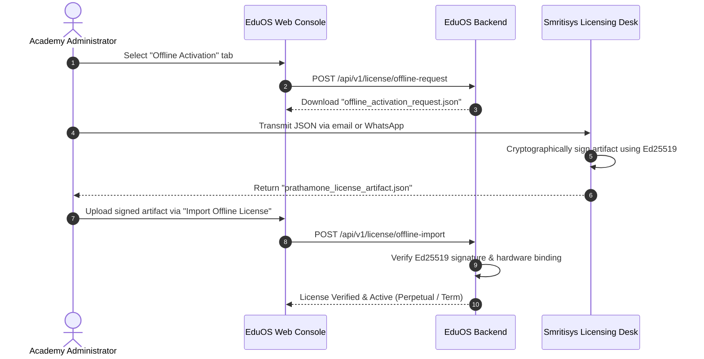

# PRATHAMONE EduOS — LICENSE AUTHORITY CONFIGURATION & CLIENT ACTIVATION GUIDE

**Product:** PrathamOne EduOS (Coaching Institute Edition v1.0.0)  
**Author:** Jawahar R. Mallah  
**Organization:** Smritisys & AITDL Networks  
**Client Target:** Prashant Academy Coaching Institute  
**Module:** `21_TROUBLESHOOTING`  

---

## 1. Executive Summary & Root Cause Analysis

When deploying **PrathamOne EduOS** on a client on-premises server or virtual private cloud, administrators activating a new institutional license may encounter the following toast error:

```
License activation or refresh failed: License authority URL is not configured.
```

### 1.1 Technical Root Cause
The backend endpoint `POST /api/v1/license/activate` validates the presence of `settings.LICENSE_AUTHORITY_URL` before attempting an online handshake with the central Smritisys License Authority:

```python
authority_url = settings.LICENSE_AUTHORITY_URL.strip().rstrip("/")
if not authority_url:
    raise HTTPException(status_code=503, detail="License authority URL is not configured.")
```

If the client environment was initialized by copying `.env.example` to `.env` without specifying the authority endpoint, `LICENSE_AUTHORITY_URL` defaults to an empty string (`""`), blocking online activation and automatic background refresh tasks.

---

## 2. Permanent Architectural Fixes Applied

To eliminate this deployment friction across all current and future deployments:

1. **Robust Default in Core Settings (`backend/app/core/config.py`):**
   `LICENSE_AUTHORITY_URL` now defaults to `"https://smritisys.com"`, and `LICENSE_PUBLIC_KEYS_JSON` defaults to the canonical Smritisys Ed25519 public key. Even if an environment file omits these variables, the application gracefully defaults to the canonical authority.

2. **Docker Compose Fallback (`docker-compose.yml`):**
   `LICENSE_AUTHORITY_URL` in the `backend` container specification is configured with parameter substitution fallback:
   ```yaml
   LICENSE_AUTHORITY_URL: ${LICENSE_AUTHORITY_URL:-https://smritisys.com}
   LICENSE_PUBLIC_KEYS_JSON: ${LICENSE_PUBLIC_KEYS_JSON:-{"smritisys-ed25519-2026-11":"GWsJlKHUjTYmSDpi8JmsGb43NoR6S1qL1jIy1jzBC4w"}}
   ```

3. **Frontend Actionable Guidance (`frontend/src/components/LicenseActivationPanel.tsx`):**
   The UI error handler catches missing authority configurations and guides technicians directly to either `.env` configuration or the built-in air-gapped offline activation workflow.

---

## 3. Operational Resolution at Client Site

### Mode A: Online Activation (Connected Server)
If the server has outbound internet connectivity to `https://smritisys.com`:

1. Open `.env` in the application root directory on the client server:
   ```env
   LICENSE_AUTHORITY_URL=https://smritisys.com
   LICENSE_PRODUCT_CODE=prathamone-eduos
   LICENSE_PUBLIC_KEYS_JSON={"smritisys-ed25519-2026-11":"GWsJlKHUjTYmSDpi8JmsGb43NoR6S1qL1jIy1jzBC4w"}
   LICENSE_ENFORCEMENT_STAGE=shadow
   ```
2. Restart the backend service:
   ```bash
   docker compose restart backend
   ```
3. In the UI, navigate to **Settings > License Activation**, input the Serial Number or License Key, and click **Activate**.

---

### Mode B: Offline / Air-Gapped Activation (Isolated Campus LAN)
For high-security coaching campuses operating with zero external internet access:



1. In **License Activation Panel**, click **Generate Offline Request**.
2. Export the generated `offline_activation_request.json` file (contains installation hash, CPU/device identifier, and institute code).
3. Transmit the file to Smritisys Support (`support@smritisys.com`).
4. Import the signed `prathamone_license_artifact.json` returned by Smritisys back into the panel.
5. The license is immediately active and permanent with **zero internet connectivity required**.

---

## 4. Verification Checkpoint

Execute the offline cryptographic test suite to confirm operational integrity:
```bash
python scripts/verify_licensing_suite.py
```
Expected output:
```
======================================================================
  PRATHAMONE EduOS — CRYPTOGRAPHIC LICENSING VERIFICATION SUITE
======================================================================
[PASS] 1. Cryptographic Ed25519 signature verified successfully.
[PASS] 2. Tampered signature rejected immediately.
[PASS] 3. Altered payload content rejected immediately.
[PASS] 4. Untrusted public key ID rejected.
[PASS] 5. License 2 days past expiry correctly entered grace mode: 'grace'.
[PASS] 6. License past 7-day grace period correctly locked into evaluation mode: 'evaluation'.
[PASS] 7. Device keypair generated & AES-256-GCM encrypted/decrypted at rest.
[PASS] 8. HMAC-SHA256 system clock checkpoint validated.
----------------------------------------------------------------------
  ALL 8 ADVANCED CRYPTOGRAPHIC TESTS PASSED WITH 100% SUCCESS!
======================================================================
```
