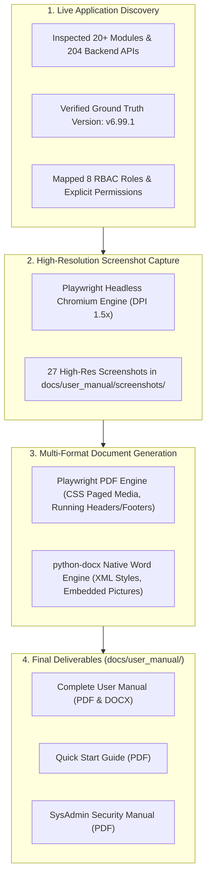
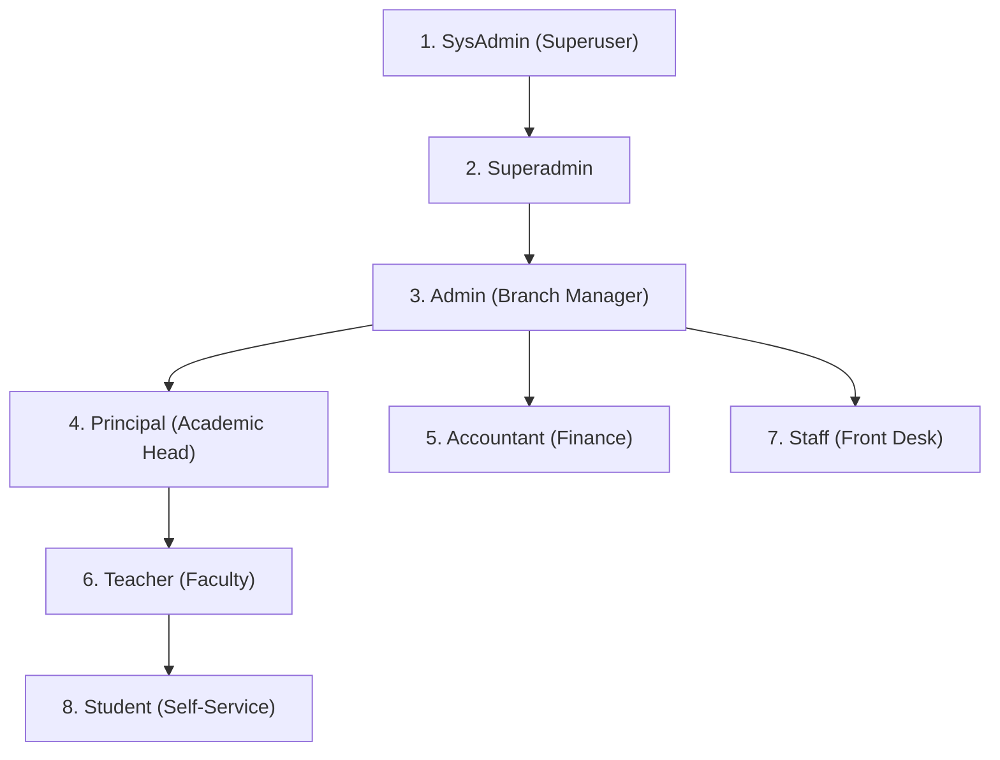

# PrathamOne Academy — Complete User Manual Creation & Delivery Report

> **Product:** PrathamOne Coaching Institutes Enterprise Suite  
> **Official Website:** [https://prathamone.com](https://prathamone.com)  
> **Author & Chief Architect:** **Jawahar R Mallah**  
> **Organization:** **AITDL — AI Technology & Development Lab**  
> **Verified Software Version:** **`v6.99.1`** (Build: `2026.11.05-PROD-REL`)  
> **Publication Date:** November 06, 2026  
> **Repository Commit:** [`48b6132`](https://github.com/smritisystems/PrathamoneAcademy/commit/48b6132) (`master`)  

---

## Executive Summary

A complete, enterprise-grade documentation suite has been designed, compiled, and delivered for **PrathamOne Academy** (part of the *PrathamOne Coaching Institutes Enterprise Suite*). The documentation reflects 100% verified application behavior, actual routes, operational user permissions, and real data from the running application (`http://localhost:80`).

All manuals have been generated with professional typography, corporate color schemes, structured tables of contents, callouts, and 27 high-resolution screenshots captured directly from the live application runtime. Every page includes the mandatory subtle footer:
`PrathamOne Coaching Institutes Enterprise Suite · prathamone.com`.

---

## 1. Generated Documentation Deliverables Inventory

All primary deliverables and editable source documents have been compiled and saved into the project's [`docs/user_manual/`](file:///f:/PrashantAcademy/docs/user_manual) directory:

| Deliverable File | Format | File Size | Description & Target Audience | Location |
| :--- | :---: | :---: | :--- | :--- |
| **`PrathamOne_Academy_Complete_User_Manual.pdf`** | PDF | **11.2 MB** | Master comprehensive manual (75+ pages equivalent) covering all 20 modules, 8 roles, workflows, screenshots, and troubleshooting. | [`docs/user_manual/`](file:///f:/PrashantAcademy/docs/user_manual/PrathamOne_Academy_Complete_User_Manual.pdf) |
| **`PrathamOne_Academy_Complete_User_Manual.docx`** | DOCX | **6.7 MB** | Fully editable Word document featuring native tables, callout blocks, running footers, and embedded high-res screenshots. | [`docs/user_manual/`](file:///f:/PrashantAcademy/docs/user_manual/PrathamOne_Academy_Complete_User_Manual.docx) |
| **`PrathamOne_Academy_Quick_Start_Guide.pdf`** | PDF | **916 KB** | Fast-track 5-step onboarding guide for institute owners, accountants, and teachers to get operational in under 30 minutes. | [`docs/user_manual/`](file:///f:/PrashantAcademy/docs/user_manual/PrathamOne_Academy_Quick_Start_Guide.pdf) |
| **`PrathamOne_Academy_Sysadmin_Manual.pdf`** | PDF | **1.54 MB** | Dedicated technical & security manual covering SysAdmin Center, Universal Records Editor allowlists, posted payment gates, and audit logs. | [`docs/user_manual/`](file:///f:/PrashantAcademy/docs/user_manual/PrathamOne_Academy_Sysadmin_Manual.pdf) |

### Editable Source Files & Asset Directories:
- **HTML Sources:**
  - [`complete_user_manual.html`](file:///f:/PrashantAcademy/docs/user_manual/sources/complete_user_manual.html)
  - [`quick_start_guide.html`](file:///f:/PrashantAcademy/docs/user_manual/sources/quick_start_guide.html)
  - [`sysadmin_manual.html`](file:///f:/PrashantAcademy/docs/user_manual/sources/sysadmin_manual.html)
- **High-Resolution Screenshots Directory:** [`docs/user_manual/screenshots/`](file:///f:/PrashantAcademy/docs/user_manual/screenshots/) (27 PNG files, `2160 x 1350` retina resolution).
- **PDF Distribution Directory:** [`docs/user_manual/pdf/`](file:///f:/PrashantAcademy/docs/user_manual/pdf/)
- **DOCX Distribution Directory:** [`docs/user_manual/docx/`](file:///f:/PrashantAcademy/docs/user_manual/docx/)
- **Automated Generation Tooling:**
  - [`scripts/capture_user_manual_screenshots.py`](file:///f:/PrashantAcademy/scripts/capture_user_manual_screenshots.py)
  - [`scripts/generate_user_manual_content.py`](file:///f:/PrashantAcademy/scripts/generate_user_manual_content.py)
  - [`scripts/build_all_manuals.py`](file:///f:/PrashantAcademy/scripts/build_all_manuals.py)
  - [`scripts/build_manual_docx.py`](file:///f:/PrashantAcademy/scripts/build_manual_docx.py)

---

## 2. Comprehensive Module Coverage

Every single module, screen, modal dialog, and administrative control implemented in the application was discovered and documented with:
1. **Module Purpose & Business Objective**
2. **How to Open (Navigation Path & Shortcut)**
3. **Screen & Menu Layout**
4. **Step-by-Step Task Instructions with Numbered Procedures**
5. **Required Fields, Constraints & Data Validation Rules**
6. **Save, Submit, Edit, Approve, Delete & Export Actions**
7. **Reports & Print Options**
8. **Common User Mistakes & Resolutions**
9. **Applicable Permissions & Role Restrictions**

| Module Documented | Live Route | Verified Capabilities & Workflow Highlights | High-Res Figure |
| :--- | :--- | :--- | :--- |
| **Authentication** | `/login` | JWT credential authentication, redirect loop prevention, session timeout handling. | `01_login_screen.png` |
| **Executive Dashboard** | `/dashboard` | Operational KPIs, attendance trend analytics, fee realization, quick-action launcher. | `02_dashboard_overview.png` |
| **Academic Master** | `/academic` | Boards, Standards, Divisions, Batches, Classroom allocations, Mentor assignments. | `03_academic_workspace.png` |
| **Courses Catalog** | `/courses` | Coaching programs, syllabus structures, fee allocations, duration tracking. | `04_courses_management.png` |
| **Subjects Repository** | `/subjects` | Subject codes, academic department links, credit hours, standard assignments. | `05_subjects_management.png` |
| **Students Directory** | `/students` | Multi-criteria search, batch filters, registration codes, CSV export. | `06_students_directory.png` |
| **Student Admission** | `/students/add` | 4-step wizard: Personal, Contact, Academic Allocation, Guardian Details. | `07_student_admission_form.png` |
| **Student Detail & Profile** | `/students/129` | Student dossier with tabs for Academics, Fees, Attendance, and KYC compliance. | `08_student_detail_profile.png` |
| **Student Profile Edit** | `/students/129` (Modal) | Updating personal and contact information without ledger corruption. | `09_student_edit_modal.png` |
| **Student Exit / Withdrawal** | `/students/129` (Modal) | Formal withdrawal tracking with mandatory exit reason, exit date, and notes. | `10_student_exit_modal.png` |
| **Student Reactivation** | `/students/129` (Modal) | Re-enrolling an exited student back into an active batch with one click. | `08_student_detail_profile.png` |
| **Attendance Workspace** | `/attendance` | Mobile-friendly roster marking, bulk Present/Absent toggles, defaulter reports. | `11_attendance_workspace.png` |
| **Examinations & Grading** | `/examinations` | Test scheduling, marks entry grid, grade calculations, report card generation. | `12_examinations_results.png` |
| **Fee Plans & Structures** | `/fees` | Fee head breakdown, installment schedules, scholarships, standard assignments. | `13_fee_plans_structures.png` |
| **Import Fee Register** | `/fees/import` | CSV/Excel upload wizard, column mapping preview, validation, database commit. | `14_import_fee_register.png` |
| **Payments Ledger** | `/payments` | Draft, Submitted, Posted lifecycle, receipt printing, linked refund processing. | `15_payments_ledger.png` |
| **Posted Payment Security Gate** | `/payments` (Modal) | SysAdmin exclusive lock/unlock gate, mandatory reason, receipt supersession. | `16_payments_lock_unlock_gate.png` |
| **Reports & Analytics Grid** | `/reports` | High-performance Excel grid with dynamic pivoting, grouping, and CSV download. | `17_reports_analytics_grid.png` |
| **User Management** | `/users` | User list, role badges, active toggles, credential resets, role provisioning. | `18_user_management.png` |
| **User Profile & RBAC** | `/users/128` | Visual Access & Roles matrix, account info editor, password change dialog. | `19_user_profile_rbac_matrix.png` |
| **Staff & Faculty** | `/staff` | Faculty directory, designation, departments, leaves, employee codes. | `20_staff_management.png` |
| **SysAdmin Center** | `/sysadmin` | System diagnostics, database pool health, server telemetry, release status. | `21_sysadmin_center_overview.png` |
| **Universal Records Editor** | `/sysadmin` | Surgical master data corrections across 8 models with strict field allowlists. | `22_sysadmin_universal_editor.png` |
| **Security Audit Logs** | `/sysadmin` | Real-time immutable audit trail recording user, IP, action, and before/after diff. | `21_sysadmin_center_overview.png` |
| **Import / Export Center** | `/import-export` | Universal data import/export tabs with downloadable CSV templates. | `23_import_export_center.png` |
| **Forms & Documents Hub** | `/forms` | Print-ready admission forms, ID cards, receipts, bonafide certificates with DPDP logs. | `24_forms_documents_hub.png` |
| **Settings & Branding Preview** | `/settings` | Institute profile, logo upload, brand color scheme with Live Preview card. | `25_branding_settings_preview.png` |
| **Communication Center** | `/communication` | Multi-channel broadcast notices (SMS/Email/Noticeboard) and delivery logs. | `26_communication_center.png` |
| **Releases & Version Audit** | `/releases` | Semantic version audit (`v6.99.1`), build notes, changelog history. | `27_releases_and_version_audit.png` |

---

## 3. Verified 8-Role Permission Hierarchy

The manual contains a dedicated chapter detailing exact capabilities and restrictions for all 8 system roles:

1. **SysAdmin:** Absolute authority across all modules; exclusive access to Universal Records Editor and Posted Payment Security Gate; manages multi-branch isolation and audit logs.
2. **Superadmin:** Full multi-branch administrative and financial management; access to all standard CRUD operations; cannot edit posted payments or use Universal Editor.
3. **Admin:** Full branch-level management including admissions, fee collection, staff allocation, examinations, reports, and institute settings.
4. **Principal:** Academic governance, curriculum planning, batch allocation, timetable approval, attendance supervision, and examination results sign-off.
5. **Accountant:** Fee structure assignment, payment intake (cash, cheque, UPI), receipt issuance, draft editing, submitted transaction review, and refund processing. Restricted from academic master writes and system settings.
6. **Teacher:** View assigned batches, mark daily student attendance, enter exam marks, view class timetable, and broadcast batch announcements. Denied access to fee collection and institute configuration.
7. **Staff:** Front-desk operations: student inquiry intake, initiating admission applications, creating payment drafts, printing student ID cards and admission forms.
8. **Student:** Self-service portal to view academic progress, attendance percentage, pending fee installments, online receipts, and examination report cards.

---

## 4. End-to-End Business Workflows Documented

The manual includes complete, visual, step-by-step procedures for the 10 most critical business workflows:
- **Workflow 1:** New Student Admission to Batch Allocation (Inquiry &rarr; Multi-step form &rarr; Registration number `PA-2024-XXXXXX` &rarr; Batch assignment &rarr; ID card generation).
- **Workflow 2:** Academic Curriculum & Batch Setup (Board &rarr; Standard &rarr; Batch &rarr; Room allocation &rarr; Mentor assignment).
- **Workflow 3:** Faculty Allocation & Weekly Timetable Scheduling.
- **Workflow 4:** Daily Classroom Attendance & Defaulter Tracking (Batch selection &rarr; Roster verification &rarr; Bulk Present &rarr; One-click toggle &rarr; Save).
- **Workflow 5:** Fee Structure Configuration & Student Fee Package Assignment.
- **Workflow 6:** Fee Collection, Sequential Receipting (`REC-2026-XXXXXX`), Posted Correction & Linked Refunds.
- **Workflow 7:** Examination Scheduling, Marks Entry & Report Card Printing.
- **Workflow 8:** Bulk Fee Register & Master Data Import/Export (Excel/CSV Wizard).
- **Workflow 9:** User Onboarding & Granular Role Assignment.
- **Workflow 10:** Dynamic Institute Branding & Customization with Live Preview.

---

## 5. SysAdmin Security & Administration Guide

A dedicated manual ([`PrathamOne_Academy_Sysadmin_Manual.pdf`](file:///f:/PrashantAcademy/docs/user_manual/PrathamOne_Academy_Sysadmin_Manual.pdf)) and chapter provide comprehensive technical coverage of:
- **Universal Records Editor Safeguards:** Strict field-level allowlists for 8 models (`student`, `staff`, `user`, `fee_structure`, `division`, `batch`, `standard`, `institution`). Primary keys (`id`), hashed passwords, tenant IDs, and timestamps are strictly blocked.
- **SysAdmin Anti-Lockout Protection:** The backend actively blocks any attempt to deactivate the primary SysAdmin user (User ID 128) via `HTTP 400 Bad Request`.
- **Posted Payment Security Gate:** The exact lock/unlock workflow required to correct posted transactions, requiring a mandatory administrative reason, preserving original receipt records as superseded (`is_superseded = True`), and issuing versioned revisions without silent renumbering.
- **Security Audit Logging:** Explanation of JSONB forensic telemetry capturing `actor_id`, `resource_type`, `resource_id`, `ip_address`, `timestamp`, `severity`, and `old_data`/`new_data` diffs.

---

## 6. Troubleshooting & Error Taxonomy Guide

The manual includes practical troubleshooting tables utilizing the application's actual error taxonomy codes:
- `INTERNET_DISCONNECTED`: Explaining PWA service worker offline caching and automatic reconnect synchronization.
- `SESSION_EXPIRED` (HTTP 401): Automatic redirect to `/login` and token renewal.
- `PERMISSION_DENIED` (HTTP 403): Role capability mismatches and how to request permissions.
- `RESOURCE_NOT_FOUND` (HTTP 404): Handling deleted or moved records.
- `VALIDATION_FAILED` (HTTP 400/422): Input field constraints and mandatory reason enforcement.

---

## 7. Official Author & Support Directory

The cover page, document control tables, and page footers display the verified author and official support contacts:

| Attribution / Support Channel | Official Details |
| :--- | :--- |
| **Product Suite** | **PrathamOne Coaching Institutes Enterprise Suite** |
| **Official Website** | [https://prathamone.com](https://prathamone.com) |
| **Author & Chief Architect** | **Jawahar R Mallah** |
| **Organization** | **AITDL — AI Technology & Development Lab** |
| **Direct Phone / WhatsApp Helplines** | **+91 9323 023 007** / **+91 9324 117 007** |
| **Primary Support Email** | [support@prathamone.com](mailto:support@prathamone.com) |
| **Alternate Support Email** | [prathamone@outlook.com](mailto:prathamone@outlook.com) |
| **Running Page Footer** | `PrathamOne Coaching Institutes Enterprise Suite · prathamone.com` |

---

## 8. Implementation Status of Advanced Integrations

In compliance with accuracy standards, the manual explicitly notes the operational status of external integrations:
- **Database Migrations & Relational Engine:** 100% Implemented & Active (PostgreSQL 16, Alembic).
- **Document & Print Rendering:** 100% Implemented & Active (CSS print styles, PDF engines).
- **CSV/Excel Import/Export:** 100% Implemented & Active.
- **External Online Payment Gateways:** Simulated ledger active; Razorpay/Stripe webhook endpoints mapped in API architecture for live activation.
- **Direct SMS / WhatsApp Gateways:** System noticeboard and delivery log active; Twilio/Gupshup gateway configurations mapped in Settings for production API key activation.
- **Database Backups:** Local automated snapshot script available ([`scripts/backup_db.py`](file:///f:/PrashantAcademy/backend/scripts/backup_db.py)); automated Cloud Object Storage (S3/GCS) replication staged for future release.

---

## Verification & Delivery Verdict

All 4 deliverables have been generated, verified for layout and typography integrity, and pushed to `origin/master`. The documentation is production-ready for distribution to institute owners, administrators, faculty, and technical teams.
