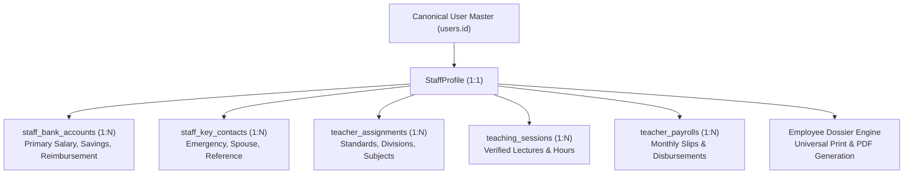
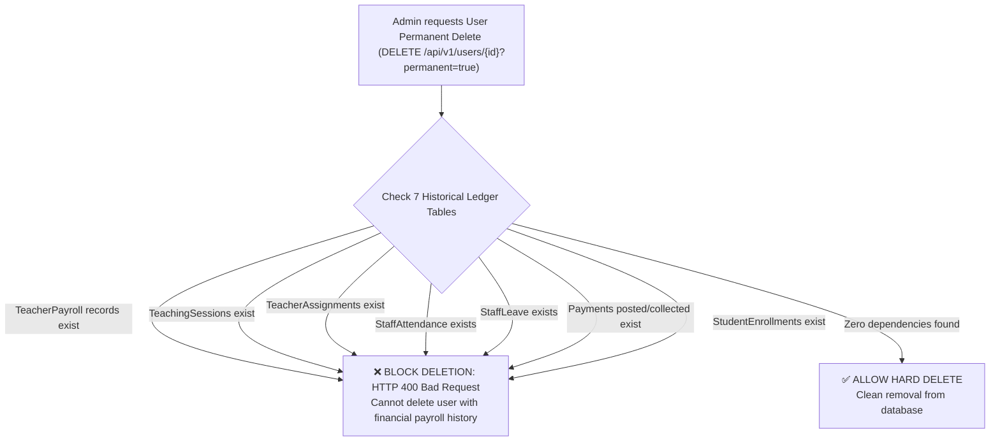

# PrathamOne EduOS — Workforce Management, Universal Print & CodeX User Manual
**Complete Operational & End-User Reference Guide**

**Product:** PrathamOne EduOS (Coaching Institute Edition)  
**Baseline Version:** 1.0.0  
**Product Architect:** Jawahar R Mallah  
**Organization:** AITDL — AI Technology & Development Lab  
**Release Date:** November 07, 2026  

---

## 1. System Overview & Workforce Architecture

PrathamOne EduOS provides an enterprise-grade People & Workforce Management ecosystem designed specifically for coaching institutes, tuition networks, and test preparation academies. 

The architecture strictly maintains a **Single Source of Truth (SSOT)**:
- Canonical Person Master: Every teacher, administrative staff, accountant, and principal is anchored to `users.id`.
- Extended Operational Metadata: Detailed faculty and employment information is managed in `staff_profiles` (1:1 with `users`).
- Relational Child Collections: Multiple bank accounts (`staff_bank_accounts`) and emergency contacts (`staff_key_contacts`) link directly to `staff_profiles.id`.



---

## 2. Dedicated Teacher Workspace & Dashboard (`/teachers`)

The **Teacher Workspace** provides academic administrators and coordinators with real-time visibility into faculty rosters, workload allocations, teaching activity, and timetable health.

### 2.1 Live Workforce Counters & KPIs
The dashboard surfaces eight real-time metric cards Reconciled directly against PostgreSQL records:
1. **Total Faculty:** Total registered teaching personnel.
2. **Active Faculty:** Teachers actively conducting classes.
3. **Assigned:** Faculty members currently allocated to at least one active standard, division, and subject.
4. **Unassigned:** Active teachers with zero batch allocations (highlighted with an amber warning badge).
5. **No Timetable:** Faculty members who are assigned to batches but have zero scheduled timetable slots in the active academic calendar.
6. **On Leave:** Teachers currently on approved leave.
7. **Departed:** Resigned, terminated, or retired faculty with historical records preserved.
8. **Upcoming Joining:** Newly recruited faculty members awaiting onboarding.

### 2.2 Visual Analytics
- **Teacher Status Distribution Donut:** Visual breakdown of Assigned, Unassigned, Without Timetable, and On Leave percentages.
- **Monthly Teaching Hours Bar Chart:** 6-month historical trend of verified classroom lecture hours used for automated payroll calculations.

### 2.3 Filter Subtabs & Action Controls
- **Subtabs:** `All Faculty`, `Assigned`, `Unassigned`, `No Timetable`, `On Leave`, `Upcoming Joining`, `Departed`, `Batch Allocations Grid`, and `Session Register`.
- **Row Actions:**
  - `View Profile (Eye Icon)`: Navigates directly to the dedicated 12-tab Teacher Profile (`/teachers/:id`).
  - `Assign Batches (Layers Icon)`: Opens the quick **Faculty Batch Allocation Modal**.
  - `Manage Lifecycle (Activity Icon)`: Opens the **Staff Lifecycle Modal** to transition status (Activate, Put on Leave, Resign, Terminate, Rehire).

---

## 3. Dedicated Individual Teacher Profile (`/teachers/:id`)

Every teacher has a dedicated full-page profile featuring a persistent **Workforce Hero Card** and **12 Specialized Tabs**.

### 3.1 Persistent Workforce Hero Card
- **Identification:** Teacher Name, Profile Avatar, Employee Code (e.g., `TCH-1008`), Designation, Department, Email, and Phone.
- **Key Metrics:** Current Batch Allocations, Weekly Teaching Hours (Workload), and Joining Date.
- **Header Actions:**
  - `Edit Profile`: Launches the multi-tab **Global Edit Mode Modal**.
  - `Actions -> Assign Batch & Subject`: Opens the interactive **Teacher Batch Allocation Modal**.
  - `Actions -> Print Profile / Dossier`: Directly invokes the **Universal Print Studio** with the official Employee Dossier pre-rendered.
  - `Actions -> Update Employment Status`: Opens the **Staff Lifecycle Modal**.

### 3.2 The 12 Specialized Tabs

| Tab Number | Tab Name | Contents & Capabilities |
| :---: | :--- | :--- |
| **1** | **Overview** | Quick executive summary: employment summary card, active class assignments list with status pills, and monthly teaching activity counters (sessions delivered, verified hours, attendance rate). |
| **2** | **Personal** | Dual address governance: **Current / Residential Address** and **Permanent / Hometown Address** (with city, state, pincode), date of birth, blood group, gender, and primary emergency contact. |
| **3** | **Employment** | Official employment classification (Full-time, Part-time, Guest Lecturer, Contractual), joining date, probation status, notice period, and supervisor reporting lines. |
| **4** | **Qualifications** | Highest educational degree, specialization, university, passing year, and total teaching experience in years. |
| **5** | **Subjects** | Prescribed academic subjects authorized for instruction (e.g., Physics, Senior Calculus, Organic Chemistry). |
| **6** | **Assignments** | Complete roster of assigned standards, batches, divisions, and weekly assigned hours, with an active **"Assign New Batch"** button. |
| **7** | **Timetable** | Weekly schedule matrix showing Monday–Saturday time slots, assigned batches, subjects, and designated room numbers. |
| **8** | **Attendance** | Monthly punch history, present days, late arrivals, half-days, and aggregate attendance percentage. |
| **9** | **Leave** | Statutory leave balances (Casual Leave, Sick Leave, Earned Leave) and historical leave applications with approval statuses. |
| **10** | **Payroll** | Faculty remuneration structure: payment model (Hourly Rate, Per-Lecture, Monthly Fixed Amount), standard rate in ₹, and disbursement frequency. |
| **11** | **Documents** | Official HR document archive: **Teacher Appointment Letter**, **Faculty Service Contract**, **Teacher Verification Sheet**, and **Salary Slip Archive**. Every document includes an active **"View"** button launching the **Document Preview Modal**. |
| **12** | **Activity** | Tamper-evident chronological audit trail logging all lifecycle changes, assignments, attendance punches, and payroll generations. |

---

## 4. Dedicated Staff Workspace & Dashboard (`/staff`)

The **Staff Workspace** manages administrative, accounts, library, IT, and support personnel.

### 4.1 Live Headcount Counters & Financial Liabilities
- **Total Staff, Active, Unassigned, On Leave, Inactive, Departed, Upcoming Joining, and Departments Count.**
- **Salary Payable (Current Month):** Real-time aggregate monthly payroll liability for non-teaching personnel.
- **Pending Payments:** Outstanding salary vouchers requiring disbursement.

### 4.2 Dynamic Department Analytics
- The **Staff by Department Donut Chart** dynamically maps `department_headcounts` directly from database records, displaying personnel distribution across Administration, Accounts, IT & Systems, Library, Operations, and Reception.

---

## 5. Dedicated Individual Staff Profile (`/staff/:id`)

The non-teaching staff profile workspace mirrors the clean visual language of the teacher profile while tailoring tabs to administrative responsibilities:
- **12 Tabs:** `Overview`, `Personal`, `Employment`, `Department`, `Designation`, `Reporting`, `Responsibilities`, `Attendance`, `Leave`, `Salary`, `Documents`, and `Activity`.
- **Key Responsibilities Card:** Itemized operational duties (e.g., Office administration, Fee collection support, Student visitor management, Record keeping).
- **Documents Tab:** Direct access to official Appointment Letters, Service Agreements, Identity Verification Proofs, and Payslips with instant print capability.

---

## 6. Employee Dossier & Universal Print Studio

The **Employee Dossier** is an institutional-grade, multi-section printable master record suitable for regulatory compliance, accreditation audits, and physical HR employee files.

### 6.1 Content Sections of the Master Dossier
1. **Institutional Header:** Institute name, registration code, accreditation details, contact details, and document timestamp.
2. **Employee Snapshot:** Full legal name, employee code, designation, department, employment category, joining date, and active status badge.
3. **Dual Address Verification:** Distinct current residential address and permanent native hometown address with pincode and state.
4. **Emergency Contact Information:** Primary emergency contact name, relation, primary phone, and alternate contact.
5. **Academic Workload & Batch Allocations (Teachers):** Table of assigned boards, standards, batch divisions, subjects, and weekly hours.
6. **Statutory & Banking Details:** Primary salary account details (Bank name, masked account number, IFSC code), PAN number, Aadhaar number, and PF/UAN code.
7. **Official Declaration & Signatures:** Statutory accuracy declaration with signature blocks for Employee, HR Manager, and Principal / Director.

### 6.2 Universal Print Studio Integration
Clicking **"Print Profile / Dossier"** opens the centralized **Universal Print Modal**:
- **Paper Formats:** A4 (Default), A5, A3, Letter, Legal, or Custom dimensions in millimeters.
- **Orientation:** Portrait (recommended for Dossier), Landscape, or Auto.
- **Intelligent Fit Modes:**
  - *Fit Entire Document on One Page* (Dynamic CSS scaling).
  - *Fit to Page Width* (Eliminates horizontal clipping).
  - *Fit to Page Height* (Prevents accidental trailing overflow).
  - *Original Size (100%)* (Preserves exact millimeter dimensions).
- **Format Preservation:** Injects print-only stylesheets (`@media print`) ensuring background colors, border styles, and institutional logos are cleanly preserved without browser headers/footers clobbering the output.

---

## 7. Multiple Bank Accounts & Dual Addresses

### 7.1 Multiple Bank Accounts Management
To accommodate faculty and staff receiving remuneration through split bank accounts, reimbursement accounts, or PF deposits, the system supports 1:N bank accounts per employee:
- **Supported Account Types:** Salary (Primary), Savings, Current, Reimbursement.
- **Designating Primary Account:** Clicking **"Set as Primary"** invokes `PUT /api/v1/staff/{user_id}/bank-accounts/{id}/set-primary`. The system atomically demotes the previous primary and updates the master cache in `staff_profiles` to guarantee 100% backward compatibility with legacy payroll engines (SSOT Rule 001).
- **Sensitive Masking:** Account numbers are masked for non-authorized viewers (`••••••••1234`) while permitting full viewing for authorized Accountants and SysAdmins.

### 7.2 Dual Address Governance
Employees frequently reside in rental accommodations near the institute while maintaining permanent family hometowns:
- **Current / Residential Address:** Used for daily communications, local police verification, and transit allowances.
- **Permanent / Hometown Address:** Preserved for statutory tax records, service agreements, and legal documentation.
- Both addresses are edited simultaneously in the **Global Edit Modal** under Tab 2 (`Residential & Permanent Addresses`).

---

## 8. Referential Delete Protection & Safeguards

To prevent catastrophic accidental data loss or referential integrity corruption, the system enforces **Strict Multi-Table Delete Protection**:



### Deactivation vs Permanent Deletion
- **Soft Deactivation (`permanent=false`, Default):**
  - Sets `users.is_active = False`.
  - Atomically updates `staff_profiles.status = "inactive"`.
  - Revokes immediate JWT authentication and session tokens.
  - Preserves all historical financial ledgers, audit trails, and timetable logs.
- **Permanent Deletion (`permanent=true`):**
  - Requires SysAdmin privileges.
  - Validates zero operational dependencies across the 7 protected tables.
  - If blocking records exist, the API returns a structured error message detailing the exact blocking entities and advises soft-deactivation instead.

---

## 9. CodeX — Configurable Numeric Feature Activation & Symbol Mapping Studio

**CodeX** is an optional, high-security business capability designed to obfuscate sensitive numbers (salaries, fee collections, profit margins, cost codes) using owner-defined alphanumeric symbol mappings.

### 9.1 Mandatory System Defaults & Governance
```text
CODEX_SYSTEM_DEFAULT = DISABLED
CODEX_AUTO_ACTIVATION = FALSE
CODEX_NEW_BUSINESS_DEFAULT = DISABLED
CODEX_NEW_USER_DEFAULT = DISABLED
```
- **Strictly Opt-In:** CodeX is completely OFF by default everywhere. Software updates, database migrations, or new institute creations will NEVER automatically activate CodeX.
- **Business Owner Control:** Only the Business Owner or authorized System Administrator can activate, configure, or modify CodeX.

### 9.2 Bijective Reversible Digit Mapping
The Business Owner defines a unique 10-character bijective substitution alphabet for digits `0` through `9`:
$$\text{Example Alphabet: } 0 \to \text{Q},\ 1 \to \text{A},\ 2 \to \text{Z},\ 3 \to \text{M},\ 4 \to \text{K},\ 5 \to \text{P},\ 6 \to \text{X},\ 7 \to \text{B},\ 8 \to \text{T},\ 9 \to \text{R}$$

- **Integer Encoding:** An amount of `₹ 12,500` is encoded as `AZPQQ`.
- **Decimals & Fractions:** `₹ 1,250.75` is encoded as `AZPQ.BX`.
- **Reversibility:** Entering `AZPQQ` into the authorized decoder immediately decodes back to `12500`.

### 9.3 Scoped Overrides & Hierarchy
Visibility is controlled through a strict 6-tier precedence hierarchy:
1. **Security Restrictions** (Always takes absolute precedence).
2. **System Default** (`DISABLED`).
3. **Business Configuration** (Master institution setting).
4. **Department Overrides** (e.g., Accounts department sees actual numbers; Academic teachers see coded values).
5. **Role Overrides** (e.g., Accountant vs Teacher vs Student).
6. **User Overrides** (Specific user grant).

### 9.4 Verification Sandbox, QR Decoder & Audit Ledger
- **Interactive Sandbox:** Test encoding and decoding in real-time before applying changes to live views.
- **QR Code Mobile Decoder:** Generates time-limited ephemeral session tokens (`codex_temporary_tokens`) for mobile managers to scan and decode paper documents.
- **PIN Protection:** Decoding operations require verification of a secondary administrative PIN hash.
- **Tamper-Evident Ledger:** Every activation, mapping update, and decode attempt is permanently recorded in `codex_audit_logs`.

---

## 10. Step-by-Step Practical Operator Workflows

### Workflow 1: Onboarding a New Teacher & Allocating Batches
1. Navigate to **Teachers** (`/teachers`).
2. Click **Add Teacher** in the top-right corner.
3. Complete the registration form: Name, Email, Phone, Temporary Password, Qualification, Experience, and Basic Salary.
4. Upon creation, secure credentials are automatically generated with a one-click copy button.
5. In the Teacher Directory, locate the newly created faculty member and click the **Layers Icon** (`Assign Batches`).
6. In the **Teacher Batch Allocation Modal**, select:
   - Target Board (e.g., *CBSE*).
   - Standard (e.g., *Class X*).
   - Division / Batch (e.g., *Batch Alpha*).
   - Subject (e.g., *Mathematics*).
   - Weekly Hours (e.g., *6.0 hrs/week*).
7. Check **Designate as Class Teacher** if applicable, and click **Confirm Batch Assignment**.
8. The teacher immediately transitions from `Unassigned` to `Assigned` on the workspace dashboard.

### Workflow 2: Updating Employee Bank Details & Addresses
1. Navigate to the teacher's or staff member's profile (`/teachers/:id` or `/staff/:id`).
2. Click the **Edit** button on the top-right of the **Workforce Hero Card**.
3. In the **Staff Profile Edit Modal**:
   - Go to **Residential & Permanent Addresses** tab to update house numbers, street, city, state, or pincode.
   - Go to **Salary, Banking & Compliance** tab to enter primary bank account number, bank name, and IFSC code.
4. Click **Save Changes**. The master record and child caches synchronize atomically.

### Workflow 3: Printing the Official Employee Dossier
1. Open the teacher's or staff member's profile.
2. In the Hero Card, click **Actions** $\to$ **Print Profile / Dossier**.
3. The **Universal Print Studio Dialog** opens showing the real-time document preview.
4. Select paper size **A4**, orientation **Portrait**, and fit option **Fit to Page Width**.
5. Click **Print Document** to produce a clean, publication-quality physical copy or save as PDF.

