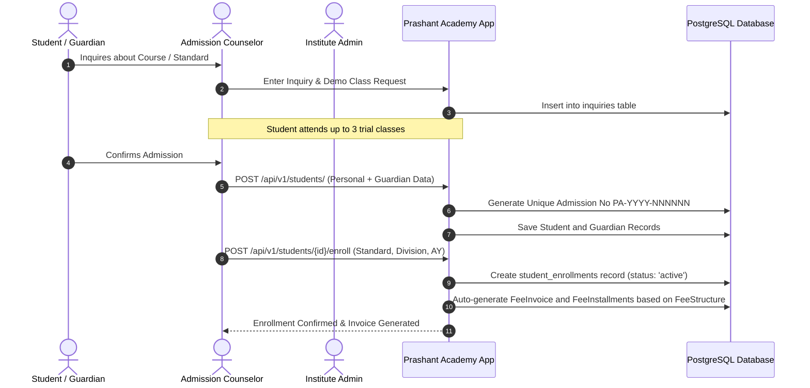
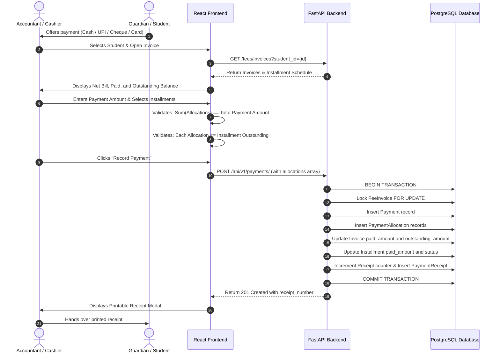

# Detailed Workflow Specifications
**Document ID**: WFS-001  
**Version**: 1.0-DRAFT  
**Parent Framework**: CIPF-001  
**Status**: APPROVED DEFAULT ARCHITECTURE / DRAFT POLICIES PENDING OWNER CONFIRMATION  
**Target System**: Prashant Academy SMS / Coaching Management System  

---

## Workflow 1: Student Admission, Registration & Enrollment

### Steps & Failure Modes:
1. **Preconditions**: Academic Year is active; selected Standard has active Divisions with available seat capacity.
2. **Duplicate Detection**: System checks unique constraint on Student `(first_name, last_name, date_of_birth, guardian_phone)` to prevent accidental duplicate registration.
3. **Transaction Safety**: Student record, guardian record, enrollment row, and initial fee invoice are processed in an atomic database transaction. If invoice generation fails, the entire enrollment is rolled back.

---

## Workflow 2: Fee Collection and Allocation Workflow

---

## Workflow 3: Payment Reversal Workflow

1. **Trigger**: Bank dishonor of cheque, duplicate cashier entry, or transaction dispute.
2. **Role Required**: `Accountant`, `Institute Admin`, or `Super Admin`.
3. **Action**: Initiator clicks "Reverse" on Payment row and inputs mandatory justification reason (min 10 characters).
4. **Execution (`POST /api/v1/payments/{id}/reverse`)**:
   - Validates payment is not already reversed.
   - Restores each allocated installment balance:
     $$\text{Installment}.\text{paid\_amount} \leftarrow \text{Installment}.\text{paid\_amount} - \text{allocated\_amount}$$
   - Restores invoice balances and updates status from `paid` to `partial` or `unpaid`.
   - Stamps `status = 'reversed'`, `reversed_at = NOW()`, `reversed_by_id = current_user.id`, `reversal_reason = reason`.
   - Generates audit log entry.

---

## Workflow 4: Daily Attendance Workflow

1. **Teacher Login**: Accesses `/attendance` route.
2. **Roster Loading**: Selects Standard, Division, and Date. Roster auto-populates from `student_enrollments`.
3. **Marking**:
   - Defaults to "All Present".
   - Teacher toggles exceptions to `Absent`, `Late`, or `Half-Day`.
   - Adds remarks (e.g., "Parent called regarding fever").
4. **Submission**: Single bulk request `POST /api/v1/attendance/bulk` saves records atomically.
5. **Alerts**: System queues notifications for absent students to their respective primary guardians.

---

## Workflow 5: Examination and Marks Publication Workflow

1. **Exam Setup**: Academic Coordinator creates examination specifying standard, subject, total marks, and exam date.
2. **Marks Entry**: Subject teacher enters student scores and absent flags (`draft` status).
3. **Verification**: Academic Coordinator inspects marks distribution, grade curve, and outliers, and clicks "Verify".
4. **Publication**: Coordinator clicks "Publish". Ranks and percentiles are computed, and results become visible on student and parent dashboards.

---

*End of WORKFLOW_SPECIFICATIONS.md*

